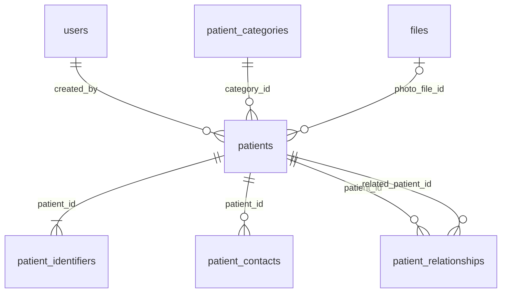
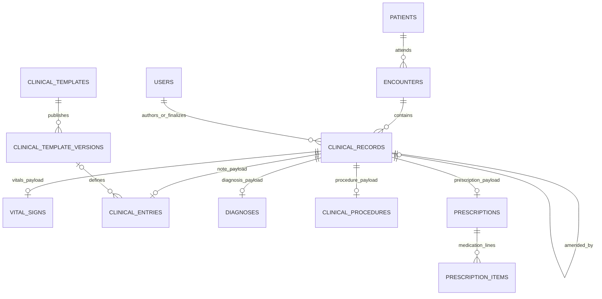
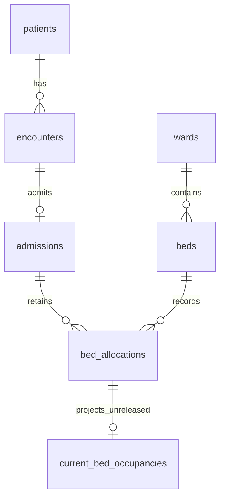
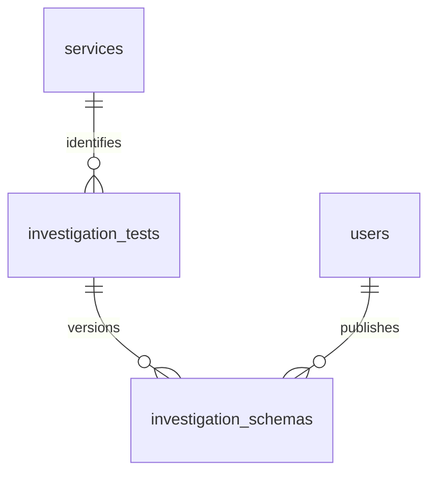
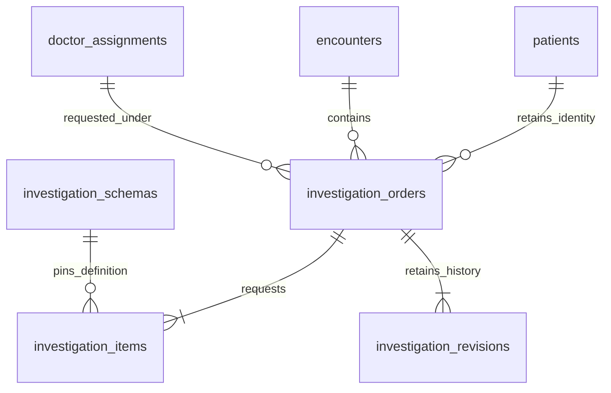
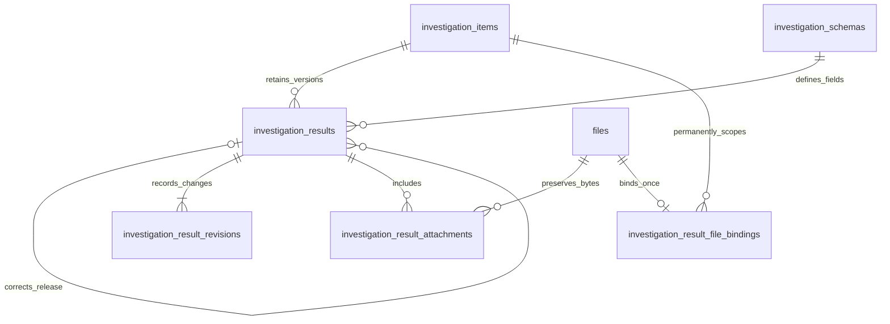
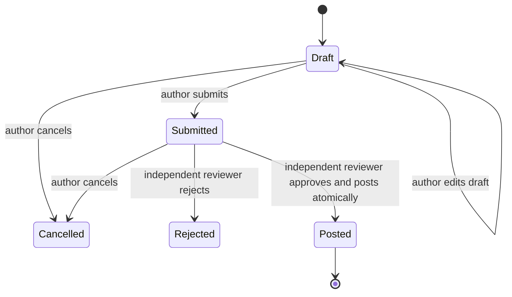
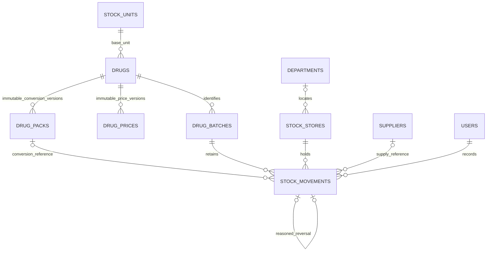

# EasyCare local development

This is the laptop development setup, separate from the eventual hospital-server deployment.

```text
easycare/
  backend/       Laravel PHP application and backend source
  easycare2/     Existing React + TypeScript frontend
  docs/          Architecture and development notes
  .tools/        Local PHP, Composer, MySQL, credentials and database files
```

Laravel belongs in `backend/`. `.tools/` contains development programs, not application source. It is excluded from Git. The backend's `.env` contains local configuration and is also excluded from Git. The setup uses project-local runtimes; it does not require adding PHP or Composer to your Windows system PATH.

## Start working

Open a terminal in `C:\Users\HP\Desktop\easycare\backend`:

```powershell
.\dev.cmd start
```

Open **http://localhost:8000** for the backend. The existing React frontend remains a separate application; start it from `easycare2` using `npm run dev` when working on the UI.

`start` launches the local database and backend in the background. They bind to your laptop's loopback address. After restarting Windows, run the same command again.

```powershell
.\dev.cmd status                  # Check installed versions and running processes
.\dev.cmd stop                    # Stop this local backend and MySQL instance
.\dev.cmd serve                   # Run Laravel in the foreground; Ctrl+C stops it
.\dev.cmd php -v                  # Check PHP
.\dev.cmd composer --version      # Check Composer
.\dev.cmd artisan --version       # Check Laravel
.\dev.cmd artisan migrate:status  # See which database migrations have run
.\dev.cmd artisan test            # Run the fast SQLite/in-memory suite
.\dev.cmd mysql                   # Open the local application's MySQL console
```

Use `stop` before switching from background `start` to foreground `serve`, because both use port 8000. Run `exit` to leave the MySQL console.

## What the tools do

| Tool | Purpose |
|---|---|
| PHP | Executes the backend code |
| Composer | Installs PHP packages from `composer.json` and `composer.lock` |
| Laravel | Organizes routes, controllers, models, validation and application services |
| MySQL | Stores shared application data |
| Artisan | Laravel's command-line tool, invoked through `dev.cmd artisan` |
| Migration | A version-controlled PHP file that creates or changes database tables |

The local database is named `easycare_dev`, with an application account restricted to that database. The generated password is already set in `backend/.env`; the helper reads the private local configuration when opening MySQL.

## Where you will write code

- `backend/routes/`: incoming web/API routes.
- `backend/app/Http/Controllers/`: HTTP request handlers.
- `backend/app/Models/`: database-backed models.
- `backend/database/migrations/`: database structure changes.
- `backend/tests/`: automated checks.
- `backend/.env`: private laptop settings, including the database connection.

The application migrations add staff/roles, audit history, private files, command confirmations and the patient storage foundation to Laravel's runtime tables. Staff login uses the existing session table. Patient APIs, screen integration and clinical workflows are later stages. The complete architecture SQL remains a proposal; it is not imported into the development database.

## Database and API foundation

Apply the application migrations and seed the reference catalogs:

```powershell
.\dev.cmd artisan migrate
.\dev.cmd artisan db:seed
```

The schema adds `departments`, `roles`, `permissions`, `user_roles` and `role_permissions`, plus staff identity fields on `users`. A department has many staff; staff have many roles through `user_roles`; roles have many permissions through `role_permissions`. Foreign keys prevent orphan relationships, unique keys prevent duplicate codes/assignments and MySQL checks require a positive staff version. Deleting a referenced department is restricted; deleting an authorization catalog record removes its pivot links, without deleting staff or the other catalog records.

The repeatable seeder adds seven initial department/role entries matching the current frontend modules and the thirteen known permissions defined in `config/authorization.php`. It applies each initial grant set once, tracked by `permission_baselines`. These are editable starting values; final hospital patient access rules still require agreement. Seeding preserves existing catalog names and subsequent grant/revocation decisions. It creates no staff accounts or staff-role assignments. Factories are for synthetic tests only. The initial counts are seven departments, seven roles, thirteen permissions, twenty-one role-permission links and four baseline markers. Seven starting patient categories are also seeded, without patient records or automatic patient-access grants.

The additive migration preserves existing staff IDs, passwords, email addresses and the original `name` column. Existing users receive `legacy_<id>` usernames and provisional split name fields; review these when staff account management is implemented. The application maintains `name` for compatibility when structured names change. Email is optional; its existing 255-character capacity is retained. The proposal's smaller email length and microsecond timestamps on existing starter columns are not retroactively imposed. Staff profiles/contacts and the other hospital tables will arrive with the corresponding features.

Rollback removes the foundation catalogs and added fields while retaining the starter user data. Because the starter schema requires email, rollback refuses before changing anything if any staff email is null. Assign valid addresses first when deliberately reverting to that schema. MySQL DDL is not fully transactional: a failed migration must be inspected before retrying; do not use `migrate:fresh` against the development or hospital database.

## Isolated test configuration

The default `artisan test` suite uses SQLite in memory for fast checks. MySQL is the authoritative database for dialect, constraint and migration behavior.

Create a private `.env.testing` from `.env.testing.example`, generate its own application key, and set its test password. Use a dedicated local MySQL database/account; the account must have privileges only on `easycare_test`:

```sql
CREATE DATABASE easycare_test CHARACTER SET utf8mb4 COLLATE utf8mb4_unicode_ci;
CREATE USER 'easycare_test'@'localhost' IDENTIFIED BY 'replace-with-your-private-test-password';
GRANT ALL PRIVILEGES ON easycare_test.* TO 'easycare_test'@'localhost';
```

The local workspace already has this isolated database/account configured. Credentials remain in the ignored `.env.testing`. On another machine, an administrator runs the SQL above and chooses the password; do not use the example text as a password.

```powershell
.\dev.cmd artisan key:generate --env=testing
.\dev.cmd artisan test --compact
.\dev.cmd php vendor/phpunit/phpunit/phpunit --configuration phpunit.mysql.xml --no-progress
```

Use the direct PHPUnit command for the alternate configuration; the installed Artisan test wrapper can supply a duplicate configuration option. MySQL tests reset the disposable test schema. Before migration/refresh traits run, the test base rejects cached configuration, non-testing environments, SQLite files, database URLs, remote MySQL hosts and any MySQL database/account other than `easycare_test`. The MySQL account's restricted grants add a second boundary. Do not enable parallel testing against this fixed database.

`.env.production.example` is a configuration template for the later hospital installation, with a separate database/account, HTTPS cookies and debug disabled. It does not provision or deploy a production server. Actual environment files, keys and database contents stay private.

On 10 November 2026, the full 85-table proposal and its 201 foreign keys were imported into a randomly named disposable MySQL 8.4.13 schema. The existing architecture suite passed 38 checks, including restrictive relationships, uniqueness, financial/clinical constraints and bed/stock row locking. Its test adapter was corrected for MySQL savepoint syntax and explicit transaction starts; synthetic string fixtures now respect declared column lengths. The schema itself did not need a DDL change. The disposable schema was removed afterward. The workspace runner and detailed results are in `../docs/architecture/verify_mysql.py` and `../docs/architecture/mysql-validation.json`; the installed Laravel foundation has its own reproducible PHPUnit suite described above. This verifies structural rules, not the unimplemented clinical services or complete concurrent hospital workflows.

## API contract: version 1

Base path: `/api/v1`. Send `Accept: application/json`; send JSON request bodies with `Content-Type: application/json` for write endpoints. JSON keys use `snake_case`. Successful resources are wrapped in `data`; paginated collections additionally include Laravel's `links` and `meta` objects. Return an empty collection as `200`, with `data: []`.

Implemented routes:

| Method and path | Access | Response |
|---|---|---|
| `GET /api/v1/health` | Public | `data.application`, `data.api_version`, `data.status`; `503` if MySQL cannot be queried. No database connection details are returned. |
| `GET /api/v1/auth/csrf-token` | Public, session-backed | `data.csrf_token`; starts an anonymous browser session. |
| `POST /api/v1/auth/login` | CSRF protected | Accepts `email_or_username` and `password`; returns `data.user`, `data.csrf_token`, `data.expires_at`. |
| `GET /api/v1/auth/me` | Active signed-in staff | Current identity, CSRF token and expiry; `401` for invalid sessions. |
| `POST /api/v1/auth/logout` | Active signed-in staff, CSRF protected | `204`, invalidates the current server session. |
| `GET /api/v1/departments` | Active signed-in staff with `reference-data.view` | Paginated department resources: `id`, `code`, `name`, `created_at`, `updated_at`. |
| `GET /api/v1/departments/{department}` | Same department-read permission | One department resource. |
| `GET /api/v1/staff` | `staff.view_any`, or `staff.view_department` with an assigned department | Paginated directory entries within the viewer's permitted scope. |
| `GET /api/v1/staff/{user}` | Scope policy for that staff record | One directory entry; inaccessible and missing staff IDs both return `404`. |
| `GET /api/v1/access-control` | `authorization.view` | `data.permissions` (code/name) and `data.roles` (code/name/permission codes), restricted to known permission codes. |
| `GET /api/v1/patients`, `GET /api/v1/patients/{patient}` | `patients.view`, active records only | Paginated patient summaries or a detailed demographic/contact resource. |
| `GET /api/v1/patients/options` | `patients.view` | Current category IDs/codes/names. |
| `POST /api/v1/patients/duplicate-check` | `patients.view`, CSRF protected | Up to twenty visible candidates and `meta.has_more`. No mutation. |
| `POST /api/v1/patients` | `patients.view` and `patients.create`, CSRF protected | Transactional registration, `201`; requires `Idempotency-Key`. |
| `PATCH /api/v1/patients/{patient}` | `patients.view` and `patients.update`, active records only, CSRF protected | Versioned demographic/contact edit, `200`; requires `Idempotency-Key`. |

The existing `/` response and framework `/up` route remain available. `/up` checks application liveness; the versioned health route also checks database readiness.

Department query parameters:

| Parameter | Rules | Default |
|---|---|---|
| `q` | Optional text, at most 100 characters; literal substring in code or name | No filter |
| `sort` | `code`, `-code`, `name`, `-name`; minus means descending | `code` |
| `page` | Integer, at least 1 | `1` |
| `per_page` | Integer from 1 to 100 | `25` |

Lists use an ID tie-breaker for stable ordering. SQL wildcard characters in `q` are searched literally. Unknown query fields are ignored and are not copied into pagination links. No department write endpoint is exposed at this stage.

The staff directory uses the same query bounds and pagination format. Its `q` searches name or username; allowed sorts are `name`, `-name`, `username` and `-username`, defaulting to `name`. Each entry contains only `id`, `name`, `username`, `staff_code`, `is_active` and department code/name/ID. It excludes email, credentials, roles and permission grants. Scope is applied before searching and pagination, so counts and search results cannot include inaccessible staff.

Errors always return JSON under `/api`, including requests without an Accept header. The shape is:

```json
{
  "message": "The submitted data is invalid.",
  "code": "validation_failed",
  "errors": { "per_page": ["The per page field must not be greater than 100."] }
}
```

`errors` is present for validation failures. Other errors contain `message` and `code`. API exceptions do not return stack traces, SQL text or exception messages, even when local debug is enabled. Validation messages remain readable so clients can display field errors.

| HTTP status | Code | Client behavior |
|---|---|---|
| `400` | `bad_request` | Correct the request |
| `401` | `unauthenticated` | Require sign-in |
| `403` | `forbidden` | Show access denied |
| `404` | `not_found` | Show missing resource |
| `405` | `method_not_allowed` | Use a supported method; `Allow` is preserved |
| `409` | `conflict` | Reload current state before resolving the conflict |
| `415` | `unsupported_media_type` | Correct the content type |
| `419` | `session_expired` | Renew the session and CSRF state |
| `422` | `validation_failed` | Display field errors |
| `429` | `too_many_requests` | Wait according to `Retry-After` |
| `500` | `server_error` | Show a generic error; inspect private server logs |
| `503` | `service_unavailable` | Retry later; investigate server/database readiness |

The API limiter permits 120 requests per minute per client IP. Revisit the limit with realistic shared-network usage before hospital deployment. Times returned by current resources are ISO 8601 UTC strings ending in `Z`. Future date-only clinical values must remain `YYYY-MM-DD`; future money and precise quantities should use decimal strings, with currency/units specified by each resource contract.

Foundation verification on 10 November 2026: all 51 PHPUnit tests passed on MySQL (138 assertions). The fast SQLite suite passed 50 tests (137 assertions), with the MySQL-only version-constraint test skipped. Coverage includes clean migrations, preservation/rollback of existing starter users, guarded rollback for missing email, relationship integrity, repeatable seeding, access denial, validation, pagination, CORS, sanitized failures and test-database isolation. The live health endpoint returned HTTP 200 with the configured frontend CORS origin. Task 10 subsequently extends the permission catalog and grants as described below.

## Server-side authorization

Laravel gates check explicit permission codes; model policies enforce record scope. Every current resource endpoint requires a valid active staff session and a gate/policy. The current-user and logout routes require the staff session itself. Frontend role guards do not authorize API requests. An admin role has no unconditional bypass: removing a permission removes its access. Unknown permission codes and wildcards grant nothing. Multiple assigned roles combine their known permissions without duplicates.

The initial permission presets are:

| Permission | Initial admin | Other six initial roles | Meaning |
|---|---|---|---|
| `reference-data.view` | Yes | Yes | Read department reference data |
| `staff.view_self` | Yes | Yes | Read one's own directory entry |
| `staff.view_department` | No | No | Opt-in directory access to staff in one's assigned department |
| `staff.view_any` | Yes | No | Read the complete staff directory |
| `authorization.view` | Yes | No | Read roles and their known grants |
| `staff.manage` | Yes | No | Read administration records and create/update staff accounts |
| `staff.reset_password` | Yes | No | Issue reset codes; also requires `staff.manage` |

An account without a role or grant can still inspect its own signed-in identity and log out, but has no resource access. Own-entry access alone does not allow enumeration through the staff list. Department access never treats an unassigned department as a group: a staff member without a department cannot use department-wide access. An explicit self grant and department grant form a union; a full-directory grant covers all staff. Caller-supplied department IDs cannot widen the scope. Unauthorized staff IDs return the same generic `404` as missing IDs.

Effective permissions are queried from the database on each request. Revoking a permission or staff-role assignment, or changing the viewer's department, affects subsequent requests in an existing session. Current-user responses also return fresh, sorted permission codes. Authenticated resource responses and failures use `Cache-Control: no-store, private`. Staff creation/update policies require `staff.manage`; department write policies and all staff deletion policies deny access.

Run these commands from the server console, using exact catalog codes:

```powershell
.\dev.cmd artisan access:role doctor
.\dev.cmd artisan access:role doctor staff.view_department
.\dev.cmd artisan access:role doctor staff.view_department --revoke
```

The first command only lists grants. The second grants department-directory access to everyone assigned the doctor role; the third removes it. Grant/revoke commands are idempotent and reject unknown roles, unknown codes and an unseeded permission catalog. Console access is an administrative boundary; the API exposes no grant or role-membership mutation endpoint yet. `staff:create --role=...` assigns an existing role without changing its grants.

For an existing development installation, run `artisan migrate` followed by `artisan db:seed`. Task 10 added `permission_baselines`; task 11 adds `staff_password_resets`. The seeder creates the catalog and applies each baseline in one transaction only when its marker is absent. The `staff-administration-v1` baseline explicitly grants the admin role the two new management permissions once. It preserves older read-permission revocations. Subsequent seed runs preserve removals and custom grants. Future grants need a deliberately defined new baseline or an explicit console grant. Retain baseline markers with database backups. Rolling back the marker-table migration removes its markers but leaves seeded grants; recreating and reseeding afterward would apply both initial baselines again. Do not reset markers to refresh catalogs.

These rules describe staff/reference authorization. Patient, encounter, clinical and prescribing access extensions are documented in their later sections. Stock and financial authorization remain with their workflows. Each new resource needs explicit permissions, record scope and denial tests. Department membership alone must never be assumed to grant access to clinical records. Hospital-specific access, emergency access, approvals and exports remain subject to task 2's decisions.

Task 10 verification on 11 November 2026: all 91 backend tests passed on MySQL (456 assertions); SQLite passed 90 tests (455 assertions), with one MySQL-only check skipped. Coverage includes all six ordinary role presets, explicit grants, admin revocation, null departments, inaccessible IDs, scoped search/pagination, unknown permissions, duplicate grants, failed initialization rollback and seed preservation of revocations. Database-backed session tests verify permission revocation and department changes without signing in again. A route audit checks authentication and authorization middleware on every current resource route. The additive migration and baseline are applied to `easycare_dev`, with no staff accounts or role assignments created; the live health endpoint returns HTTP 200.

## Frontend connection and authentication boundary

The frontend API client and tracked development configuration use `/api/v1`. Vite proxies this path to `http://127.0.0.1:8000`, so cookies stay on the frontend's hostname. The previous cloud API URL has been removed. Production hosting must route this same prefix to Laravel. `FRONTEND_URLS` remains an explicit origin allowlist for deliberately separate origins; development defaults are `http://localhost:5173` and `http://127.0.0.1:5173`. CORS supports credentialed requests, CSRF headers and preflight. CORS is browser configuration, not authorization.

For example, the frontend can check the public endpoint with:

```javascript
const response = await fetch('/api/v1/health', {
  headers: { Accept: 'application/json' },
});
const result = await response.json();
```

Session routes use Laravel's `web` middleware and the database session driver. The browser sends cookies with `credentials: include`. Before login or logout it retrieves the CSRF token and sends `X-CSRF-TOKEN`; Laravel's request-forgery middleware also accepts valid same-origin browser requests. Login rotates both session ID and CSRF token and destroys the old session. Identity cookies are HTTP-only, SameSite=Lax by default, and secure under the production template's HTTPS configuration. No bearer token is returned or required.

Unknown accounts, wrong passwords and inactive accounts receive the same `422` validation error. Laravel verifies the password hash. Login permits five failed attempts per normalized identifier/IP pair per minute, plus twenty login requests per IP per minute; `429` preserves `Retry-After`. Identity-specific limiter keys are hashed. Successful login clears its failure counter and records `last_login_at`. Login while already signed in returns `409`; logout is required before changing accounts. Extra input fields cannot assign roles or activate accounts.

`data.user` includes staff ID, username, names, email, active status, department, assigned roles, effective permission codes, `created_at` and nullable `last_login_at`. Passwords and remember tokens are omitted. `data.expires_at` is the current estimated session expiry in UTC. Protected routes check the active account and session password fingerprint. Disabling an account or changing its password prevents subsequent authenticated access. Logout invalidates the current session and regenerates CSRF state. Auth responses and API errors use `Cache-Control: no-store, private`.

The frontend uses one in-memory identity store shared by the global auth context and clinician components. It restores identity from `/auth/me` after reload and blocks private routes while identity is unknown or the server is unreachable. Module guards use server-returned roles; administration additionally requires `staff.manage`. UI checks do not replace backend policies. All active profile views use the server record. Profile changes go through staff administration; the old browser-only name, role and password editors are removed. No profile/password or patient record is written to browser storage. Obsolete authentication entry points use the same sign-in component; unsupported public signup/OTP hooks reject locally without requesting nonexistent APIs.

An access scope includes staff ID, department ID, active status, role codes and permission codes. A change resets the private React tree, including forms, contextual patient state and notifications. Registered cleanups clear module-level medical tables, pending entries, general-consultation state, patient flags and pharmacy callbacks. The boundary also revokes session-owned object URLs and removes only known legacy private keys (`easycare-auth`, `easyCareSession`, `mockUser`, `easyCareDoctorProfile`, `mockPatients`, `patients`) from local/session storage; unrelated preferences remain. Disabled browser storage does not prevent authentication. Metadata-only refreshes and reordered roles/permissions do not reset the scope or open forms. Clinical screens remain demonstrations and do not persist hospital records.

The API client captures the access revision before CSRF bootstrap, checks it before sending and before returning a response, and aborts pending requests on a boundary. A late success or `401` from the previous scope cannot populate data or sign out the new staff member. A write waiting for an old CSRF bootstrap is not sent under a new account. Aborting a browser request cannot undo a server operation that has already committed; writes are never automatically replayed after an account change. Only login/logout may refresh CSRF and retry once after `419`.

Sign-in, confirmed sign-out and completed recovery notify other tabs using a random event nonce through BroadcastChannel and a storage-event fallback. Notifications contain no identity or credentials and never authorize access: receivers clear private state and query `/auth/me`. Focus/visibility checks refresh the current session, and a restored browser-cache page blocks and verifies before reuse. Server-side access revocations are detected at the next API call or session check. Local expiry hides private content while the server check is pending. Idle pages do not send an endless heartbeat that keeps sessions alive. Logout waits for a server response; a failed logout can be retried. Browser history state from an earlier access scope is discarded before private routes render, including on back/forward navigation.

When adding another cache or request path, use the shared `apiFetch` client and register any module-level private cache with `registerSessionCleanup` in `src/lib/sessionScope.ts`. Create preview/download object URLs through `createSessionObjectUrl`. React component state belongs below `SessionBoundary`. Future patient APIs still need patient/encounter scopes, authorization policies and route-ID loading with their workflows; session isolation does not implement those services.

Run the frontend regression suite from `easycare2` with `npm test`. It uses Node's test runner and the already-installed TypeScript compiler to load production modules; no new dependency is installed. Verified runtime: Node 24.19.0. Eleven tests cover refresh preservation, permission changes, selective storage removal, storage-disabled operation, late responses, stale `401`, CSRF waits, connection uncertainty, object-URL revocation and clinical-cache separation. Type checking remains a separate check.

Task 12 verification on 11 November 2026: eleven frontend tests and twenty-five browser checks passed, with no browser page errors. The browser checks include multi-tab sign-out/account switching, server-backed profiles, preservation of same-account forms, history-state sanitization, restored-page verification, server role revocation and a storage-disabled expiry check that holds the server response while confirming private content is hidden. All 113 backend tests passed on MySQL (651 assertions); SQLite passed 112 (650 assertions), with one MySQL-only check skipped. The frontend builds. The complete type check reports 125 errors outside the changed files, so it remains an outstanding release check. One pre-existing unused declaration in a touched upload component was removed.

No public registration or OTP activation endpoint exists. Authorized administrators create accounts and issue recovery codes through `/admin/users`; staff redeem codes at `/forgot-password`. Patient and clinical screens still contain demonstration data; signing in does not make them operational or production-ready. Hospital patient-access decisions, complete audit history and clinical cache isolation remain on the checklist.

Create the first staff account from the server console:

```powershell
.\dev.cmd artisan db:seed
.\dev.cmd artisan staff:create --role=admin
```

The command privately prompts for username, names, optional email and a confirmed password. Usernames use lowercase letters, digits, dots, underscores or hyphens. Passwords require at least 12 characters, mixed case and a number, within bcrypt's 72-byte limit. Duplicate identifiers and unknown roles are rejected; creation and role assignment use a transaction. The role flag is optional and never defaults to administrator. Selecting a role does not add permission grants. Non-interactive execution is refused, keeping passwords out of command history and arguments. No staff account is automatically provisioned.

Verification on 11 November 2026: all 67 backend tests passed on MySQL (244 assertions); SQLite passed 66 tests (243 assertions), with one MySQL-only check skipped. Session tests use database-backed cookies and enable real CSRF verification instead of its usual test bypass. Eight browser checks passed: forged local identity, invalid credentials, login, refresh, role denial, connection failure/retry, logout and unassigned-role handling. No JavaScript page errors occurred. The frontend builds; its full TypeScript check still reports 126 errors outside the changed authentication files, so it is not a clean release check yet.

## Staff administration and recovery

The frontend screen is `/admin/users`. Its route and navigation require server-returned `staff.manage`, including when that permission is explicitly delegated to another role. All administration reads require this permission; writes also recheck the actor's current account and permissions inside the database transaction. Staff creation returns `201`; updates return `200`. No delete endpoint exists.

| Method and path, under `/api/v1` | Permission | Purpose |
|---|---|---|
| `GET /staff-management` | `staff.manage` | Search/paginate full staff administration records |
| `GET /staff-management/options` | `staff.manage` | Departments and roles, with each role's `assignable` flag |
| `GET /staff-management/{user}` | `staff.manage` | Current profile, assigned roles, effective permission codes and version |
| `POST /staff-management` | `staff.manage` | Create a staff account and assignments atomically |
| `PATCH /staff-management/{user}` | `staff.manage` | Update a profile and replace department/role assignments atomically |
| `POST /staff-management/{user}/password-reset` | `staff.manage` and `staff.reset_password` | Issue a one-use code after identity verification |
| `POST /auth/password/reset` | Anonymous, CSRF protected and throttled | Redeem a code and choose a password |

The administration list uses the directory's validated query parameters. Administration records include structured names, email, staff code, department, roles, active status, effective permissions, last login, creation time and `version`. They exclude password hashes, remember tokens and reset codes. Administration access permits these full profile reads; ordinary directory access still returns only the minimal directory resource.

Account creation accepts `username`, `first_name`, `last_name`, optional `middle_name`, nullable `email`, nullable `staff_code`, nullable `department_id`, `role_codes` (an array, which may be empty), `is_active` and the acting administrator's `current_password`. The nullable email, staff code and department fields must be present. Names are limited to 64 characters, username to 3-64 lowercase letters/digits/dots/underscores/hyphens, email to 255, and staff code to 64. Username, email and staff code are unique; department and role references must exist. Inputs cannot supply permissions or an initial password. The backend generates an unknown random initial password; issue a reset code separately after verifying the new staff member's identity.

Updates accept the same profile/assignment fields plus the latest `version`, without a username or password field. Usernames remain stable. Conflicting versions return `409` without partial writes; cancel and reload before editing the current record. Database uniqueness conflicts return validation errors. Reenter the administrator's current password for every save or code issuance; it is never stored in browser storage. Management mutations allow twenty requests per administrator/IP per minute.

A manager cannot assign a role containing permissions they do not hold, or modify/reset an account whose assigned permissions exceed their own. This also applies to inactive targets. Administrators cannot change their own roles, department or active status, or issue their own code through the API. Another administrator must perform those access changes. Staff mutations acquire a shared database row lock and recheck the actor after waiting, preventing two active administrators from concurrently deactivating each other and leaving no active manager. Transactions roll back profile and assignment changes together. Access changes remove the target's database sessions; subsequent requests must sign in again. Every profile update invalidates pending reset codes; a changed email also clears its verification timestamp. Reactivation allows a fresh sign-in and does not restore old sessions.

To issue a code, submit the target's latest `version`, the administrator's `current_password` and `identity_verified: true`. Only active targets are eligible. The response returns the updated `data.user`, `data.reset_code` and UTC `data.expires_at`, with `201` and `Cache-Control: no-store, private`. The code is 48 hexadecimal characters from a cryptographically secure random source, expires after 15 minutes, and replaces any previous code. Its SHA-256 hash, issuer ID and timestamps are stored in `staff_password_resets`, one row per staff member; the plaintext is returned only at issuance. Issuance increments the staff version but does not itself change the password. Closing the frontend panel removes its in-memory code display. Codes do not appear in URLs, local storage or later profile responses.

The verified staff member opens `/forgot-password` and submits `username`, `token`, `password` and `password_confirmation`. Passwords require at least 12 characters, uppercase/lowercase letters and a number, within bcrypt's 72-byte limit. Unknown, disabled, expired and wrong-code cases return the same validation error. Attempts are limited to five per username/IP and ten per IP per minute, with `Retry-After` on `429`. A successful reset consumes the code inside the transaction, changes the hash, rotates the remember token, increments the version and removes existing database sessions and legacy email-reset tokens. It returns `204`; staff must sign in with the new password. It does not activate disabled accounts. Password validation failures do not consume the code.

If the sole administrator has forgotten their password, an authorized operator with access to the trusted hospital server console can run:

```powershell
.\dev.cmd artisan staff:recover their-username
```

The command requires an interactive identity-verification confirmation and an active existing account. It displays a one-use code for private handoff, with the same expiry/redeem behavior; a null issuer identifies console issuance. It neither sets a shared password nor activates an account. Non-interactive execution and cancelled confirmation issue no code. Console access is a privileged recovery boundary and must be restricted by the hospital's operating procedure.

Run migrations and `db:seed` before using these endpoints. No email provider, internet connection or new package is required for recovery; clients still need a connection to the hospital server. The hospital must approve the identity-verification and console-operator procedure before production use. These workflows are implemented for local review; staff acceptance and production hosting are later checklist tasks. The separate audit trail described below preserves issuance and redemption events after the current reset code is replaced or consumed.

Verification on 11 November 2026: all 113 backend tests passed on MySQL (647 assertions); SQLite passed 112 tests (646 assertions), with one MySQL-only check skipped. Tests cover permission denial, profile/relationship validation, stale edits, rollback, self-access protection, privilege escalation including inactive accounts, repeated seeds, code hashing/expiry/replacement/reuse, password byte limits, throttling, console recovery and real CSRF-protected sessions. Nine browser checks passed: admin entry, creation with assignments, editing after refresh, verified code issuance/clearing, mobile recovery and code reuse denial, recovered-staff access denial, stale edits after a password change, deactivation/session invalidation and reactivation. No page errors occurred; desktop/mobile views were inspected. The frontend builds. Its full TypeScript check still reports the same 126 errors outside the changed files. At that task 11 verification, the development database had seven permissions, eighteen grants, two baseline markers and no staff accounts or pending resets; task 13 adds the independent audit permission baseline described below.

## Audit history

MySQL installation prerequisite: the migration creates two protection triggers and needs schema-level `TRIGGER` privileges. When binary logging is enabled, this migration also requires `log_bin_trust_function_creators=1` during installation. It checks this before creating the table and fails with a setup instruction if the setting is missing. The project-local development server now sets `log-bin-trust-function-creators=ON` in its private MySQL configuration; no global privileges were added to application accounts. On a hospital server, the database administrator must review and enable the setting for the migration window and can restore the previous value after the triggers are installed. Do not give the web application's database user `SUPER`. See [MySQL's stored-program binary logging rules](https://dev.mysql.com/doc/refman/8.4/en/stored-programs-logging.html). For a database-administrator session, the setting is:

```sql
SET GLOBAL log_bin_trust_function_creators = 1;
```

Task 13 adds local, append-only audit history for the implemented staff workflows. Run migrations and `db:seed` before using the updated application. The independent `audit-history-v1` grant baseline adds `audit.view` to the initial admin role once; later seeding preserves revocations. `staff.manage` does not imply `audit.view`, and the admin role has no bypass. A reviewer can hold only `audit.view` and open `/admin/audit` without staff-administration access. The Modules screen and administration navigation show the permitted links.

`GET /api/v1/audit-events` requires an active session and `audit.view`. It returns the normal resource collection with `data`, `links`, `meta`, plus a top-level `through_id`. Records are ordered by UTC `occurred_at` and then ID, newest first. Pagination defaults to the API page size and accepts at most 100 records. Filters are exact `action`, `outcome` (`succeeded`, `denied`, `failed`), `channel` (`http`, `console`), `actor_id`, `subject_type` (`staff`, `role`, `audit`), `subject_id`, and inclusive UTC `from`/`to` dates in `YYYY-MM-DD` format. A subject ID requires its subject type. `to` cannot precede `from`. Carry the returned `through_id` into subsequent page requests to keep the same upper ID boundary while new activity is recorded. Refresh omits that boundary and returns current history. Permission denial, validation and private/no-store responses follow the existing API contract. There are no audit edit/delete endpoints or export functionality.

Events contain the action, outcome, source, UTC time, server-generated request UUID, actor ID, logical record type/ID and a strictly allowlisted `safe_summary`. Rejected HTTP requests also contain their final status code. Staff names, usernames, emails, request bodies/headers, IP addresses, browser identification strings, passwords/hashes, CSRF values, session IDs and recovery codes/hashes are not copied into audit records. Profile summaries identify which fields changed without storing their personal values; access summaries retain previous/current role codes, department IDs, active flags, version and session-revocation outcome. Role-grant summaries contain the known permission code and whether the command changed an existing grant. A no-op command is still accountable.

| Action | When recorded |
| --- | --- |
| `staff.created` | HTTP or console account creation; rejected HTTP/console creation requests |
| `staff.updated` | Profile/access changes and rejected HTTP update attempts |
| `staff.recovery_issued` | Admin or trusted-console issuance; rejected requests and console cancellation |
| `staff.password_reset` | Successful redemption and rejected HTTP attempts |
| `role.permission_granted`, `role.permission_revoked` | Console grants/revocations, including no-ops and rejected codes |
| `auth.login`, `auth.logout` | Sign-in/out and rejected requests, including CSRF and throttling failures |
| `audit.viewed` | Successful history reads and rejected read attempts |

Successful staff mutations, recovery and console permission changes insert their audit event in the same database transaction. If the audit insert fails, the mutation rolls back, including password/reset-code/session-table changes. Console permission commands share the staff-management row lock. Login records its last-login timestamp and audit event together; an audit failure invalidates the attempted session. Logout ends the session before recording its event, so audit-storage failure cannot keep staff signed in. Rejected HTTP attempts are recorded after their mutation transaction has rolled back. If the database is unavailable, the request fails and no claim is made that an audit event could be persisted. HTTP auditing covers the listed routes; ordinary reference-data reads, session refreshes, seeding and direct database maintenance are not recorded as staff actions.

Actor/subject IDs are historical logical references, deliberately without cascading foreign keys. This differs from the proposal's actor foreign key and preserves the original reference if an account is removed during maintenance. A null actor with `channel: console` identifies the trusted server-console boundary, not an authenticated staff identity; the hospital must separately control and account for operating-system access. Password redemption uses a null actor and the target staff ID because possession of a recovery code does not establish a signed-in actor. Unknown/failed sign-ins do not look up or store the submitted identity.

MySQL and SQLite triggers reject row updates and deletes. The application exposes only authorized reads and trusted inserts. This is application/database protection, not cryptographic proof against a database administrator: privileged schema operations can bypass triggers. Retention, backup/restore, operating-system operator identity and hospital approval remain deployment decisions. The current audit scope contains no patient/clinical workflows; those stages must add their own approved event summaries and permission tests.

Verification on 11 November 2026: all 140 backend tests passed on MySQL (840 assertions); SQLite passed 139 tests (839 assertions), with one MySQL-only check skipped. The 27 new audit cases cover privacy, permission changes, pagination, console attribution, immutable rows, and rollback of staff/recovery/permission changes when audit storage fails. Twelve frontend regression tests and thirty-nine real browser checks passed, with no page errors. The production build passed; 125 pre-existing TypeScript errors remain outside changed files. Synthetic browser accounts were removed after desktop/mobile inspection. At task 13 verification, development had eight permissions, nineteen grants, three baseline markers and no staff accounts, pending resets or audit records; task 14 adds its separate file permissions baseline.

Repeat the browser acceptance checks with synthetic staff in the isolated test installation: create/edit a staff account and issue/redeem a recovery code, then verify the actor, target, outcome and safe details in `/admin/audit`; filter by action and UTC dates; page through history while another session creates activity; Refresh to include it. Test empty results and an interrupted connection/retry on desktop and mobile. An ordinary staff account must receive route/API denials. A custom role with only `audit.view` must land on the audit screen and remain unable to manage staff. Revoke that permission while the screen is open: the next request must clear its rows, and reload must not restore them. Sign-out/account changes must remove private audit content.

## Protected files

Task 14 provides the shared private-file foundation at `/admin/files`, scoped to files owned by the signed-in staff member. Uploads still reject submitted `patient_id` or `encounter_id`. Task 35 adds result-scoped attachment references and downloads through separate investigation endpoints; permanently bound result files are hidden from the generic owner library, details and download routes. The existing patient document demonstrations are not connected to this library.

Run migrations and `db:seed` before using it. A separate `protected-files-v1` baseline adds `files.view_own` and `files.upload` to the initial admin role once. It preserves later revocations and does not grant other roles file access automatically. Grant the exact permissions through the trusted `access:role` command when approved. Upload requires both permissions; listing, metadata and downloads require `files.view_own`. File-only custom roles can enter their library without staff-management or audit permissions. Even administrators cannot read another staff member's file through these endpoints. Inaccessible and nonexistent IDs return the same `404` after the permission check.

| Endpoint | Result |
| --- | --- |
| `GET /api/v1/files` | Paginated list of the current staff member's files, newest ID first |
| `POST /api/v1/files` | CSRF-protected multipart upload in the `file` field; returns `201` only after persistence and integrity verification |
| `GET /api/v1/files/{file}` | Owner-checked metadata |
| `GET /api/v1/files/{file}/download` | Owner-checked, integrity-checked attachment download |

Files must be non-empty PDF, JPEG or PNG and at most 10 MiB (10,240 KiB). Content MIME is detected from actual bytes; the extension must match, and image headers must be readable. The browser's MIME/size hints are not trusted. Names are reduced to a safe bounded basename and canonical extension; they never select a storage location. The server chooses the owner, random storage key, MIME, size, SHA-256 digest, scan status and timestamps. Client-supplied versions of those metadata fields are rejected. Duplicate names and duplicate content are allowed, with distinct records/keys. There is no overwrite, rename or delete endpoint. Request-key confirmation is described under transaction and retry rules below.

`files` stores the private storage key, display filename, detected MIME, byte size, checksum, scan status, owner and UTC timestamps. Its owner foreign key restricts hard deletion of referenced staff; it does not cascade away files. API metadata excludes storage keys, absolute paths and checksums. It includes `id`, `original_name`, `mime_type`, `byte_size`, `scan_status`, `uploaded_by` and UTC `created_at`. Lists accept positive `page` and `per_page` (maximum 100). Upload attempts are limited to ten per staff/IP per minute, in addition to the existing API limit. Validation returns `422`; requests above PHP/web-server limits can return `413` before file validation. Configure PHP `upload_max_filesize` and `post_max_size`, plus the production web server, to allow a 10 MiB file with multipart overhead. This local PHP installation allows 20 MiB requests/files.

Bytes use a dedicated local `protected` disk, defaulting to `storage/app/protected`. `PROTECTED_FILES_ROOT` may select another private local directory; omit it to keep the default. Tests default to `storage/app/testing/protected` and feature tests fake the disk. The disk is not served by Laravel's signed-storage routes, is not linked by `storage:link`, and must stay outside the public web root. Runtime checks reject a public root, served disk, invalid storage key, and a resolved download path outside the protected directory. Deployments must not add a public alias/symlink to this directory. Unix permissions request private files/directories; on Windows, configure the directory's NTFS access permissions for the service and authorized backup operators.

An upload writes bytes, verifies their stored size/digest, and saves metadata plus its audit event in one database transaction. Failure rolls back the metadata and attempts to remove the new blob; unsafe storage/database exception details are replaced before reporting. A process/power interruption or failed cleanup can leave an unreferenced private blob. Such blobs have no downloadable API record. The verification command detects inconsistencies and makes no destructive cleanup decisions. Filesystem and MySQL writes are not a single crash-atomic resource. The transaction/retry rules below define safe confirmation and cleanup; operational backups and a demonstrated restore remain task 54.

Every download rechecks ownership and current permissions, opens the private stream, verifies size and SHA-256, and records authorization before returning bytes. Missing/corrupt bytes fail with a generic `503`; pending/blocked scan states return `409`. Downloads use attachment disposition, `application/octet-stream`, `nosniff`, sandbox CSP and private/no-store caching. No public URLs or reusable signed download links are returned. The frontend uses the shared authenticated client for multipart and binary responses; it rejects HTML masquerading as a download and late file bodies from an earlier staff session. Temporary download object URLs are revoked after use or on session changes.

No antivirus engine is installed. New files are explicitly `not_scanned`; the UI shows this and current policy permits their owners to download them as attachments. Format validation and checksums do not establish malware safety. A scanner's integration/quarantine/release policy must be agreed before production use; the application does not label unscanned files clean or release pending/blocked files. An audit success named `file.download_authorized` records the permission/integrity check, not proof that the client received or opened every byte.

Upload, own-list, metadata and download-authorization actions produce restricted audit events. HTTP denials/failures on those routes are recorded when they reach the route middleware. Audit summaries include size/type or verification counts only; they exclude filenames, storage paths, checksums and file contents. Application failures cannot bypass the normal JSON error contract.

To check storage consistency from the trusted server console:

```powershell
.\dev.cmd artisan files:verify
```

The command checks all metadata records and private blobs, reporting only aggregate checked/missing/corrupt/orphaned counts. It returns a failure exit code on inconsistencies or incomplete checks, audits the verification outcome, and does not remove bytes, alter metadata or change scan status. Run it while uploads are paused so a file being created does not appear temporarily orphaned. It verifies storage integrity, not malware safety.

For backup preparation, preserve MySQL's `files` rows and the entire protected root as one consistent recovery set. Record the configured root, PHP/web-server limits and service/backup filesystem permissions in the installation handover. Pause upload writes, take the database backup and file copy/snapshot together, then resume writes; keep the recovery set encrypted/restricted and separate from live storage. Restore both into an isolated installation, run `files:verify`, then repeat owner/permission-checked download tests. A database-only backup cannot restore file bytes. Actual scheduled backups, retention, recovery targets and a demonstrated full restore remain task 54; the command and this layout prepare that work without claiming it has been completed.

Task 14 verification on 11 November 2026: all 171 backend tests passed on MySQL (1,068 assertions). SQLite passed 170 tests (1,067 assertions), with one MySQL-only check skipped. The 31 file-specific cases cover actual MIME/extension validation, private ownership and pagination, byte-exact downloads, missing/corrupt/quarantined files, failed disk/audit writes, private exception reporting, filename safety, reference integrity, repeat seeding, upload throttling and consistency verification. Seventeen frontend regression tests and fifty-two browser checks passed, with no page errors. Browser checks include actual multipart upload/download, persistence after refresh, spoofed/oversized files, read-only roles, revoked access, cross-account denial even for administrators, account changes, desktop/mobile layouts and interruption/retry displays. The production build passes; full type checking still reports 125 existing errors outside changed files. The normal development storage check passed with no file records, missing/corrupt/orphaned bytes or staff accounts. Local configuration has ten permissions, twenty-one role grants and four baseline markers. An audit event records the development integrity check.

Repeat file acceptance with synthetic staff in an isolated installation: upload a permitted file, refresh, download and compare bytes; try a spoofed extension, an oversized/empty file and forbidden metadata fields. Two authorized staff must see only their own files; another uploader's IDs must fail for metadata and bytes even when the caller is an administrator. A view-only file role must have no upload form or upload access. Revoke view access while its list is open and confirm the next request/reload removes the content. Check network failure, a late old-account download, mobile table scrolling, and sign-out/account changes. Finally, simulate missing, corrupt and orphaned files and confirm `files:verify` reports them without deleting anything. Production acceptance must also address scanning and paired backup/restore.

## Local files and logs

- `.tools/mysql-data/`: actual local MySQL database files.
- `.tools/mysql-server.log`: MySQL startup/errors.
- `.tools/backend-stdout.log` and `.tools/backend-stderr.log`: background PHP server logs.
- `backend/storage/logs/laravel.log`: Laravel application log.
- `.tools/mysql-admin.cnf`, `.tools/mysql-app.cnf` and `.tools/local-dev.json`: private local connection details.

The backend Git repository contains application source. The project-local `.tools` directory sits outside it; other team members will need their own PHP/Composer/MySQL installation or a separately prepared development environment.

## Official references

- [Laravel installation](https://laravel.com/docs/13.x/installation)
- [PHP on Windows](https://www.php.net/manual/en/install.windows.php)
- [Composer installation](https://getcomposer.org/download/)
- [MySQL Windows archive setup](https://dev.mysql.com/doc/refman/8.4/en/windows-install-archive.html)


## Transaction and retry rules

Task 15 implements the shared safeguards for the currently delivered staff and private-file workflows. Apply the additive `create_idempotency_requests_table` migration with `dev.cmd artisan migrate --no-interaction`. No patient, stock, payment or admission services are introduced by this task; they must use these rules and add their own aggregate locks, constraints and concurrency tests when implemented.

### Submission contract

Authenticated staff creation (`POST /api/v1/staff-management`), updates (`PATCH /api/v1/staff-management/{user}`), recovery issuance (`POST /api/v1/staff-management/{user}/password-reset`) and uploads (`POST /api/v1/files`) require `Idempotency-Key`. Missing or invalid keys return `422` with `errors.idempotency_key`. Supply a cryptographically random key for one intended submission and keep that same key and payload for an explicit retry. Keys accept 16 to 128 ASCII letters, digits, dots, colons, underscores and hyphens. The frontend uses 128 random bits encoded as 32 hexadecimal characters. Cross-origin development allows this header and exposes `Idempotency-Replayed` and `Retry-After`.

The key namespace is the authenticated actor and named route. The request fingerprint also includes the target staff ID, preventing accidental reuse across target accounts. JSON object-property order is ignored; array order and value types are significant. Upload identity includes the original filename, actual byte length and SHA-256 of the uploaded bytes, rather than trusting a browser content-type hint. Other submitted fields participate in identity. Current-password reauthentication is checked freshly on every staff write, including a replay, but the password is excluded from the fingerprint. Other current permissions, active status, target access and file ownership are checked before confirming an earlier command.

New successful creates/uploads return `201`; updates return `200`. A confirmed repeated create, update or upload returns `200`, the same resource ID and `Idempotency-Replayed: true`, without repeating the domain mutation or its success audit event. A new execution returns `Idempotency-Replayed: false`. Replays reconstruct an authorized resource rather than caching a response body. Staff replays require the saved resource version still to match; they never return an outdated snapshot as a successful new edit. Confirmation adds a separate, payload-free `command.replayed` audit event.

| Result | HTTP/code | Client action |
|---|---|---|
| Same key, changed payload or target | `409 idempotency_conflict` | Inspect the current record; start a new submission only for deliberately new work. |
| Original staff save completed, then the account changed again | `409 idempotency_outdated` | Reload the current staff record. |
| Confirmation window elapsed or an invalid completion state was found | `409 idempotency_expired` | Inspect saved records before starting another submission. |
| Recovery code already issued | `409 idempotency_completed` | The code cannot be redisplayed. Reload the target, verify identity and deliberately issue a replacement if needed. |
| Stale edit or recovery version | `409 conflict` | Cancel and reload; never automatically replace the version with a newer one. |
| Database concurrency retries exhausted | `503 write_busy`, `Retry-After: 1` | Wait and explicitly retry the same submission key. |
| Throttled | `429`, `Retry-After` | Wait for the indicated period; retain the pending key. |
| Connection loss, client timeout, server error or unreadable response | Outcome unconfirmed | Retain the key and unchanged payload; explicitly confirm the same submission. |

Completed keys can confirm an outcome for 24 hours. Expired rows remain as tombstones and reject reuse; there is no automatic deletion or recycling of keys. Validation, authorization, audit or completion-record failure rolls back the claim together with the mutation, so a definitely failed submission does not reserve its key. The table stores a SHA-256 key digest, an application-keyed HMAC request fingerprint, status, original HTTP code, resource type/ID/version and UTC timestamps. It stores no raw key, request payload, password, recovery code or cached response. Retain this table with database backups. Application-key rotation changes fingerprints and makes old confirmations fail closed; key lookup remains stable so rotation cannot turn a replay into a fresh upload. Retention/pruning requires a later hospital-approved policy and must preserve the duplicate-prevention guarantee.

Recovery-code issuance returns its secret only on the first successful execution. A replay does not issue another code or retain the original plaintext for redisplay. Recovery redemption (`POST /api/v1/auth/password/reset`) instead has its existing locked, expiring, one-use token rule. After an uncertain redemption, try signing in with the chosen password before requesting another verified reset. Authentication/session endpoints are not enrolled in the command-key protocol. Only login/logout may refresh CSRF and retry once after a known pre-mutation `419`; business writes are never silently replayed.

### Transactions and lock order

`IdempotentCommands` completes the claim, related domain records, session/reset revocation, success audit and resource outcome in the same database transaction. Claim lookup precedes uniqueness and stale-version validation, allowing an exact retry to confirm an already committed operation. Form requests still validate every new execution. A unique database constraint on actor/route/key is the final identity guard.

Current staff/recovery/upload commands first lock the `staff.manage` permission row, then refresh and lock the actor, then the target when applicable, and finally the command record. The shared guard coordinates with existing console permission and recovery operations and serializes the current small set of access-sensitive writes. Missing guard configuration fails closed. This is deliberately conservative for the current foundation; future clinical, bed, billing and stock services need their own documented aggregate lock order rather than routing all hospital traffic through this guard. A locked staff version is compared before any edit or recovery issuance, incremented on success and never silently overwritten.

`WriteTransactions` allows at most three attempts for database-only deadlock, serialization or lock-wait conflicts detected by the installed Laravel version. Nested services propagate concurrency exceptions so the entire outer command is retried; they cannot retry one partially completed fragment. Validation, authorization, uniqueness, stale versions, unrelated failures and uncertain connection/commit errors are not automatically retried. Filesystem operations receive one attempt only. Database lock-wait duration still follows the configured database server setting; the frontend's 30-second request deadline does not cancel an operation that has reached the server.

A file upload writes a random private blob and verifies its bytes before committing metadata, audit and command completion. If the outer completion fails, cleanup queries the authoritative metadata before deleting an unreferenced blob. It preserves a referenced blob when a commit may have succeeded. If database/storage state cannot be checked, it leaves the bytes for read-only `files:verify` inspection instead of risking deletion of a committed document. Power loss and failed cleanup can still leave private orphaned bytes; database transactions do not make filesystem writes crash-atomic. Do not automate orphan deletion. Future external notifications, integrations and other irreversible effects belong after a confirmed commit or in a transactional outbox, never inside a database-only retry closure.

### Frontend behavior and verification

Staff and upload forms retain an in-memory attempt key until success or explicit abandonment. Unconfirmed writes keep the selected data fixed and offer a manual retry. Reentering the current password does not change the command identity. New form data, a new file, confirmation or a staff access boundary starts a different attempt. No key, file bytes, credentials or draft are persisted in browser storage. A full page reload clears the pending attempt: inspect the staff list or file library before starting another submission. Requests and CSRF bootstrap have a 30-second deadline, account changes still abort pending work, and late old-session results remain rejected. Error messages expose the server's `Retry-After` guidance without automatically sending another write.

Run `dev.cmd php vendor/phpunit/phpunit/phpunit tests/Feature/TransactionRulesTest.php --no-progress` for command/rollback cases. Run `dev.cmd php vendor/phpunit/phpunit/phpunit --configuration phpunit.mysql.xml tests/Feature/TransactionConcurrencyTest.php --no-progress` for real parallel MySQL requests and retry boundaries. Parallel workers enforce the isolated `easycare_test` database/account and use synthetic data. SQLite skips the three actual parallel-transaction cases. Run complete suites sequentially with `dev.cmd composer verify`. Task 16 isolates private-file fakes by database driver, process and test; the MySQL suite still owns a fixed test schema and must not run alongside another MySQL suite or browser fixtures. Frontend checks are `npm test` and `npm run build`; the latter includes strict TypeScript verification.


Task 15 verification on 11 November 2026: all 200 backend tests passed on MySQL (1,238 assertions). SQLite passed 196 tests (1,215 assertions), with four MySQL-only checks skipped. The 29 new transaction/retry cases cover duplicate commands, changed data/targets, actor scope, current reauthentication and revoked permissions, version conflicts, expired tombstones, application-key rotation, command-completion rollback, upload byte/name identity and cleanup. The MySQL suite includes real parallel duplicate creates and conflicting edits; rollback/retry cases also verify complete outer retries and one-attempt filesystem behavior. Twenty-six frontend regression tests passed, with zero TypeScript errors and a successful production build. Thirty-two browser checks passed with no page errors, including actual committed responses deliberately lost before rendering, same-key confirmation of one staff account/file, one-time recovery-secret behavior, existing administration/recovery/file permissions, account switching and desktop/mobile retry layouts. The additive migration is applied locally; development has zero staff, file and command records. Synthetic browser accounts/files/command records were removed and only the isolated preview servers were stopped. These results cover current shared workflows; future clinical and financial operations still need their own domain constraints, authorization, aggregate locking and concurrency acceptance tests.

## Reusable feature verification

Task 16 establishes a repeatable test recipe for each new module. The executable example is [FeatureVerificationTest](../tests/Feature/FeatureVerificationTest.php); shared helpers live in [TestCase](../tests/TestCase.php). Staff administration, audit history, protected files and transaction tests now use those helpers. They exercise the existing APIs without introducing patient workflows or changing production behavior.

Run the combined backend gate from `backend`:

```powershell
.\dev.cmd composer verify
```

On another developer's installation, use `composer verify`. It runs `test:sqlite` followed by `test:mysql` and stops on failure. Install the locked development dependencies with `composer install`, configure the restricted local `easycare_test` account as described above, and keep configuration uncached for tests. The test bootstrap refuses development/production databases, remote MySQL, database URLs and non-memory SQLite. Never run tests against the hospital database. Do not run another suite or populate browser fixtures in the fixed MySQL test schema during this command. MySQL supplies actual row-lock/concurrency and database-specific constraint evidence; SQLite skips those cases.

To focus on the verification recipe while developing:

```powershell
.\dev.cmd php vendor/phpunit/phpunit/phpunit tests/Feature/FeatureVerificationTest.php --no-progress
.\dev.cmd php vendor/phpunit/phpunit/phpunit --configuration phpunit.mysql.xml tests/Feature/FeatureVerificationTest.php --no-progress
```

Use `RefreshDatabase`, explicitly seed the reference catalog, then build synthetic fixtures. Do not silently seed inside a helper or give every actor administrator permissions. These helpers are available to feature tests:

| Helper | Contract |
| --- | --- |
| `createStaffWithRole($role, $attributes)` | Creates staff with an existing seeded role and a known test-only password; accepts explicit attribute overrides. |
| `grantRolePermissions($role, $codes)` | Adds only named existing permissions; rejects unknown codes rather than inventing grants. |
| `fakeProtectedStorage()` | Gives each database driver/process/test its own private fake disk and cleans its owned directory after the test. Use it for any file workflow. |
| `postCommand()` / `patchCommand()` | Sends a fresh request key by default. Supply an explicit identical header for duplicate/retry tests. |
| `assertApiFailure($response, $status, $code, $fields)` | Checks the JSON error contract, non-empty message, private/no-store header and optional field errors. |
| `assertTablesUnchanged($tables, $operation)` | Compares complete sorted row contents before/after, including unchanged row counts with altered values; returns the operation result and rejects an empty table list. Failure output uses hashes rather than private rows. |
| `assertAuditEventRecorded(...)` | Checks the exact actor, logical subject, outcome, matching event count and selected safe-summary values. |
| `assertNoSuccessfulAudit($action)` | Requires zero success events for that action in the isolated fixture. |
| `assertAuditExcludes($sentinels)` | Checks decoded audit fields for sensitive fixture values, including JSON-escaped strings. It supplements the audit allowlist tests. |
| `failNextWriteTo($table, $operation)` | Throws once after a matching actual `insert`, `update` or `delete`; returns a closure reporting whether the intended boundary was reached. |

For each new API, require these cases before connecting its screen:

1. Save valid input through the real route, assert its response, then GET the saved ID afresh. Check database values, every relationship, version and server-derived fields. Confirm exactly one correctly attributed success audit and the absence of sensitive sentinels in audit/API output.
2. Exercise missing/invalid fields, unknown references, invalid combinations and client-supplied protected fields. Assert field errors and unchanged contents of every affected domain, pivot, session/recovery and command table. A status code or row count alone is insufficient.
3. Exercise a guest, an inactive actor, a role without permission, an explicitly read-only role and a permitted actor outside the record's scope. Check direct record IDs, collections, search and attachments for leakage. Distinguish permission denial from hidden-record `404` according to the approved module policy. Current file ownership is an example, not a universal patient-access rule.
4. Force failure after a domain write, after the success audit insert and at command completion. Assert the hook was reached, all related records rolled back, no success audit survived, and staged file bytes were cleaned when unreferenced. Check denied/failed audit events separately: those intentionally survive rejection. Explicitly assert legitimate security side effects; for example, inactive-session rejection rotates the remember token while preserving the profile.
5. Add stale-version, exact-duplicate, changed-payload, changed-target and expired-key cases. Use the same explicit request key for confirmation; verify one resource and one success event. Test actual competing requests on MySQL for the module's documented locks and domain constraints. Database-only retry and filesystem behavior must follow the transaction rules above.

The existing staff example selects all affected tables and targets the completion **update**, so the test cannot pass merely because the initial command claim failed:

```php
$this->actingAs($this->admin);
$hit = $this->failNextWriteTo('idempotency_requests', 'update');
$response = $this->assertTablesUnchanged(
    ['users', 'user_roles', 'sessions', 'staff_password_resets', 'idempotency_requests'],
    fn () => $this->postCommand('/api/v1/staff-management', $this->staffData()),
);
$this->assertTrue($hit());
$this->assertApiFailure($response, 500, 'server_error');
$this->assertNoSuccessfulAudit('staff.created');
```

Here `$this->admin` and `staffData()` are fixtures defined in `FeatureVerificationTest`; adapt the table list and domain assertions to the new workflow. Inject failures only inside isolated tests. Do not add failure-injection endpoints or production debug controls. The new suite also tests the helpers themselves: a same-count value change, an empty snapshot list and an escaped private audit value cannot produce a false pass.

### Browser acceptance recipe for every module

Prepare an isolated installation with synthetic records and accounts for allowed, read-only, denied and inactive access. Record the approved role/scope rules, exact build, browser/version, date and desktop/mobile viewports (currently 1440 px and 390 px). Use two distinguishable records and two independent browser sessions. Future patient scenarios remain pending until their APIs and approved access rules exist; do not mark demonstrations or blocked cases as passed.

| Scenario | Repeatable browser check and expected evidence |
| --- | --- |
| Entry and authentication | Sign in through CSRF-protected sessions, reload and open a private URL directly. Guests/inactive staff cannot enter; allowed navigation matches server permissions. Check the actual API response as well as the screen. |
| Valid save and relationships | Save distinguishable values and related records. Success appears only after the response confirms persistence. Reload/reopen by ID and compare saved values and relationships; an authorized audit reviewer sees the correct actor, subject and one success event. |
| Invalid input | Try required fields, bad dates/references and protected fields. Errors identify the affected inputs, retain appropriate entered values and show no success state or partial related record. |
| Permission and record scope | Use read-only/denied accounts and another record's direct ID, search and attachment links. Deny writes and hide inaccessible data according to the approved policy; no name or bytes leak through errors. |
| Stale edits and competing actions | Open the same record in two sessions. Save one, then submit the stale version: show conflict and reload current data without overwrite. Repeat the module-specific competing booking/bed/stock/payment scenario once that module exists; reconcile persisted results. |
| Duplicate submission | Double-submit or manually retry the same unchanged pending request. Confirm the same key, one record and one success audit. Changing payload/target under that key must fail without a second mutation. For files, compare downloaded bytes as well as metadata. |
| Lost response after commit | In the isolated test browser, drop a successful response after the server commits. Show an uncertain result and allow manual same-key confirmation; verify one saved resource. Recovery-code confirmation must never redisplay a one-use secret. |
| Failure and recovery | Interrupt the network before a save/read, then reconnect and use the offered retry. No fabricated success, stale list or automatic repeated write is allowed. Server rollback is proven by the API failure-injection tests, without a product debug switch. |
| Revocation and account switch | Revoke permission while a screen is open, re-request, sign out/in as another actor, use another tab and Back/Forward. Private rows, forms, object URLs and late responses must not reappear under the wrong scope. |
| States and layout | Verify loading, empty collection, forbidden, hidden/not-found and unavailable-server states on desktop/mobile; inspect long errors, dialogs and retry guidance. Downloads require current permission and exact bytes. |

Capture one evidence row per scenario, with no real patient data or secrets:

| Build/date/module | Scenario and API test reference | Browser/version/viewport | Steps and expected result | Actual result/evidence | Status or unresolved approval |
| --- | --- | --- | --- | --- | --- |
| Commit or local revision/date/module | Test method or pending module case | Supported browser and dimensions | Synthetic account/record labels and actions | Sanitized observation or screenshot reference | Pass, fail, blocked or not run |

The automated examples map to `FeatureVerificationTest`, `StaffManagementTest`, `ProtectedFilesTest`, `AuditHistoryTest`, `TransactionRulesTest` and `TransactionConcurrencyTest`. When frontend behavior changes, also run `npm test` and `npm run build` in `easycare2` and repeat affected browser scenarios. Task 15's 32 browser checks are earlier evidence for current modules; Task 16 changes test infrastructure and documentation and does not claim a new browser run or hospital acceptance. Record later modules' actual results separately. Hospital identity-verification approval, patient-access decisions and final staff acceptance remain open checklist items.

Task 16 verification on 11 November 2026: `dev.cmd composer verify` completed successfully. MySQL passed all 213 tests with 1,460 assertions. SQLite passed 209 tests with 1,437 assertions and four MySQL-only checks skipped (213 cases total). The thirteen new cases cover persisted relationships, validation and authorization rejection, hidden file ownership, domain/audit/command rollback, file cleanup and the helper self-checks described above. The existing real parallel MySQL cases also passed. This task adds no production endpoints, schema changes or dependencies.

## Patient storage foundation

Task 17 implements demographics, categories, identifiers, emergency/next-of-kin contacts and links between distinct patients. The authoritative installation is the additive `2026_11_11_171342_create_patient_foundation_tables.php` migration. Apply it and the reference seeder from `backend`:

```powershell
.\dev.cmd artisan migrate --no-interaction
.\dev.cmd artisan db:seed --no-interaction
```

MySQL requires the schema-level `TRIGGER` privilege and the binary-logging setup already described for audit history. The patient migration installs database guards and number-reservation triggers. Existing staff, grants, audit history, private files and command records are preserved. MySQL DDL is not atomic; inspect an installation failure before retrying. Reversing this migration drops its five tables and their data, so rollback after patient use needs a reviewed backup/recovery plan.

| Table/model | Stored information and relationships |
| --- | --- |
| `patient_categories` / `PatientCategory` | Stable unique category code and editable name; has many patients. |
| `patients` / `Patient` | Stable internal ID, current `mrn`, structured names, sex, nullable birth date and estimate flag, phone/email, marital status, religion, occupation, state of origin and address. Links to category, registering staff and optional private-file metadata. Life status, death time, access status and version are separate fields. |
| `patient_identifiers` / `PatientIdentifier` | One registry of all current and historical hospital patient numbers. Every number belongs permanently to one patient. |
| `patient_contacts` / `PatientContact` | Name, relationship, phone and positive priority; priorities are unique within each patient and contacts are read in that order. These contacts need not themselves be registered patients. |
| `patient_relationships` / `PatientRelationship` | Directed, labeled links between two distinct patient IDs; rejects duplicate links and self-links. Relatives, including each baby, retain separate demographic records. Reverse or reciprocal links are not invented automatically. |



Models expose category/registrar, current and historical identifiers, ordered contacts, outgoing relationships and incoming relationships. `User::registeredPatients()` and `PatientCategory::patients()` provide inverse relationships. Dates of birth use date-only immutable casts, not a stored age; age will be derived at presentation time. The estimate flag requires a known date. Death time is allowed only with deceased life status; a deceased status can have an unknown death time. The access states (`active`, `restricted`, `merged`) do not represent life status or insurance eligibility, and their storage does not implement the later restriction/merge workflows.

Foreign keys restrict deletion of referenced patients, categories, registering staff and photo metadata. The photo link provides referential integrity only: it grants no upload/download permission, checks no patient ownership and does not make the existing staff-owned library a patient attachment service. Patient APIs must add the approved policies and attachment workflow before using it.

### One number registry

On every patient insert, including raw SQL, a database trigger inserts the current `mrn` into `patient_identifiers` as `kind: mrn`. On a changed MRN, the same database statement retires its previous reservation with a UTC timestamp and reserves the new number. The unique registry rejects collisions against any current or historical number. A collision aborts the whole statement, including demographic changes and attempted retirement. Ordinary profile changes do not create extra identifiers. Explicit imported old numbers use `legacy_mrn` with a retirement time; retired rows originating from an earlier current MRN retain `kind: mrn`.

Identifier values, ownership and kind cannot be rewritten. Retired numbers cannot be reactivated or deleted, including reuse by their original patient. The current number cannot be retired separately or supplemented with a second current number. These rules close the proposal's gap between separate `patients.mrn` and `patient_identifiers.identifier` unique keys. A later approved merge must preserve source identity and resolve its canonical patient through merge history; moving or deleting number reservations is not a merge implementation.

The current storage convention is a maximum of 64 ASCII characters, beginning with a letter or digit and containing uppercase letters, digits, `/`, `.`, `_` or `-`. Eloquent normalizes MRNs and identifier assignments by trimming outer whitespace and uppercasing; direct SQL must already be canonical. The database rejects controls, embedded spaces and noncanonical casing consistently on MySQL and SQLite. This defines collision comparison, not a hospital-approved numbering scheme: no prefix, counter, category conversion or allocation algorithm is assumed. Confirm actual card formats and migration requirements with the hospital before Task 18 finalizes allocation or import. Insurance membership numbers belong to future coverage records, not this globally unique hospital-number namespace.

The category seeder starts with `private`, `company`, `hmo`, `nhis`, `family`, `staff` and `walk-in`, matching the present registration screen. It preserves existing names and custom categories and creates no patients, contacts, numbers, staff accounts or access grants. These are editable starting categories for review. Coverage/insurer/plan structures remain deferred until insurance work requires their approved fields and relationships.

### Verification and next API work

`PatientFoundationTest` exercises persistence, both directions of relationships, date-only/Unicode handling, direct-SQL reservations, current/historical collisions, number-change rollback, identifier permanence, contact priorities, self/duplicate family links, missing foreign keys, safe demographic mass assignment, repeatable seeding and rollback of a multi-record transaction. `PatientMigrationTest` rolls the new migration back and reapplies it while preserving existing foundation records, then proves number reservation still works. Run the focused files with either test configuration, then `composer verify` for the complete gate.

At completion of Task 17 there were no patient endpoints, patient-access grants, screen connections or number-generation service. Demographic mass assignment excludes MRN, attribution, category, photo, version and life/access controls. Services must set approved server-controlled values explicitly, enforce current permissions and patient scope, save related rows with success audit and command confirmation, and compare/increment versions. Triggers enforce storage integrity; they do not authorize a change or write its application audit event. Task 18 below adds registration/search/edit APIs and input/date/duplicate validation. Task 19 adds governed restrictions, category/card history, flags and merges; Task 20 connects the patient screens and verifies isolation.

Task 17 verification on 11 November 2026: `dev.cmd composer verify` passed all 272 MySQL tests (1,651 assertions). SQLite passed 268 tests (1,628 assertions), with four MySQL-only checks skipped. The focused patient suites passed 59 cases on each database, including a trailing-newline number rejected consistently by both engines and 64-character Unicode names. PHP syntax and whitespace checks passed. The migration and reference seeder are applied to local development: seven patient categories, zero patient records, identifiers, contacts or family links, and zero staff, file or command records. Existing grant counts remain unchanged. No frontend source or browser checks changed for this task.

## Patient registration, search and editing APIs

Task 18 uses the decisions confirmed for this implementation: staff enter hospital/card numbers, and patient access is opt-in. The provisional scope permits only active records; restricted and merged patients remain hidden. Final hospital access, emergency override and numbering/allocation policies remain Stage 1/dependent-work decisions. There is no automatic number generator, admin bypass, restriction override or merge endpoint in this API.

Task 19 extends this initial scope through the explicit record-management contract below: restricted details remain hidden; approved merged IDs/numbers may resolve to an active surviving identity. Ordinary edits never redirect to another patient.

Run migrations and `db:seed` to install the birth-date lookup index and add the three known permission codes. No role receives them automatically. After approval for a role, an authorized operator can grant each permission through the existing trusted console command, for example:

```powershell
.\dev.cmd artisan access:role frontdesk patients.view --no-interaction
.\dev.cmd artisan access:role frontdesk patients.create --no-interaction
.\dev.cmd artisan access:role frontdesk patients.update --no-interaction
```

These commands change real role access; use the appropriate environment and approved role. `patients.view` alone permits lookup/search, duplicate checks and category options. Registration also requires `patients.create`; edits also require `patients.update`. Neither write permission implies read access. Repeat seeding preserves revocations. Current sessions recheck active-account and permission state; mutations/replays refresh the actor and lock/recheck the target after waiting. A missing/inaccessible patient ID returns the same generic `404`; absent route permissions return `403` before validation. Collection counts, pagination, historical-number searches and duplicate candidates share the active-record scope.

### Registration input

Send JSON with `Accept: application/json`, the current session CSRF token and a fresh `Idempotency-Key`. For example, using a category ID returned by `/patients/options`:

```json
{
  "mrn": "CARD-001",
  "first_name": "Example",
  "last_name": "Patient",
  "category_id": 1,
  "date_of_birth": "2000-03-14",
  "dob_estimated": false,
  "phone": "+2348012345678",
  "contacts": [
    {"name": "Example Contact", "relationship": "parent", "phone": "+2348000000000"}
  ]
}
```

Required fields are `mrn`, `first_name`, `last_name` and a known `category_id`. The MRN uses the canonical 64-character storage convention above; its current/historical uniqueness is checked and backed by the database registry. Optional demographics are `middle_name`, `sex`, `date_of_birth`, `dob_estimated`, `email`, `phone`, `marital_status`, `religion`, `occupation`, `state_of_origin` and `address`. Names/middle name/sex/marital status/religion have their 64-character limits; occupation/state of origin/email have 191; address has 2,000. Optional text may be null. Email is validated and lowercased. Names are trimmed without changing their display case. Sex and other hospital-specific catalogs remain bounded text until the approved clinical vocabulary is established.

Birth dates must be actual `YYYY-MM-DD` dates no later than today in the configured application timezone (currently UTC). Unknown birth dates are null; age is not stored or accepted. `dob_estimated` must be boolean and requires a date. Phones are international digits with an optional leading `+` on input; spaces, hyphens and parentheses are removed, a leading `+` is added when absent, and the result must have 7-15 digits starting with a nonzero digit. No local-country prefix is guessed. Phone/email are not globally unique, since relatives can share contact details.

`contacts` is an optional ordered list of at most ten complete name/relationship/phone objects. Names are limited to 191 characters and relationships to 64. Contact phone rules match the patient phone rules. The server assigns priority from the list order; IDs, patient ownership and priority cannot be supplied. Omitted contacts start empty. Attribution is the current staff ID, with initial version 1, active access and unknown life status set by the server. Unknown top-level and nested contact keys are rejected, including empty/null protected fields. This prevents insurance, photo, relationship, status or other unsupported fields from appearing to save successfully. Coverage, life-status management, photos and family-link writes follow their dependent workflows.

The detailed resource includes the saved demographics, category ID/code/name, registrar ID, version, ordered contacts, current/historical identifiers, life-status fields and UTC timestamps. It omits file storage pointers, staff credentials and unrelated records. Category options are reference data only. Patient-list/duplicate summaries contain ID, current MRN, structured names, sex, birth date/estimate, category, version and timestamps; they omit email, phone, address, contacts and registrar identity. All responses are private/no-store.

### Search and duplicate review

`GET /patients` accepts `q` (up to 100 characters), exact `mrn`, `category_id`, exact `date_of_birth`, `page` (1-1,000,000), `per_page` (1-100) and `sort` (`mrn`, `-mrn`, `last_name`, `-last_name`, `created_at`, `-created_at`). Default sort is `last_name`, page size 25. ID breaks ties. Scope is applied before filters/counts. Search tokens must each match a name field, phone or current/historical identifier; SQL wildcard characters are literal. Exact `mrn` also resolves a retired number to its original patient, without following unimplemented merge history. Empty matches return `data: []` with the normal `links`/`meta` pagination contract. Unknown query fields are ignored and excluded from pagination links.

`POST /patients/duplicate-check` accepts `first_name`, `last_name`, `date_of_birth` (required key, nullable) and optional `phone`. Optional `exclude_id` must identify an accessible patient being edited. It returns `data` summaries and `meta.has_more`; it performs no write and needs CSRF but no request key. Possible matches are the same normalized first/last name and birth date, or the same patient phone. Name comparison collapses whitespace and ignores case, including Unicode. Unknown dates alone do not identify a duplicate, and emergency-contact phones are not matched. Matching is advisory: it neither proves identity nor merges relatives.

When a registration or identity/phone edit has possible matches, saving returns `409 duplicate_review_required` without partial rows. Run the duplicate check, review those records and, when a separate patient is appropriate, supply `acknowledged_duplicate_ids` containing the exact visible candidate IDs. The server recomputes the matches under the registry lock before saving; stale, invented, incomplete or extra acknowledgements fail. At most twenty candidates can be acknowledged; `has_more: true` requires a narrower/manual review and cannot be bypassed by acknowledging only the first page. A hidden patient is never returned as a candidate. Existing hidden MRNs remain globally reserved and unavailable, without disclosing the owner's details. The API cannot eliminate all duplicate identities; hospital review remains necessary.

### Partial edits, transactions and confirmation

`PATCH /patients/{id}` requires the latest `version` and accepts a subset of the mutable demographics plus optional contacts and duplicate acknowledgements. Omitted fields are retained. A supplied empty `contacts: []` clears contacts; a supplied list replaces them and assigns new contact IDs/priorities. Contacts are not individually patched in this contract. MRN, category, actor, photo, life/access state and timestamps cannot change through demographic edits. An unrelated address/contact edit does not force repeated duplicate review of an unchanged identity. A changed name, birth date or patient phone is rechecked. Estimated-date validation considers the persisted date/flag when the other field is omitted. Successful saves increment version; stale versions return `409 version_conflict` without overwriting any field/contact.

The patient mutation, generated number reservation, contacts, success audit and idempotency completion commit in one transaction. A failed domain/audit/completion write restores the entire aggregate. Current operations use the existing staff-management guard first to coordinate with permission/account changes, then the patient-registration permission row, actor, patient (for edits) and command record. The registry guard serializes candidate checks with registrations/identity edits, so two simultaneous different-number submissions cannot both skip review of each other. This conservative first-registry lock also serializes unrelated current patient writes; measure/revisit it with approved duplicate rules and performance requirements before large-scale hospital use. Future clinical and financial operations must use their own aggregate locks rather than extend this registry lock to all work.

Patient commands follow the existing bounded database-only retry rules. Exact same-key/same-body confirmation returns `200`, the saved patient ID/version and `Idempotency-Replayed: true`, before MRN uniqueness or old-version validation can reject an already completed save. Changed data/target, expired keys and later patient versions fail closed with the existing idempotency codes. Confirmation checks current permission and active-record scope again; it cannot return a now-restricted patient. No patient body is cached in the command table; it stores resource pointers/version and keyed request digests. Retrying with another key is a new submission. Writes are limited to thirty per staff/IP/minute, in addition to the existing API limit.

Audit actions are `patient.created`, `patient.updated`, `patient.listed`, `patient.viewed` and `patient.duplicates_checked`; confirmed retries add `command.replayed`. Actor/subject IDs identify the logical records. Summaries contain only approved field names, version, category ID, contact count/change flag and whether duplicates were acknowledged. No patient names, birth dates, phones, emails, MRNs, addresses, contact values, search terms or duplicate-ID lists are copied into the audit summary. Rejected/failed requests record the outcome after rollback. Database exceptions on patient routes are reported with a fixed message rather than SQL/bindings; HTTP failures remain generic. The audit viewer recognizes patient records, labels the new actions/details and filters by patient subject. Audit access is an independent permission and does not grant patient API access.

The automated contract is in `PatientApiTest` and the real parallel MySQL cases in `PatientConcurrencyTest`. `composer verify` runs the complete SQLite/MySQL regression gate. The MySQL script disables Composer's generic five-minute subprocess timeout because schema rebuild/concurrency suites can exceed it; individual parallel workers retain a twenty-second timeout. Run `npm test` and `npm run build` after audit-viewer changes. Patient registration/profile screens still use their existing demonstrations until Task 20; do not treat them as the operational frontend for these APIs. Hospital acceptance, clinical access decisions, card changes, restrictions and merges remain open dependent work.

Task 18 verification on 11 November 2026: the combined gate passed all 331 MySQL tests (2,547 assertions). SQLite passed 324 tests (2,497 assertions), with seven MySQL-only skips. The 56 patient API cases cover scoped authorization, date/contact/input validation, hidden-record behavior, candidate acknowledgements, rollback at domain/audit/completion boundaries, version conflicts, replay scope/expiry/actor/target and sanitized database reporting. Three real parallel MySQL cases verify one-patient confirmation, duplicate review after a competing registration and stale-edit rejection. Twenty-six frontend tests passed; strict TypeScript and the production build passed. Fourteen browser checks passed with no page errors using real sessions: guest denial, origin/token protection, persistent registration/lookup, invalid saves, partial/stale edits, duplicate review, hidden records, one-patient lost-response confirmation, read-only denial, patient audit filtering/privacy, mobile layout and sign-out. Desktop/mobile audit captures were inspected. Laravel 13 permits verified same-origin browser metadata or a valid CSRF token; the rejection check explicitly used untrusted origin metadata without a token, while normal clients continue sending tokens. The new index and permission catalog were applied locally: thirteen known permissions, twenty-one existing grants, zero patient-access grants, seven categories and zero development patients/staff/files/commands. Browser records belong only to the disposable test schema; its cleanup does not delete number reservations from the development or hospital database.

## Patient record management

Task 19 implements the confirmed rules: merges require a requester and a different authorized reviewer; restriction and restore use a known patient ID, a mandatory reason and a separate opt-in permission. Restricted demographics remain hidden. Emergency access is not implemented. Staff still enter card numbers manually.

All routes below are under `/api/v1/patients/{patient}` and require an active staff session and `patients.view`. Every write requires an `Idempotency-Key`, the current patient `version` and a trimmed `reason` of 5–2,000 characters. Card, access and merge writes also require `current_password`. No patient permission is automatically granted to a role, including administrators.

| Method and suffix | Additional permission | Input or result |
| --- | --- | --- |
| GET `flags` | `patients.flags.view` | Paginated private flags and resolutions for an active patient |
| POST `flags` | `patients.flags.view` and `patients.flags.manage` | `type`: lowercase code, at most 64 characters |
| POST `flags/{flag}/resolve` | Both flag permissions | Resolve an owned, unresolved flag once |
| GET `card-history` | `patients.cards.manage` | Paginated private category/number changes for an active patient |
| POST `card` | `patients.cards.manage` | Required `category_id`; optional new `mrn` |
| GET `access-state` | `patients.access.manage` | Only `{id, version, access_status}`, including known restricted IDs |
| POST `access/restrict` | `patients.access.manage` | Active → restricted |
| POST `access/restore` | `patients.access.manage` | Restricted → active |
| GET `merge-requests` | `patients.merges.request` or `patients.merges.approve` | Paginated proposals for an active source; reasons omitted if the target is hidden |
| POST `merge-requests` | `patients.merges.request` | `target_patient_id`, `target_version`; source and target must be distinct active roots |
| POST `merge-requests/{mergeRequest}/approve` | `patients.merges.approve` | `request_version`; independent reviewer and unchanged snapshot versions |
| POST `merge-requests/{mergeRequest}/reject` | `patients.merges.approve` | `request_version`; independent reviewer |
| POST `merge-requests/{mergeRequest}/cancel` | `patients.merges.request` | `request_version`; original requester only |

History reads use the standard `data`, `links`, `meta` pagination envelope; `page` starts at one and `per_page` is 1–100. Flags and card history return private reasons only under their specific permissions. General patient resources do not embed private management histories. Restricted reasons have no read endpoint. An authorized requester/reviewer may cancel/reject a known pending proposal after restriction without retrieving patient details; the response is a metadata receipt.

Writes return `{data: {id, version, operation, record_id}}`: the source patient ID/current version, operation code and management-row ID. Flag creation and merge requests return `201`; other commands and successful confirmations return `200`. No demographics or reasons are echoed in receipts. Unknown fields are rejected. Missing permissions return `403`; hidden/unowned nested resources return `404`; stale versions and invalid transitions return `409`; invalid input/password returns `422`. The existing API envelope, no-store headers and thirty-writes-per-staff/IP/minute limit apply.

### Storage and relationships

The additive migration creates five tables and adds a nullable management outcome pointer to command receipts:

| Table | Relationships and retained history |
| --- | --- |
| `patient_flags` | Patient, creator and optional resolver; original type/reason remain immutable after one resolution |
| `patient_category_history` | Patient, previous/new category and changing staff member; stores previous/new number and reason |
| `patient_access_events` | Patient and actor; append-only restrict/restore reason and occurrence time |
| `patient_merge_requests` | Source/target patients, requester and reviewer; patient snapshot versions and one final review |
| `patient_merges` | Unique approved request and source, surviving target and approving staff member; immutable committed identity link |

Foreign keys prevent deleting referenced patients, categories or staff. Database triggers guard valid resolution/review state, prevent self-approval and protect immutable history, including direct SQL. A generated unique pending-source key prevents two pending proposals for one source. Existing number-reservation triggers continue to reserve every old/current MRN permanently. A category change may keep the current number; replacing a number requires a previously unused canonical number. No-op card changes fail. Numbers and categories cannot be changed through ordinary demographic editing.

### Merge lifecycle and lookup

A request records both versions and increments the source version. Approval must match the resulting source snapshot, the target snapshot and the proposal version. Any intervening edit, flag, access or card change makes approval stale; cancel/reject and request a fresh review. Approval increments both patient versions, marks the source `merged` and inserts a permanent source → target link. Reject/cancel increments the source version and closes the proposal. Reviewed requests cannot be reopened or deleted.

Both original patient rows, contacts, identifiers, family links, flags and histories remain attached to their original IDs. Approval does not select or overwrite demographics, move family links or combine clinical records. Unresolved flags in the source identity history and family links connecting the two identity histories block approval for review. Resolve these concerns before requesting a new merge. Future clinical modules must explicitly account for retained original identities when assembling history.

Authorized `GET /patients/{id}` returns the active survivor with `meta.requested_id` and `meta.canonical_id`. Exact `GET /patients?mrn=...` resolves current or retired source numbers to that survivor. Neither response includes original source demographics. Broad text search continues to search active roots only. Ordinary demographic and management writes do not follow aliases: use the returned canonical ID and its current version for new work. A merged source cannot be restored through the access endpoint. Missing, restricted, inconsistent, cyclic or excessively deep identity paths fail closed; supported paths contain at most 64 patient IDs. New merges require active roots and bounded identity histories to prevent cycles and excessive depth.

### Transactions, confirmation and audit

Management commands share the existing permission/actor/registry locks and bounded database retry rules. The patient change, management history, target version (for approval), success audit and command completion commit together. A failed write rolls back all of them. Nested flag/proposal IDs participate in request hashing so a confirmation key cannot resolve another record. The command table stores only hashes and numeric pointers/version, including `outcome_id`; it never caches private reasons or patient bodies.

Confirmation checks current permissions, password, scope and source version again. Approval confirmation also checks that the survivor is still active at the committed version. Changed input/nested target, expired keys, revoked access or later versions fail closed. A restriction confirmation can return its metadata receipt while details remain hidden. Passwords are excluded from request digests and never persisted in receipts.

Audit actions cover flag creation/resolution/reads, card changes/history reads, restriction/restore/state reads and merge request/approve/reject/cancel/reads. Successful write summaries contain only `version` and `record_id`; read summaries are empty. Clinical type codes, reasons, numbers and patient/contact values are excluded. Failed/denied outcomes are recorded after rollback. The audit viewer labels every new action and the related record ID without granting patient API access.

`PatientRecordManagementTest` covers API privacy, permissions, reauthentication, versioning, history guards, two-person decisions, alias lookup and rollback through command completion. `PatientMergeConcurrencyTest` exercises simultaneous requests and approvals on disposable MySQL. Run the complete gate with `composer verify`; keep browser fixtures separate from that gate. Task 20 connects these APIs to patient screens. Hospital acceptance, final clinical permissions and emergency-access policy remain open.

Task 19 verification on 11 November 2026: MySQL passed all 379 tests with 3,252 assertions. SQLite passed 369 tests with 3,179 assertions and ten MySQL-only skips. The additions comprise 45 API/integrity cases and three real concurrent merge cases. Twenty-six frontend tests passed; TypeScript and the production build passed. Eleven real browser checks passed with no page errors using separate requester/reviewer sessions, including origin protection, private flag reads, card history, restriction/restore, self-approval denial, reviewer reauthentication, lost approval confirmation, canonical lookup, source-write denial, audit privacy/mobile layout and logout. The additive migration and catalog are applied to development: nineteen known permissions, twenty-one existing grants, zero patient grants, seven categories and zero patients/staff/files/commands or management rows. Synthetic browser records are confined to the disposable test schema.

## Connected patient screens and isolation

Task 20 connects the existing patient entry points to a shared `/patients` workspace in the frontend. The registry supports server-side filtering and pagination, while global header search opens the same saved records. Frontdesk, doctor, nurse, HMO and diagnostics patient dashboards use this registry. Numeric legacy profile/flag/history URLs normalize to the common saved-record routes; old navigation-state patient snapshots and sample-patient fallbacks do not supply demographics. Invalid/non-numeric legacy IDs fail closed. Clinical history has an unavailable state until its own backend exists.

Registration collects supported demographics, a staff-entered hospital/card number, a real category and emergency contacts. It does not accept unsupported photo or insurance-policy fields. Duplicate preflight uses only identifying fields and requires acknowledgement of the current matching records before saving a separate identity. The success panel requires a matching committed patient ID, initial version and canonical card number; a direct success URL cannot manufacture that panel. Editing reloads the patient by ID, retains its version and replaces contacts explicitly. A merged-source edit does not silently change the surviving patient.

Private flag creation/resolution, category/card history, merge request/approve/reject/cancel and known-ID restrict/restore use the Task 19 APIs and permissions. Restricted demographics remain hidden. The access screen validates that returned metadata belongs to the requested ID. Merge requesters cannot approve their own requests. A successful command requires the matching source ID, next version, operation and nested management-row ID before the interface confirms it. Old numbers and merged IDs resolve through the server to the survivor.

All requests use the existing cookie/CSRF/no-store client. Patient loads clear previous results immediately when their ID/query scope changes and ignore late responses; session revision changes cancel old requests and remount private UI. Patient forms, selections, reasons, passwords and retry keys remain in memory. No patient snapshots are passed through navigation state or persisted in browser storage. The existing cross-tab session broadcast and focus/expiry recheck remove private state on logout, account changes or permission changes. Each tab owns its own patient/editor state.

An uncertain write freezes the submitted values and retains its key for explicit confirmation. Reauthentication passwords may be reentered without changing the operation. Known version/confirmation conflicts block another save until the latest record is reloaded and reviewed. Leaving the form or reloading discards the local retry key; staff must inspect saved records before making another submission. No business write is automatically retried. Clinical, insurance, appointment and encounter modules are separate dependent work; the Stage 1 approval decisions remain open.

Task 20 verification on 11 November 2026: all 47 frontend tests passed, including 21 new patient API/confirmation/session-boundary checks. Strict TypeScript and the production build passed. Twenty-eight real browser checks passed with no page errors across multiple patients, independent staff sessions and shared-cookie tabs. Checks covered invalid/duplicate registration, persisted demographics/contacts, lost registration and merge-approval responses, filters/late queries, direct-ID/legacy/canonical routes, untrusted navigation state, stale parallel edits, flag/card/access/merge UI, read-only/private-history boundaries, custom-role display, mobile profile/editor layouts, cross-tab logout/account switching and permission revocation. Captures were inspected. No backend API or schema change was needed; the existing Task 19 regression baseline remains 379 MySQL tests and 369 SQLite passes with ten MySQL-only skips. Browser fixtures belong only to `easycare_test`; development retains zero patient/staff/file/command/management records and no patient-access grants. Task 21 is next.


## Appointment, encounter and assignment storage

Task 21 adds three tables and their Eloquent models/factories. This implements the booking, visit and assignment part of the architecture proposal; migrations remain the executable schema. No booking/queue endpoint or new permission grant is added by this storage task. Frontend booking and queue demonstrations await Tasks 22-24. Factories create synthetic test records only; the migration creates no staff, bookings, patients or assignments.

| Record | Relationships and retained information |
|---|---|
| `appointments` | Required booking staff; optional registered patient and planned doctor. Name, phone, booking channel, visit type and specialist contact details are stored independently from the patient/staff profile. Start/end times and status have queue/search indexes. |
| `encounters` | Required patient, opening staff and category-at-visit snapshot; optional unique appointment. A composite foreign key binds an appointment to the same patient. One booking produces at most one encounter; walk-ins need no appointment. `(id, patient_id)` is unique for later patient/encounter-scoped clinical references. |
| `doctor_assignments` | Required encounter, clinician and assigning staff, with assignment/acceptance/end timestamps, consultation type and ending staff/reason. One generated, unique current-encounter key permits one current clinician per visit, with all earlier assignment rows retained. |

Bookings may be created before registration with `patient_id = null`. Linking a registered patient preserves the caller's stored contact details; later demographic changes do not rewrite them. Once linked, a booking cannot be unlinked or moved to another patient. Booking contacts/schedule may be corrected before a terminal status, subject to the future booking API's validation and audit. The planned booking doctor is distinct from the current clinician on the actual visit. Linking a visit requires an attended booking belonging to that patient; The arrival API performs attendance and visit creation in one authorized transaction; see the workflow contract below.

The visit category must match the patient's category when the visit opens. Later card/category changes preserve that original category. Patient, appointment, opening staff/time and category cannot be changed on an existing visit. Care setting (`OPD`, `IPD`, `EMERGENCY`) and visit type can be corrected while open; they become fixed when care starts. Admission and bed occupancy are separate later records.

### Stored lifecycle rules

- Appointments start `booked`; they may become `confirmed`, `attended`, `cancelled` or `no_show`. Confirmed bookings may become attended/cancelled/no-show. Attended requires a registered patient. Terminal bookings cannot be rewritten or reopened.
- Encounters start `open`, then move to `in_progress` and `closed`. An open visit may instead be `cancelled` before care starts. Terminal visits require an end time at or after opening, after all assignment end times, and no current assignment. Closed/cancelled visits cannot reopen.
- Assignments start `assigned`, then may become `accepted`, `cancelled` or `reassigned`. Accepted assignments may become `completed` or `reassigned`. Acceptance requires an in-progress visit. Cancellation is available before acceptance. Ended rows require ending staff/time; cancellation/reassignment also require a reason. Accepted time cannot be rewritten. New assignments cannot predate the end of an earlier assignment.

Reassignment ends the old row and inserts a new row in one transaction. It never changes the old clinician, sender, visit, assignment time or consultation type. Completed/cancelled/reassigned rows are immutable. Assignment timestamps must follow the visit opening and assignment/acceptance times in order. These are provisional workflow states aligned with the existing screens; hospital workflow acceptance remains open.

All three records start at version 1 and every update must increment the version by exactly one. The models expose `canTransitionTo()` as a state helper, not as an authorization decision or command handler. Database guards also reject raw SQL writes that violate lifecycle rules; model mass assignment does not accept identity/lifecycle/version fields. Physical deletion is blocked and foreign keys restrict parent deletion. Retention/correction policies still need hospital approval.

MySQL assignment writes lock the owning encounter before checking its state. Encounter closure checks current assignments using locking reads. This serializes assignment creation and visit closure as well as preserving the unique current-clinician rule under competing requests. Future APIs must acquire the encounter before assignment rows, validate expected versions, and use the existing transaction/idempotency/audit conventions. Storage does not grant a user permission to read or change a visit. Staff eligibility, patient visibility, arrival authorization and command-specific permissions remain API responsibilities in Tasks 22 and 23.

Dates are stored as UTC `DATETIME(6)` and exposed by the models as immutable datetimes without losing microseconds. Booking end must follow start when provided. Storage does not invent a slot duration or availability calendar. The booking API requires explicit intervals and prevents overlapping active reservations; its confirmed hospital timezone is Africa/Lagos. Historical booking contact snapshots are not evidence that a caller and a linked patient are the same person; staff must verify identity when linking. Patient merging retains original booking/visit ownership. Task 22 blocks merge approval until active source bookings are resolved; these storage relationships never silently move a booking to another patient. The arrival and queue workflow is documented below.


Task 21 verification on 11 November 2026: `composer verify` passed the full MySQL gate with 476 tests and 3,724 assertions, and the SQLite gate with 462 passes, 3,621 assertions and fourteen MySQL-only skips. There are 97 new cases across storage integrity, models/relationships, lifecycle/versions, Unicode and microseconds, atomic rollback, upgrade/rollback and real concurrent writes. The four concurrency cases were strengthened to establish an older read snapshot before the competing write and to attempt a backdated replacement after another transaction ends the current assignment; that separate MySQL run passed all four cases with 37 assertions. Development migrations are applied with zero appointment/encounter/assignment rows, zero patient/staff/file/command rows, nineteen permissions and twenty-one existing grants. No new permissions or grants were seeded. Task 22 is next; there is no booking/queue API or corresponding browser workflow to verify in this storage-only task.


## Appointment booking and update APIs

Task 22 adds session-protected booking APIs. The confirmed hospital timezone is `Africa/Lagos`, configurable through `APPOINTMENT_TIMEZONE`; application/database timestamps remain UTC. The chosen provisional scheduling rule requires explicit start/end times, prevents overlaps for the same selected clinician, permits back-to-back intervals and unassigned bookings, and does not guess working hours, leave, appointment durations or clinician capacity. Hospital approval of the wider workflow remains open.

### Access and endpoints

All routes use the current active staff session, CSRF for writes and `Cache-Control: no-store, private`. Three permissions are opt-in, with no default grants: `appointments.view`, `appointments.create` and `appointments.update`. Writers also require appointment view. Linked bookings require `patients.view` and an active patient; restricted/merged patient bookings are hidden from list, detail, history, mutation and replay. An appointment viewer without patient-view permission can work only with unregistered bookings. There is no department-derived or role-derived appointment grant.

| Endpoint under `/api/v1` | Behavior |
|---|---|
| `GET /appointments/options` | Timezone, channel/visit-type catalogs, statuses and the interval/overlap policy. |
| `GET /appointments/clinicians` | Paginated active staff with the `doctor` role. Only IDs and names are exposed; optional `q`, `page`, `per_page`. This does not grant staff-directory access. |
| `GET /appointments` | Scoped search, filtering and pagination. |
| `GET /appointments/{id}` | Saved booking details and current version. |
| `GET /appointments/{id}/history` | Private, immutable revision snapshots, reasons and actors, ordered by version with `page`/`per_page`. |
| `POST /appointments` | Create a booking, optionally linked to a registered patient or an earlier attended appointment. |
| `PATCH /appointments/{id}` | Partial contact/schedule/clinician updates or rescheduling; requires current `version` and a reason. |
| `POST /appointments/{id}/confirm` | Confirm a booked appointment using its current version and a reason. |
| `POST /appointments/{id}/cancel` | Cancel a booked/confirmed appointment and release its clinician interval. |
| `POST /appointments/{id}/no-show` | Mark a booked/confirmed appointment no-show after its interval ends. |

Grant each required permission explicitly with `access:role` after running migrations and `db:seed`. The catalog now contains twenty-two permissions; initial grants stay at twenty-one. Even the administrator role has no appointment or patient grant by default.

`GET /appointments` accepts literal-token `q` searches across caller names/phone, `status`, `doctor_id`, `patient_id`, `from_date`, `to_date`, `sort` (`starts_at`, `-starts_at`, `created_at`, `-created_at`), `page` and `per_page`. Date filters select appointment starts on inclusive hospital-local calendar days; their database bounds are UTC. Sorting uses the record ID to break ties. Filter values are not copied into general audit history.

### Input, updates and ownership

Creating a booking requires `first_name`, `last_name`, `phone`, `starts_at`, `ends_at`, `booking_channel` and `visit_type`. Optional fields are `patient_id`, `doctor_id`, `specialist_name`, `specialist_email` and `follow_up_of_id`. Phone normalization follows patient registration: international digits with optional input punctuation, no guessed country prefix. Channel/visit-type values come from the existing screen's catalog returned by options. Names allow sixty-four characters, including Unicode. Specialist contact fields are independent text snapshots; the selected `doctor_id` determines the planned clinician and interval reservation, and does not assign an encounter.

Times require real ISO 8601 values with seconds and an explicit UTC offset or `Z`, with up to six fractional digits. For example, `2026-11-20T09:00:00+01:00` is stored as `2026-11-20T08:00:00.000000Z`. Naive local times, impossible dates, invalid offsets, past new/rescheduled starts and non-positive intervals fail validation. A selected clinician must currently be active and hold the doctor role. Calendar time conversion does not change the application's UTC birth-date or audit behavior.

Updates accept a subset of caller, interval, channel, visit-type, specialist-contact and planned-clinician fields. Omitted fields stay unchanged; `doctor_id: null` removes the planned clinician. Version and reason are mandatory, and at least one editable field must be supplied. The reason has five to two thousand characters. Client-supplied actors, statuses, versions on creation, identity snapshots and unknown fields are rejected. A booking's linked patient cannot change through these update APIs; linking an unregistered booking uses the separate verified arrival command below. Terminal records cannot be edited or reopened, and there is no delete endpoint.

A follow-up explicitly links an earlier attended booking for the same registered patient. The new start must follow that booking's start. The original booking and link are immutable; follow-ups do not copy clinical entries or silently move records between identities. Original caller contacts remain independent from later patient demographic changes.

### Reservations, history and confirmation

Booked/confirmed records reserve the clinician interval. Conflict checking includes hidden and unregistered records, with a generic `409 appointment_conflict` that reveals no other booking IDs or contacts. Cancelled/no-show/attended bookings do not reserve future booking slots. A legacy active booking with no end time conservatively blocks subsequent overlapping checks until its end is supplied or it is cancelled; new API bookings always require an end. Marking a legacy booking no-show also requires a known end first, so the system does not guess when its interval finished. Changes and confirmations recheck conflicts, including clinician changes. Working hours and leave are deferred until the hospital supplies their rules.

Commands share the existing staff/permission guard with access changes, patient restriction and merge writes, then lock the current actor, relevant patients/booking and selected clinician before checking the interval. This serializes even empty-slot decisions and permission changes. `WriteTransactions` retries only database concurrency failures as one whole operation. Booking changes, follow-up links, private revision snapshots, safe audit and command completion commit or roll back together.

Every successful API write creates one `appointment_revisions` row with the complete booking snapshot, actor, version and operation. Updates/actions retain their private reason; creation has no fabricated reason. `appointment_follow_ups` retains explicit parent/child ownership. Database guards make both histories append-only and bind revision snapshot IDs/versions to the saved booking. Existing bookings are not backfilled with invented historical snapshots. The migration also aligns MySQL's appointment-name and revision-reason length checks with Unicode character validation.

All writes require `Idempotency-Key` under the Task 15 contract. A new booking returns `201`; exact confirmation returns `200` with `Idempotency-Replayed: true`. Command rows retain staff/route scope, hashed keys/payloads, target versions and outcome pointers. Replays recheck current permissions, patient visibility, expiry and booking version; they cannot repeat a business write or confirm an older record after another edit. Stale versions, changed-key payloads, terminal states, expired keys and occupied intervals return explicit conflicts. Clients must keep uncertain submission values/keys unchanged and use explicit confirmation rather than automatically retrying.

General audit events include created/updated/rescheduled/confirmed/cancelled/no-show and booking list/detail/history reads. Successful write summaries contain only the booking version and private revision ID. Names, phone numbers, specialist contacts, times, snapshots and reasons stay out of the general audit log; appointment SQL/bindings are excluded from database-error reporting. The audit API and viewer can filter the `appointment` record type without granting access to booking details.

Before approving a patient merge, staff must resolve booked/confirmed appointments in the source identity's lineage. Approval returns `409 merge_appointments_pending` while those bookings exist. Cancelling them preserves ownership and history, after which independent approval can proceed; another booking can then be made explicitly against the surviving identity. Booking and merge writes share the same transaction guard so a new source booking cannot slip past approval. Merge approval also blocks while visits in the source identity's lineage remain open or in-progress; see the visit workflow below.


Task 22 verification on 11 November 2026: the full gate passed 533 MySQL tests with 4,655 assertions and 515 SQLite passes with 4,511 assertions and eighteen MySQL-only skips. Following the final merge/legacy-duration safeguards, the affected booking/record-management/concurrent-merge subset passed 100 MySQL cases (1,519 assertions) and 97 SQLite cases (1,496 assertions). There are 57 new cases, including four real competing booking/update transactions. All 47 frontend tests, strict TypeScript and the production build passed. Eleven real-session browser checks passed with no page errors; the final complete run verified CSRF/origin handling, minimal roster/options, a deliberately lost committed response, same-key confirmation, invalid/overlapping writes, rescheduling/stale versions, private history, restricted IDs, read-only accounts, cancellation/rebooking and desktop/mobile audit filtering without private values. Captures were inspected. The migration/catalog are applied to development: twenty-two permissions, twenty-one existing grants, zero appointment-access grants and zero patients/staff/bookings/visits/assignments/revisions/follow-up links/files/commands. Synthetic browser records were confined to the test schema and cleared after previews stopped. Task 23 is next; booking/queue screen integration remains Task 24.


## Arrival, clinician assignment and queue APIs

Task 23 adds the visit workflow under `/api/v1`. Writes require an active staff session, CSRF and `Idempotency-Key`; responses remain `no-store, private`. Six permissions are opt-in and receive no default grants. `encounters.view` plus `patients.view` allows a clinician to read their current assignments and visits they completed. `encounters.view_any` extends that scope to all visible patients, including unassigned visits. `encounters.arrive`, `encounters.assign`, `encounters.progress` and `encounters.cancel` authorize their respective writes. Arrival, assignment/reassignment and cancellation also require view-any. Accept/complete require the actor to remain an active doctor and own the current assignment, even if they can view all visits. Being an administrator or sharing a department never supplies these permissions.

Restricted and merged patients are hidden from queues, detail, assignment history, revisions, writes and command replay. A former clinician loses visit access on reassignment unless separately granted view-any. The clinician who completed the visit can reopen its read-only details/history; other clinicians cannot infer it through filters or pagination totals. The hospital's final clinical access matrix and emergency access procedure remain pending.

| Route | Behavior |
| --- | --- |
| `GET /encounters/options` | Lagos timezone, care settings, visit types, queue states and the policy allowing one current clinician. |
| `GET /encounters/clinicians` | Reuses the minimal paginated active-doctor roster (`id`, `name`); requires assign plus view-any, without granting staff-directory or booking access. |
| `GET /queues` | Active visits only, ordered by arrival time then record ID. |
| `GET /encounters` | The visible visit register, including closed/cancelled records. |
| `GET /encounters/{id}` | Current visit version, minimal patient identity and current assignment. |
| `GET /encounters/{id}/assignments` | Paginated, chronological assignment history with attributed end reasons, including legacy assignments. |
| `GET /encounters/{id}/history` | Paginated immutable workflow revisions, actor, reason and saved assignment snapshots. |
| `POST /appointments/{id}/arrive` | Verify/link the registered identity, mark the booking attended and open its unique encounter atomically. Also requires `appointments.view`. |
| `POST /encounters` | Open an explicitly verified registered walk-in visit without a booking. |
| `POST /encounters/{id}/assign` | Assign an eligible doctor when no current assignment exists. |
| `POST /encounters/{id}/reassign` | End the old assignment and create its replacement in one transaction. |
| `POST /encounters/{id}/accept` | Current clinician accepts the waiting assignment; the visit becomes in-progress. |
| `POST /encounters/{id}/complete` | Current clinician completes accepted care, ends the assignment and closes the visit. |
| `POST /encounters/{id}/cancel` | Cancel a visit before any care has been accepted, ending a waiting assignment if present. |

Arrival requires `version` (booking), `patient_id`, `patient_version`, `identity_verified: true`, `care_setting` and a `reason` of 5 to 2,000 characters. Walk-ins require the same patient identity/version, verification and care setting, plus a configured `visit_type`; they omit booking version and reason. Care setting is `OPD`, `IPD` or `EMERGENCY`. The server records the current UTC arrival time and the patient's category at opening. Staff must actually follow the hospital's identity check before confirming verification; this API acknowledgment does not establish a hospital-approved identity protocol. Linking a booking never rewrites its caller details or moves an already linked booking to another patient. Its planned doctor remains a booking reservation; staff explicitly assign the actual visit clinician.

For example, after verifying the identity, submit arrival with a fresh command key:

```json
{
  "version": 1,
  "patient_id": 42,
  "patient_version": 3,
  "identity_verified": true,
  "care_setting": "OPD",
  "reason": "Patient identity checked at arrival"
}
```

All later commands require the current encounter `version` and reason. Assign/reassign also require `doctor_id` and a configured `consultation_type`. Reassign/accept/complete require the current `assignment_id` and `assignment_version`. Clients cannot supply actors, timestamps, category snapshots, statuses or arbitrary fields. Every action increments the encounter version; assignment changes increment that assignment's version. For a new visit, a typical encounter sequence is version 1 opened, 2 assigned, 3 accepted and 4 completed. Acceptance is the current progress boundary; clinical notes, vitals, triage priority and other care stages belong to later clinical modules.

Queues derive from saved state: `unassigned` has no current clinician, `waiting` has an assigned clinician awaiting acceptance, and `in_progress` has an accepted assignment. Reassignment after acceptance retains the in-progress encounter and accepted history while the replacement enters waiting until they accept. Cancellation is forbidden once care has been accepted; completion must end the current accepted assignment before closing. End/replacement or end/closure share a single microsecond event time. If server time precedes a stored event, the API returns `409 encounter_clock_conflict` instead of fabricating a timestamp. A doctor may have several queued visits; this workflow does not invent working-hours, workload or emergency-triage rules.

List/queue filters are `status`, `queue` (`unassigned`, `waiting`, `in_progress`), current `doctor_id`, `patient_id`, `care_setting`, `from_date`, `to_date`, `page` and `per_page`. Queue filters never include terminal visits. Inclusive date filters use Africa/Lagos calendar days with UTC database bounds. Ordering is arrival time and ID, with bounded pagination; it is operational arrival order, not clinical priority. A filter never expands the actor's visit scope. A closed/cancelled status filter on `/queues` yields no rows; use `/encounters` for the historical register.

Booking, patient, visit and staff/permission writes share the transaction guard. Competing arrivals cannot create two encounters from one booking. Stale assignments, acceptance, completion and cancellation return `409 version_conflict`; invalid lifecycle actions return specific conflicts such as `assignment_exists`, `assignment_transition`, `assignment_conflict`, `encounter_care_started` or `encounter_terminal`. A same-key retry rechecks current permissions and patient/visit visibility, then confirms the same saved encounter/version with `200` and `Idempotency-Replayed: true`; changed payload/target or later visit versions remain conflicts. No private response body is cached in the command table.

`encounter_revisions` is append-only and validates matching encounter/snapshot versions. Revisions and assignment end reasons require private visit access. General audit events expose only record/version references; the audit viewer can filter the new Visit record type and arrival/assignment events without patient details, clinical data or reasons. Database failures on visit routes log a generic message without SQL/bindings. Workflow records, booking attendance/revision, assignment history, safe audit and command completion commit or roll back together. No historical revisions are invented for pre-existing data; the assignments endpoint still exposes its retained original history.

Independent patient merge approval now returns `409 merge_encounters_pending` while any open/in-progress encounter exists in the source identity's lineage, as well as the existing active-booking safeguard. Resolve care before approval. Visits and assignments never silently move to another patient. Restriction continues to hide care immediately; authorized known-ID restoration is required before ordinary visit work can resume. This task does not add an emergency bypass.

Booking, arrival, assignment and queue screen integration is Task 24. This task updates only the existing audit viewer for the new activity classifications.

Task 23 regression verification on 11 November 2026: the full gate passed all 582 MySQL tests (5,680 assertions) and 559 SQLite tests (5,496 assertions), with 23 MySQL-only skips on SQLite. The 49 new cases include 43 API checks, five real competing arrival/assignment/care transactions and one additive-migration rollback/reapplication check. Coverage includes identity/version validation, independent booking snapshots, clinician and patient isolation, handover history, completion/cancellation, active-care merge protection, retained history and failures after each critical write. All 47 frontend tests, strict TypeScript and the production build passed.

Eleven real-session browser checks also passed with no page errors: guest/CSRF boundaries, a deliberately lost committed arrival response, same-key confirmation, own-clinician queues, another clinician denied access, acceptance/stale writes, retained handover history, replacement acceptance/completion, walk-in verification/restrictions/cancellation and desktop/mobile Visit audit filtering. Captures were inspected. The final assignment race was strengthened to use separate staff actors and passed independently (seven assertions). Disposable preview processes are stopped, synthetic records and browser credentials are cleared, and the test schema contains only its empty migration table. Development remains healthy with 28 permissions, 21 existing grants, no visit permission grants and no patient/staff/booking/visit/assignment/revision/file/command records. Task 24 is next.


## Saved booking and clinician screens

Task 24 connects the frontend to the booking and visit APIs. The frontdesk booking, visitation and clinician-assignment routes now load saved records; the clinician dashboard and visit queue load current assignments. The previous local booking arrays, invented clinician roster and local assignment actions are removed from these screens. Existing clinical documentation demonstrations are not connected to this workflow; encounter-scoped clinical storage is Task 25.

| Frontend route | Saved workflow |
| --- | --- |
| `/frontdesk/book-appointment` | View/search/filter/page bookings, or create a booking using the hospital catalogs and active clinician roster. |
| `/frontdesk/visitation-log` | Saved visit register with status, setting and inclusive Lagos arrival-date filters. |
| `/frontdesk/doctor-assignments` | Active unassigned, waiting and in-progress queues with links to governed assignment actions. |
| `/doctor` and `/doctor/visits` | The signed-in clinician's current queue, with links to saved visits for acceptance/completion. |
| `/doctor/doctor-logs` | The visit register allowed by the clinician's explicit permissions. |
| `/appointments` and `/appointments/new` | Shared booking workspace, including staff with custom roles and explicit booking permissions. |
| `/appointments/{id}` | Saved booking details, editing/rescheduling, confirmation/cancellation/no-show, private history, verified arrival and attended-booking follow-ups. |
| `/visits` and `/visits/new` | Shared visit register/queues and verified registered walk-ins. |
| `/visits/{id}` | Saved patient/visit identity, current clinician, assignment/reassignment, own-clinician acceptance/completion, pre-care cancellation and paginated histories. |

Patient profiles link to their saved visits and, where permitted, new linked bookings. The staff workspace offers shared booking/visit links for custom-role users. Role module navigation does not supply API privileges. Write controls require the specific action permissions, and acceptance/completion additionally require the signed-in doctor to own the current assignment. Read-only staff can review records within their scope without acquiring write controls. The final hospital permission matrix remains pending; no new grants or default patient/appointment/visit permissions are introduced.

The booking form permits callers before registration. A registered patient may be selected from a server search; copying that patient's contact details is an explicit choice, and the booking retains its separate contact snapshot. Arrival and walk-in forms reload the selected saved identity/version and require staff identity-verification acknowledgment. Merged aliases cannot silently replace a selected identity. Follow-ups reload an attended original booking and its active registered patient. URL parameters contain only saved numeric IDs; navigation-state demographics are not trusted.

All booking date inputs and displayed visit/booking times explicitly use Africa/Lagos. Forms submit a UTC offset of `+01:00`, independent of the workstation timezone. Read dates come from the saved server timestamps. A mismatched hospital timezone catalog blocks saving instead of silently changing the interpretation. Edits send only changed fields, preserving unchanged timestamps and their original seconds/microseconds; correcting contacts on a past booking does not accidentally reschedule it.

The API now adds a minimal current `doctor_name` beside the planned `doctor_id` in appointment responses and beside the assigned doctor ID in current-assignment and assignment-history responses. Lists eager-load only staff ID/name for these relationships. This identifies the related clinician without granting directory access or returning staff email, code, department, password or role data. Display names reflect the current staff profile; immutable booking/visit revision snapshots retain their original IDs and stored contact data. Names are not copied into the general audit trail.

Each form keeps its current record/assignment versions and a command key in memory. It reports success only after a matching saved ID, version, status and assignment outcome are returned. An uncertain network/server failure or malformed confirmation freezes the submitted fields and retains the same payload/key for an explicit retry; writes are never resubmitted automatically. Stale/conflicting state requires reloading and reviewing the saved record. Validation errors remain editable, and rate-limit guidance is shown when provided. Refreshing, leaving the form or crossing an account/access boundary discards the in-memory retry; check saved records before starting another command.

Lists, rosters, patient searches and histories use bounded server pagination. Load scopes include the staff access revision and current filters/record IDs; aborted or late responses cannot populate a newer query or another account. Action/history denial revalidates the parent visit/booking and removes its private details when access is lost. Permission rechecks and cross-tab sign-out clear private forms, selected patients, results and pending keys. Patient data, reasons, booking drafts and command keys are not persisted in browser storage.

Task 24 verification on 11 November 2026: all 69 frontend tests passed, including 22 new booking/visit checks. Strict TypeScript and the production build passed. All 97 affected booking/visit API tests passed on both MySQL and SQLite (1,777 assertions each), including the minimal display-name, directory-scope and audit-privacy checks. Twenty-eight real-session browser checks passed with zero page errors, covering saved booking refresh, UTC/Lagos conversion, lost booking/arrival/acceptance/completion responses, identical explicit retries, stale tabs, overlaps/validation, preserved past microseconds, restricted patient search, verified arrival, clinician isolation, read-only/custom roles, handover, completed access/history, follow-ups, no-show/cancellation, walk-ins, real visitation filters, bounded list/queue pages, permission revocation and cross-tab logout. Loaded desktop/mobile captures were inspected. No schema/catalog/grant changes or development sample records were added. Disposable previews, records and browser credentials were cleared; Task 25 is next.


## Encounter-scoped clinical storage

Task 25 adds storage and model relationships only. Clinical routes, permissions, approved clinical validation/signing policies and screen integration remain Tasks 26-28. The existing screen definitions informed the fields; sample diagnoses, procedures, medications and templates are not imported or treated as hospital-approved catalogs. There are no clinical template seeds, new permissions, default grants or demonstration records.



Each `clinical_records` row owns exactly one kind of payload. Its composite encounter/patient foreign key prevents cross-patient records, and its author, encounter, patient, kind, recorded time and amendment link cannot be rewritten. Typed rows use that record ID as their primary key; they do not create separate writable patient identities. A note may reference another clinical record, such as a procedure finding, only within the same patient and encounter. The finding's own header retains its author separately from the procedure's author. Encounters retain the category-at-visit snapshot; neither a category change nor an independently approved patient merge moves clinical ownership.

| Storage | Fields and relationships |
| --- | --- |
| `clinical_records` | Patient, encounter, kind, original author, UTC recorded time, draft version, status, finalizing staff/time, amendment predecessor/reason and void reason. Indexed for patient history, encounter/kind/status and author drafts. |
| `vital_signs` | Observation time; temperature in Celsius; paired systolic/diastolic mmHg; kg, metres, glucose with explicit `mg/dL` or `mmol/L`, pulse, respiration, SpO2, optional fetal heart rate, urinalysis and comment. BMI is derived from height/weight rather than stored independently. |
| `clinical_templates`, `clinical_template_versions` | Stable template code, active flag, immutable numbered title/field-definition versions and publishing staff/time. Entries reference an exact version; later edits or retirement of the template leave old definitions intact. |
| `clinical_entries` | Section, JSON object of structured fields, optional narrative, exact optional template version and optional same-encounter related record. Supports presenting complaints, examinations and other structured notes without embedding mock data. |
| `diagnoses` | Description plus an optional complete code-system/version/code snapshot. Multiple diagnoses use separate records; no unapproved ICD catalog is seeded. |
| `clinical_procedures` | Procedure name/code snapshot, remarks/findings, optional paired performing staff/time and decimal quoted amount with explicit uppercase three-letter currency. Quotes are not billing-ledger entries. |
| `prescriptions`, `prescription_items` | Record-level instructions and order status (`active`, `stopped`, `completed`); ordered medication lines retain name, form, strength, dose, route, frequency, paired duration/unit, paired quantity/unit and instructions. This is prescribing storage; dispensing/stock workflows remain later tasks. |

Records start as version-one drafts. Header changes require the next version. Signing requires the matching typed content, and a prescription must have at least one medication line. `finalized_by`/`finalized_at` identify the signing staff/time for `signed`, or the staff/time recording `voided`; voiding requires a reason. A signed or voided header and its content are immutable. Corrections create a new draft pointing to the immediate finalized predecessor with a reason, retaining the earlier author, finalizer and values. One successor per predecessor prevents competing branches. A voided predecessor can be corrected through a further linked record. `ClinicalRecord::current()` returns finalized heads, including voided heads so callers can distinguish retractions; a pending draft amendment does not conceal the earlier signed record. It is a lifecycle query, not an authorization scope, and must never be used as an unscoped API history endpoint.

Draft prescription lines can be edited or removed; finalized lines cannot be inserted, changed, moved or removed. All clinical headers, typed payload rows and published template versions are retained. On MySQL, content and line mutations lock their parent clinical record, and signing uses current locking reads. A signature and competing content edit therefore serialize even when another transaction has already read an older snapshot. Amendments share a unique predecessor key and must match its patient, encounter and kind. New ordinary records require an active patient and open/in-progress encounter. Linked corrections may retain a closed encounter; this storage capability does not authorize any staff member to amend closed care. Restricted/merged identities reject new drafts; retained history stays in its original scope.

An `active` prescription payload is not by itself a usable order: consumers must also check that its owning record is the current signed head and that the staff member can access it. Draft and voided records do not authorize prescribing or dispensing actions.

Clinical write services recheck active staff, explicit clinical permissions, patient/encounter visibility, author authority and expected versions under the shared transaction locks. Payload edits, header changes, private clinical history, safe general audit and retry receipts commit together. The Task 26 API contract below records the user's provisional rules; clinical thresholds, approved catalogs, co-signing and draft handling at encounter completion still need hospital decisions. General audit records must not receive clinical content. All timestamps use UTC with microseconds; hospital-facing presentation remains Africa/Lagos.

The migration creates only the nine clinical tables. Rollback drops their contents in dependency order without changing patient, staff, visit, booking, file, audit or authorization data. The self-referencing amendment table is dropped with foreign-key checks suspended on that connection and restored immediately. A rollback removes clinical data and requires the hospital's backup/recovery procedure before production use.


Task 25 verification on 11 November 2026: all 666 MySQL tests passed (6,978 assertions); SQLite passed 638 cases (6,765 assertions), with twenty-eight MySQL-specific skips. The eighty-two new cases cover relationships, exact template versions, clinical identity/type isolation, original authors/finalizers, immutable signed/voided content, retained corrections, explicit units/precision, prescription lines, approved-merge ownership retention, schema upgrade/rollback and five real competing clinical transactions. A final strengthened identity rerun used valid replacement patients, encounters, authors and predecessors: nine SQLite cases passed (ninety assertions), and those nine MySQL cases plus the final schema rollback passed (ten cases, 138 assertions). The local migration is applied; all nine clinical tables are empty, existing development counts and authorization grants are unchanged, the disposable test schema is cleared and backend health returns HTTP 200. Frontend code is unchanged.

## Clinical entry and review APIs

Task 26 adds encounter-scoped APIs for `vitals`, `entry`, `diagnosis` and `procedure`, plus append-only private `clinical_revisions`. Prescriptions are deliberately outside these endpoints and follow Task 27; doctor/nurse screen integration follows Task 28. The user confirmed provisional rules: staff edit/sign only their own drafts, signing/amending permissions are separate, closed visits stay read-only, and signing vitals requires an observation time and at least one measurement. Hospital clinical approval remains part of Stage 1.

Every route requires an active staff session and explicit `patients.view`, `encounters.view` and `clinical.view`. Patient restrictions/merges and clinician assignment scope apply on reads, writes and replay confirmations. Without `encounters.view_any`, visibility follows the existing current/completed clinician assignments. No role receives any of the six new permissions by default; administrators have no bypass.

| Permission | Additional access within visible encounters |
| --- | --- |
| `clinical.view` | Read signed/voided records and the caller's own drafts; read options and published templates. |
| `clinical.write` | Create drafts and edit the caller's own drafts. Required for every clinical mutation. |
| `clinical.sign` | Sign the caller's own draft after current-password reauthentication. |
| `clinical.amend` | Together with write/sign, submit a reasoned, signed correction to the current signed head. |
| `clinical.void` | Void the caller's own root draft with a reason; retracting a signed head also requires sign/amend. |
| `clinical.review` | Read private revision snapshots of records already visible to the caller. It does not expose another author's drafts. |

| Method and path under `/api/v1` | Contract |
| --- | --- |
| `GET /clinical/options` | Supported kinds, sections, physical-examination keys, glucose units, timezone and provisional signing flags. |
| `GET /clinical/templates` | Paginated latest published version of each active template. Unsupported definitions return `supported: false`, `fields: null`. |
| `GET /encounters/{encounter}/clinical` | Current heads and own drafts; optional `kind`/`status`, bounded `page`/`per_page`, newest record first. |
| `POST /encounters/{encounter}/clinical` | Create an owned version-one draft; body: `encounter_version`, `kind`, `payload`. Returns HTTP 201. |
| `GET /encounters/{encounter}/clinical/{record}` | Read a visible specific record, including a retained predecessor; `superseded` identifies a finalized successor. |
| `PATCH /encounters/{encounter}/clinical/{record}` | Partial payload edit of own draft; `encounter_version`, `version`, `payload`. No-op edits return `clinical_unchanged`. |
| `POST /encounters/{encounter}/clinical/{record}/sign` | `encounter_version`, `version`, `current_password`; validate the complete saved payload and finalize it. |
| `POST /encounters/{encounter}/clinical/{record}/amend` | The same versions/password plus `reason` and changed `payload`; atomically create/sign a new owned correction. Returns HTTP 201. |
| `POST /encounters/{encounter}/clinical/{record}/void` | The same versions/password plus `reason`; void own draft or create a linked voided head retracting a signed record. |
| `GET /encounters/{encounter}/clinical/{record}/history` | Paginated private snapshots in ascending record version, requiring `clinical.review`. |

Unknown command/payload fields fail validation. Header identity, author, signer, status and version are server-controlled. Every write requires a 16-128 character `Idempotency-Key`. An unchanged successful retry returns HTTP 200 with `Idempotency-Replayed: true` only after current authorization and, for finalization, password checks. A receipt stores a keyed request digest and outcome identifiers/version, not clinical values or credentials. Changed requests/targets, expired receipts and changed/superseded outcomes fail with the existing `idempotency_*` conflicts. Confirmation of an unchanged previous save is a read and can succeed after visit closure; closure never permits a new clinical mutation.

Writes recheck versions and access while holding the existing staff/grant/patient/visit locks. Payload, header version, private revision, safe audit and completed receipt commit together. Competing edits/signatures cannot sign unseen values; competing corrections/retractions cannot branch one predecessor. Closed/cancelled encounters return `clinical_encounter_closed` for a new command after its version is confirmed. Stale record/encounter versions return `version_conflict`. Clinical history is retained; there is no delete endpoint or co-signing workflow.

Signing changes an owned draft to `signed` while preserving its author. A signed correction has its own author, finalizer, timestamps and payload, links to the immediate signed predecessor, and retains both records. Reasons must contain 5-2,000 characters. Corrections are submitted and signed in one transaction, so abandoned amendment drafts cannot reserve a predecessor. Signed retraction creates a new `voided` head without copying a second writable payload; the original content remains available through its retained record/history. Voided records cannot be reopened or amended through this provisional API. A legacy pending amendment draft can be edited/signed by its author with amendment permission, but cannot be discarded as a retraction. Closing a visit does not automatically sign or discard outstanding drafts.

Payload fields follow the storage units and precision:

| Kind | Accepted payload and validation |
| --- | --- |
| `vitals` | Required `observed_at` with an explicit UTC offset and no future time; optional `temperature_c`, paired `systolic_mmhg`/`diastolic_mmhg`, `weight_kg`, `height_m`, paired `blood_glucose`/`blood_glucose_unit` (`mg/dL` or `mmol/L`), `pulse_bpm`, `respiratory_rate`, `spo2_percent`, `fetal_heart_rate`, `urinalysis`, `comment`. Signing requires at least one measurement; a comment alone does not count. Weight/height must be positive, saturation 0-100, and values must fit stored precision. `body_mass_index` is derived/read-only. These are structural constraints, not diagnostic thresholds. |
| `entry` | Required `section`: `presenting_complaints`, `physical_examination`, `assessment`, `plan`, `note` or `procedure_findings`; optional exact `clinical_template_version_id`, `fields` object, `content`, `related_record_id`. Signing needs content/nonempty fields and any required template fields. Section/template/related record stay fixed after creation, including corrections. Findings require a current signed procedure in the same encounter at creation; later notes retain that historical link. |
| `diagnosis` | Required `description`; optional complete `code_system`/`code_system_version`/`code` triple. No diagnosis catalog or clinical coding decisions are invented. |
| `procedure` | Required `name`; optional `code`, `remarks`, `findings`, `performed_at`, paired `quoted_amount`/uppercase `currency`. Supplying a new/changed performed time records the acting staff member as `performed_by`; clients cannot select a performer. Existing unchanged times retain the original performer. Times cannot be in the future. Quotes remain separate from billing. |

Untemplated physical examinations accept the text keys `general`, `cns`, `chest`, `cvs`, `abdomen`, `dre`, `ve`, `mss`, `ent`, `comment`; other untemplated sections use narrative content with an empty fields object. Published templates define at most fifty stable lowercase keys with `text`, `number`, `integer`, `boolean`, `date` or `select` types, optional label/unit, required flag, text maximum length, numeric bounds and select options. JSON booleans are strict. Unknown fields and unsupported definitions fail closed. A note keeps its exact immutable version even after a newer version is published or the template retires; new roots cannot select a retired template. There is no template publishing API, sample catalog or template seed in this task.

Responses include minimal author/finalizer display names and exact template metadata without exposing staff contacts, roles or directory access. Private snapshots retain identifiers and clinical values separately from general audit. Revisions are unique per record/version, match the current header's patient/encounter/kind/status/author, and cannot be updated/deleted on either database. They record created/updated/signed/amended/voided events and reasons where required. No historical revisions are fabricated for existing clinical rows. The migration adds only the revision table; rollback removes that journal while retaining clinical content, existing grants and all unrelated data.

General clinical audit actions contain identifiers, versions and revision identifiers only. Reasons, measurements, notes, diagnoses, template values and staff names stay out of general audit and retry receipts. Clinical SQL failures are logged without statement bindings or clinical content. Production access grants, template publication, clinical thresholds and the hospital's operational sign-off remain separate acceptance decisions.

Task 26 feature verification on 14 November 2026: eighty new MySQL cases passed across the clinical APIs, six real competing request scenarios, append-only revision integrity and journal upgrade/rollback. Coverage includes all four record kinds, author privacy, cross-patient/encounter isolation, assignment loss, patient restriction, closed care, explicit validation, stale versions, reauthentication, independent permissions, signed corrections/retractions, no-content receipts and rollback at clinical/header/history/audit/receipt boundaries. SQLite passed 712 cases (7,772 assertions), with thirty-four MySQL-only skips. The shared audit client recognizes the new clinical actions and record type; all sixty-nine frontend tests, strict type checking and the production build passed. Clinical entry screens are still Task 28, so no browser fixture was needed for this small audit label/filter update. Local migration and reference seeding leave thirty-four permissions, twenty-one grants, four baselines, no clinical grants and no staff, patient, visit, template or clinical content. Backend readiness returns HTTP 200.

Task 26 full regression gate: all 746 MySQL tests passed (8,033 assertions). The final empty-object history response was also rechecked across all four clinical kinds on SQLite (four cases, 129 assertions).

The final MySQL response-format recheck and journal rollback passed together (five cases, 159 assertions). The disposable schema is cleared; development reference counts and zero clinical grants/content are verified, and normal backend readiness returns HTTP 200.

## Prescriptions and patient history APIs

Task 27 uses the existing clinical header, prescription, medication-line and private revision tables. There is no new schema, duplicate patient table or medication catalog seed. The user confirmed staff-entered medication snapshots until the approved catalog is built in Task 37, and reasoned signed replacements for stopping/completing active orders. Draft ownership, password reauthentication, closed-visit restrictions, version checks and command receipts follow the shared clinical contract.

Seven new permissions are opt-in; no role receives default grants:

| Permission | Access within existing patient and encounter scope |
| --- | --- |
| `prescriptions.view` | Read signed/voided prescriptions and own drafts, including minimal author/finalizer names. |
| `prescriptions.write` | Create/edit own drafts; required for every prescribing mutation. |
| `prescriptions.sign` | Sign own drafts after current-password reauthentication. |
| `prescriptions.amend` | Together with write/sign, correct a current signed order or stop/complete a current active order. |
| `prescriptions.void` | Void own root draft; signed retraction also requires write/sign/amend. |
| `prescriptions.review` | Read private revision snapshots of visible prescriptions; other authors' drafts stay hidden. |
| `clinical.history.view` | Read finalized patient history, subject to each encounter and record-kind view permission. |

All prescribing routes also require active staff sessions, `patients.view` and `encounters.view`. Prescribing access is independent of `clinical.view`/`clinical.write`; permission to write notes does not grant prescribing authority. Patient restrictions, merged identities and current/completed clinician assignments retain their existing scope. Administrators have no bypass. Global options describe the provisional rules without offering clinical dose recommendations or interaction checking.

| Method and path under `/api/v1` | Contract |
| --- | --- |
| `GET /prescriptions/options` | Order states/transitions, maximum lines, required signing fields and provisional policy flags. |
| `GET /encounters/{encounter}/prescriptions` | Current prescription heads and own drafts; optional `status`, `order_status`, `page` and `per_page`. |
| `POST /encounters/{encounter}/prescriptions` | Create an owned active draft; body: `encounter_version`, `payload`; HTTP 201. No client-supplied `kind`. |
| `GET /encounters/{encounter}/prescriptions/{record}` | Read a visible current or retained predecessor and its ordered medication snapshots. |
| `PATCH /encounters/{encounter}/prescriptions/{record}` | Edit own draft; body: `encounter_version`, `version`, partial `payload`. |
| `POST /encounters/{encounter}/prescriptions/{record}/sign` | Validate saved lines and sign own draft; expected versions and `current_password`. |
| `POST /encounters/{encounter}/prescriptions/{record}/amend` | Expected versions/password, `reason`, changed `payload`; atomically create/sign a linked replacement; HTTP 201. |
| `POST /encounters/{encounter}/prescriptions/{record}/stop` | Expected versions/password and `reason`; replace a current active signed order with a signed `stopped` head; HTTP 200. |
| `POST /encounters/{encounter}/prescriptions/{record}/complete` | Same safeguards; replace a current active signed order with a signed `completed` head; HTTP 200. |
| `POST /encounters/{encounter}/prescriptions/{record}/void` | Reasoned draft voiding or linked signed-order retraction, using the shared clinical rules. |
| `GET /encounters/{encounter}/prescriptions/{record}/history` | Paginated private record versions, requiring `prescriptions.review`. |
| `GET /patients/{patient}/history` | Paginated finalized clinical/prescription records from visible encounters; no mutation or copied patient identity. |

The prescription payload accepts `instructions` and an ordered `items` array of at most 100 medication objects. Each item accepts `medication_name`, `form`, `strength`, `dose`, `route`, `frequency`, `duration_value`, `duration_unit`, `quantity`, `quantity_unit` and `instructions`. Name is required for a saved line. Signing a new draft or content correction requires at least one line, with nonempty medication name, dose, route and frequency on every line. Other fields are optional. Duration and quantity require their explicit unit whenever supplied, must be positive, and retain at most three fractional digits within the existing column precision. Header instructions retain a 20,000-character limit and also enforce the 65,535-byte TEXT capacity; clinical narrative fields apply the same byte guard. Values are staff-entered instructions; no dosing schedule, unit conversion, allergy assessment or medication interaction logic is inferred.

Clients cannot supply item IDs, prescription ownership, line numbers, patient identity, author, finalizer, record status or order status. Header identity and ordered line numbers are assigned by the server. Drafts may have no lines but cannot be signed in that state. Omitting `items` during a partial update preserves the saved list; supplying it replaces the whole draft list in the supplied order. Changes to lines, aggregate version, private history, safe audit and the command receipt commit together. A failed replacement restores the original lines and version.

New orders begin with `order_status: active`; this does not make an unsigned draft usable. A current signed active head returns `is_active_order: true`. Draft, superseded, voided, stopped and completed records return false. This flag describes the read response; future dispensing must recheck current authority, head/version and quantities under transaction locks. Dispensing, stock movement, administered doses and billing are outside Task 27.

Signing retains the original author. Corrections create a new owned signed header and cloned/validated medication snapshots, preserving the predecessor and its lines. Stop/complete copy the existing signed order and instructions unchanged into a new signed head with terminal order status and a reason, rather than altering a protected signed row or inventing missing legacy instructions. Only active orders can take those status transitions; terminal orders cannot be reopened through the status endpoints or by supplying `order_status`. Content corrections to a terminal head retain its terminal status. Signed retraction creates a voided head without a second writable payload; the original order remains retained. Closed/cancelled encounters reject all new prescribing mutations, including stopping/completing and amendments, under the user's provisional read-only rule.

Every write requires `Idempotency-Key`. Current permissions, record scope and finalization passwords are rechecked before confirming a receipt. Identical successful confirmations return HTTP 200; changed targets/payloads, expiry and changed/superseded outcomes use the shared `idempotency_*` conflicts. Competing line edits/signatures reject stale versions; competing corrections and status transitions cannot branch a predecessor. No-op corrections use `clinical_unchanged`, stale heads use `clinical_not_current`, and terminal stop/complete attempts use `prescription_status_finalized`. Finalization and clock/version conflicts retain the existing clinical API codes.

Patient history requires `clinical.history.view`, `patients.view`, `encounters.view` and at least one record-kind view permission. `clinical.view` exposes clinical entries, vitals, diagnoses and procedures; `prescriptions.view` exposes prescription history. The query applies the same encounter scope separately to every returned record. An explicit kind filter without its corresponding view permission returns HTTP 403. The history permission does not grant access to other clinicians' encounters; that still requires the separate existing `encounters.view_any` grant.

History supports `kind`, `status` (`signed`/`voided`), `encounter_id`, `include_superseded=1`, bounded `page` and `per_page`. By default it returns finalized heads, newest recorded time/ID first, with minimal encounter metadata. Drafts and pending amendment drafts are excluded. `include_superseded=1` includes retained finalized predecessors, not private intermediate draft revisions. Earlier signed records without private journal rows remain readable; no backfill or fabricated history is required. The list is a live read, so callers should refresh after concurrent signing or corrections.

Patient and encounter IDs remain those of the original saved records. Other patients' IDs cannot select their records through this endpoint. Restricted and merged patient identities stay hidden. Approved merged-source records retain their ownership and are not silently exposed through a surviving patient's history under the current provisional access rules. Broader longitudinal or merge-lineage access requires the hospital's access decision. The endpoint creates no additional writable patient identity and makes no changes to patients, encounters or clinical content.

Private prescription revisions include medication values and reasons. General `prescription.*` audit events retain only safe identifiers/version summaries; stop/completion are recorded distinctly while their private revision operation is `amended`. `patient.history_viewed` records the actor and requested patient ID without clinical content. Request receipts contain keyed digests and outcome identifiers, not prescriptions or passwords. Clinical SQL failures suppress statement bindings. The shared audit UI recognizes the new action labels; clinical entry and history screens remain Task 28.

Task 27 verification on 14 November 2026: 145 affected MySQL cases passed (2,092 assertions), including all initial forty-eight new prescribing/history cases and four real concurrent request scenarios. A further twenty-two shared command/retry and rollback cases passed (174 assertions). The full SQLite gate passed 756 cases (8,391 assertions), with thirty-eight MySQL-only skips; four final Unicode boundary cases passed separately (45 assertions). Those four boundaries and a final complete schema rollback also passed on MySQL (five tests, 65 assertions). All sixty-nine frontend tests, strict TypeScript and the production build passed.

The development reference seeder is applied: forty-one permissions, twenty-one unchanged default grants, four baseline markers and seven patient categories. The new prescribing/history permissions have zero role grants. No staff, patients, appointments, encounters, clinical records/revisions/templates, prescriptions/items, files or command receipts were added to development. Health returns HTTP 200. The isolated test schema is rolled back to its empty migration ledger. Two unrelated frontend working changes remain untouched.

## Saved clinical screens

Task 28 connects the shared React patient/visit workspaces to the existing clinical and prescribing APIs. Doctor and nurse patient/history links already resolve to saved numeric patient IDs; patient profiles now link to clinical history and their saved visits. A visit's **Open clinical record** action opens `/visits/:id/clinical`. No patient demographics, prescriptions, clinical drafts, passwords or private snapshots are trusted from navigation state, mock contexts or browser storage.

The screen reloads the visible visit before offering clinical work. Vitals, clinical notes, diagnoses, procedures and prescriptions have separate server-paginated lists, current-head/own-draft status filters and explicit record selection. Each selected record is fetched again with patient, encounter, kind and ID confirmation. Controls require patient/encounter access plus the relevant clinical or prescribing permissions. Creating/editing/signing applies only to authorized open/in-progress visits and owned drafts; role names grant no additional privileges. Closed/cancelled visits display records and history without mutation controls.

Vitals use stored units, paired blood-pressure/glucose fields and an explicit Africa/Lagos observation time. Date controls preserve the original seconds/microseconds when the minute-resolution input is unchanged. Notes support standard narrative/examination fields and server-published template versions, including typed booleans, numbers, dates and choices. Required template fields are enforced at signing. A root note selects its template/version once; later edits/corrections retain that exact definition and section. Unsupported formats cannot be edited. Procedure findings select a current signed procedure from the same visit. Diagnosis coding triples and procedure quote/currency pairs remain explicit staff inputs with server validation.

Prescription forms edit ordered medication snapshots, with add/remove/move controls and explicit duration/quantity units. They create drafts first; signing reviews saved values with the current password. Signing requires the confirmed provisional medication fields. There is no medication catalog seed, dose calculation, stock movement or dispensing integration. Stop/completion actions appear only for authorized current signed active orders and sign reasoned terminal replacements. Content corrections to terminal orders retain the terminal status.

Signed values have no editable draft control. **Review corrections and history** offers authorized reasoned corrections/retractions and prescription status actions. Each action signs a linked replacement instead of overwriting its predecessor. Retained records link to their preceding records; superseded/voided records cannot be mutated. Private revision snapshots require the separate review permission and include actor, operation, version and reason. Staff without that permission can still review authorized finalized predecessors through patient history if granted history access.

`/patients/:id/history` now calls the scoped history API, excludes drafts and defaults to finalized heads. Staff can filter by permitted kind/status, include superseded predecessors and paginate across visible visits. Entries keep their original patient/encounter identity and link back to the selected clinical record. Restricted/merged identity rules and clinician encounter scope remain those of the backend; this task does not expand merged-source or other-clinician access.

Writes use the shared in-memory command helper: expected visit/record versions, one frozen submission and one unchanged retry key. A successful response must match the patient, encounter, kind, author, expected version/status, replacement relationship, reason and submitted/preserved clinical values. Confirmed saves open the returned saved record and show its ID/version after reloading the visible visit. An uncertain response locks fields and offers **Retry same submission**; no automatic resubmission occurs. Stale/conflicting outcomes require a reload. Access failures clear the form/results and recheck the parent visit/session. Account/access changes remount private workspaces, abort old reads and discard passwords/pending forms; late responses cannot cross the session boundary. No new schema, permission grants or dependencies are introduced. Specialist nursing programs and dispensing remain with their later checklist tasks; hospital clinical/template acceptance remains pending.

Task 28 verification on 14 November 2026: all eighty-nine frontend tests passed, including twenty new clinical client/rendering cases. Focused lint, strict TypeScript and the production build passed. Thirty-two real-session browser checks passed across the main and follow-up runs against the existing MySQL APIs with two saved patients, two doctors, a nurse and a read-only reviewer. They verify own-draft privacy/persistence, independent kind permissions, published templates and false/zero values, signature reauthentication, signed corrections/retractions, same-key confirmation after a lost committed response, stale-tab protection, ordered medication snapshots, terminal status/corrections, procedure findings, list/history pagination, closed visits, permission revocation, clinician handover, restriction and cross-tab logout. Browser page errors were zero. Loaded desktop/mobile records and an editable mobile prescription form were visually inspected; context-specific procedure-code and prescription-instruction labels have a rendering regression check. Existing backend APIs/schema are unchanged; no full backend regression gate was rerun for this frontend integration task.

Owned test previews are stopped, private fixture credentials are removed and the isolated test schema is rolled back to its empty migration ledger. Development still has forty-one permissions, twenty-one grants, four baselines and seven patient categories, with zero clinical/prescribing/history grants and zero staff, patients, visits, clinical records/revisions/templates, prescriptions/items, files or command receipts. Readiness is HTTP 200. Two pre-existing unrelated frontend edits remain untouched.

## Wards, beds and admission storage

Task 29 implements four storage tables and one read-only occupancy view. This is the admission foundation; public admission/transfer/discharge and location-management APIs follow in Task 30, and shared ward/nursing screen integration remains Task 32. Existing mock admission/ward screens are not connected by this task. No hospital ward names, bed counts, rates, staff permissions or sample patients are seeded.

The provisional storage rules follow the current screens and proposed architecture: one admission per encounter, one active admission per patient across encounters, and admission before bed assignment is allowed. `admitted` and `discharge_authorized` both reserve the patient; `discharged` releases that reservation. Readmission uses a new encounter. These rules remain subject to hospital confirmation; they are not a completed Stage 1 policy decision. The schema retains distinct authorization and completion actors/times without deciding which hospital roles may perform those actions. There is no emergency bypass or reopening of terminal records.

| Storage | Relationships and safeguards |
| --- | --- |
| `wards` | Stable unique code, editable display name/type, optional nonnegative `DECIMAL(14,2)` daily rate, active flag and version. Retire locations instead of deleting them. |
| `beds` | Stable ward identity, label unique within its ward, optional nonnegative rate, active flag and version. A used bed's label cannot be rewritten or moved to another ward. Occupied beds/wards cannot be retired. |
| `admissions` | Unique encounter, existing patient reference, admitting staff/time, separate discharge-authorization and completion staff/times, reason/summary and version. A composite foreign key enforces that the patient is exactly the encounter's original patient. A generated unique active-patient key enforces the provisional single-active-admission rule. |
| `bed_allocations` | Existing admission and bed, assigning/releasing staff and precise times, separate reasons and version. New rows start unreleased; release is a single versioned transition. Original identity, assignment details and released history cannot be rewritten or deleted. Generated unique current-bed/current-admission keys prevent two occupants per bed or two beds per admission. |
| `current_bed_occupancies` | Read-only SQL view of unreleased allocations, exposing bed/admission/allocation IDs and allocation timestamps. Availability cannot drift from a second writable occupancy flag/table. SQL and model writes to the projection are rejected. |



Models provide ward-to-beds, bed-to-allocation history/current occupancy, encounter-to-admission, patient-to-admissions and admission-to-allocation/current-occupancy relationships. Staff relationships preserve the admitting, authorizing, discharging, assigning and releasing identities. `Admission::active()`, `BedAllocation::current()` and `Bed::available()` support internal queries; they are not authorization policies or public endpoints. API scope and opt-in admission/location permissions must be implemented explicitly in Task 30 before exposing these records.

An admission starts at version one against an open/in-progress encounter and active patient identity, with admission time at/after encounter opening and the end of any earlier inpatient episode for that patient. Backdating a readmission into retained inpatient history is rejected; an exact handoff at the previous discharge instant is allowed. It follows `admitted → discharge_authorized → discharged`. Signoff needs an authorizing actor/time and a reason; completion needs its own actor/time at/after signoff. Authorized reason/summary/signature metadata cannot be altered by completion. Finalized admissions cannot be reopened or deleted. Current occupancy must be released before discharge, and release times cannot follow the recorded discharge. Encounter closure/cancellation is blocked while an admission is active and cannot predate its completed discharge.

New allocations require an active bed and ward, an active admission/open encounter, an assignment time at/after admission, and no unreleased or later-ending allocation for either that bed or admission. Back-to-back allocations at the exact release instant are allowed. Backdating into retained allocation history is rejected. A transfer releases the old allocation and inserts a new one in the same transaction; failure must roll back the release as well as the attempted replacement. There is no editable `occupied_by_patient_id` or `available` column, and no direct projection write is required after allocation/release.

MySQL guards lock the existing patient/encounter and relevant ward/bed/admission rows before validating current state. Historical self-table checks use shared current reads, which remain valid in MySQL triggers and see committed history even after an older transaction snapshot. Unique generated reservations remain the final concurrency boundary. Task 30 commands must use the existing bounded transaction retry helper, expected versions, explicit permissions and consistent parent lock ordering; deadlocks are retried as whole commands. Do not treat an earlier availability read as a reservation.

Date columns retain UTC microseconds, with immutable date casts and explicit SQLite timestamp guards. Optional catalog rates remain separate from billing; this task does not create charges or copy mutable rates into invoices. Immutable history and database foreign keys also protect direct SQL writes outside Eloquent. Models restrict mass assignment of identities, status, actors and reservation state. No related patient demographics or mutable copies of clinical identity are created.

The existing visit completion/cancellation API now returns HTTP 409 `encounter_active_admission` before changing assignments/history when its visit has an active admission. If the server clock precedes a saved discharge, it returns `encounter_clock_conflict`. After a completed discharge and valid server time, ordinary encounter completion still works. This small integration prevents a database failure from being exposed as a successful visit closure while the admission APIs are being built.

Rollback drops the admission guard on encounters, occupancy view and four new tables in dependency order while retaining all existing patient, visit, clinical, file, audit and grant data. Patient/visit foundation rollback tests include the new dependent migration. Test database refreshes explicitly drop views as well as tables; disposable `migrate:fresh` rebuilds need `--drop-views`, while normal upgrades use `migrate`. The occupancy view is a deliberate refinement of the proposed architecture's separately writable current-occupancy table: it preserves the same reference IDs while removing a second state that could become inconsistent.

Task 29 verification on 14 November 2026: all 120 affected MySQL tests passed (1,704 assertions), including all seventy-four new storage/integrity/migration/concurrency cases and existing visit API/patient/visit rollback checks. Nine real parallel cases establish an older read snapshot before the competing write and verify duplicate bed/admission prevention, admission versus encounter closure, location retirement versus allocation, and retained release/discharge chronology. The full SQLite suite passed 825 cases (9,144 assertions), with forty-seven MySQL-only skips. PHP syntax and whitespace checks passed. No frontend source changed or browser fixture was required for this storage task.

The new migration is applied to local development. Wards, beds, admissions, allocations and current occupancy are empty; MySQL reports the occupancy view as non-updatable. Reference counts remain forty-one permissions, twenty-one grants, four baselines and seven patient categories. Staff, patients, appointments/encounters, clinical records/revisions/templates, prescriptions/items, files and command receipts remain empty. Readiness returns HTTP 200. The isolated test database is rolled back to its empty migration ledger. The two unrelated frontend working edits are unchanged and excluded from this task.


## Admission, transfer, discharge and location APIs

Task 30 adds the public command/read layer over Task 29 storage. The user selected these provisional rules on 14 November 2026: one active admission per patient, bedless admission allowed, server-recorded actual times, discharge authorization by the encounter's current doctor, and completion by a different staff member with the nurse role. Every role also needs explicit permissions. These are implementation rules pending final hospital acceptance, not completion of the Stage 1 policy review. No default admission/location grants, emergency bypass, clinical recommendations or hospital catalog seeds are added.

| Opt-in permission | Scope |
| --- | --- |
| `locations.view` | Paginated wards/beds and occupancy-derived availability, without patient/admission/allocation identity. |
| `locations.manage` | Catalog creation and versioned maintenance; also requires `locations.view`. |
| `admissions.view` | Admission details, private episode revisions and allocation history within existing patient/encounter visibility. |
| `admissions.create` | Admit a verified patient in a visible open/in-progress encounter. |
| `admissions.allocate` | Allocate, atomically transfer or release a current bed. Selecting a destination also requires `locations.view`. |
| `admissions.authorize_discharge` | Authorize as the current doctor, checking the current assignment ID/version. |
| `admissions.complete_discharge` | Complete saved authorization as a different nurse, releasing the current bed atomically. |

All admission reads/writes require `admissions.view`, `patients.view`, `encounters.view`, an active staff session and the existing encounter scope. Nurses or other staff needing shared ward access must separately receive `encounters.view_any`; module grants do not expand visit visibility. Restricted and merged patient identities remain hidden on list/detail/history/write/replay paths. The original patient/encounter identity is retained. Catalog visibility reveals only location metadata and availability, not the occupant's identity. Administrators have no bypass.

| Method/path under `/api/v1` | Contract |
| --- | --- |
| `GET /admissions/options` | Lagos display timezone and selected provisional policy flags. |
| `GET /admissions` | Stable admission-time/ID order; optional `status`, `patient_id`, `encounter_id`, current `ward_id`, `page`, `per_page`. |
| `GET /admissions/{admission}` | Saved episode, provenance, lifecycle version, workflow version, parent encounter version/current assignment and current allocation. |
| `GET /admissions/{admission}/history` | Paginated append-only private command snapshots/reasons and actual actor/time. |
| `GET /admissions/{admission}/allocations` | Paginated retained assignments/releases and their separate actors, times and reasons. |
| `POST /encounters/{encounter}/admission` | `encounter_version`, `patient_version`, accepted `identity_verified`, `reason`; creates a bedless admission, HTTP 201. Identity derives from the encounter. |
| `POST /admissions/{admission}/allocate` | Common expected versions/reason plus `bed_id`, `bed_version`, `ward_version`; requires no current allocation. |
| `POST /admissions/{admission}/transfer` | Same destination fields plus expected `allocation_id`/`allocation_version`; releases the old bed and allocates the new bed together. |
| `POST /admissions/{admission}/release` | Common fields plus current allocation ID/version; releases a bed while retaining the active admission. |
| `POST /admissions/{admission}/authorize-discharge` | Common fields, `assignment_id`, `assignment_version`, optional `discharge_summary`; records doctor authorization while retaining occupancy. |
| `POST /admissions/{admission}/complete-discharge` | Common fields plus present `allocation_id`/`allocation_version`, both null if bedless; records nursing completion and releases any current allocation together. |
| `GET /locations/wards`, `GET /locations/wards/{location}` | Catalog reads; list supports `active`, bounded pagination. |
| `GET /locations/beds`, `GET /locations/beds/{location}` | Catalog/availability reads; list supports `ward_id`, `active`, `available`, bounded pagination. No occupant identifiers. |
| `POST /locations/wards` | `code`, `name`, optional `type`/`daily_rate`; HTTP 201. |
| `POST /locations/beds` | `ward_id`, `ward_version`, `label`, optional `daily_rate`; HTTP 201. |
| `PATCH /locations/wards/{location}` | Expected `version` and any of `name`, `type`, `daily_rate`, `is_active`. Code cannot change. |
| `PATCH /locations/beds/{location}` | Expected `version` and any of `label`, `daily_rate`, `is_active`. Ward cannot change; used labels cannot change. |

Common admission mutation fields are `version` (stored lifecycle version), `workflow_version` (latest private command sequence; zero for legacy storage-only episodes), `encounter_version` and a trimmed reason of 5-2,000 characters. Lifecycle versions advance only for authorization/completion; workflow versions advance for every successful admission command, including transfers and releases. Checking both prevents a stale bedless tab from succeeding after a full allocate/release cycle. Parent encounter/assignment versions protect visit progression and handover. Admission commands do not change encounter version/status/care setting or end clinician assignments; closing the visit remains the existing clinician workflow after discharge.

Client identity/status/actors/times, unknown command fields and malformed paired allocation fields are rejected. Discharge summaries are optional, limited to 20,000 characters and the 65,535-byte TEXT capacity. Saved authorization reason/summary/actor/time are frozen during completion. The completion reason remains separately in private history and the allocation release reason. Transfers/releases remain possible while discharge is authorized, with the new workflow/allocation versions required at completion. Closed/cancelled visits and discharged episodes reject further mutations. Readmission requires a new encounter; the old episode remains terminal.

All writes use the shared explicit `Idempotency-Key` contract, CSRF/session middleware, bounded throttles and database-only transaction retries. Current account/grants/record scope and doctor/nurse authority are rechecked before a replay. Receipts retain keyed request digests and outcome IDs/versions, not clinical text or passwords. An identical confirmed submission returns HTTP 200 with `Idempotency-Replayed: true`; creation initially returns HTTP 201. Changed targets/payloads, expiry and changed outcomes return the existing `idempotency_conflict`, `idempotency_expired`, `idempotency_outdated` errors. A replay compares the admission snapshot as well as workflow version, so direct allocation/lifecycle changes or later visit/assignment changes cannot masquerade as the original save. Catalog write responses contain catalog fields only; availability is a fresh read and never a reservation.

Commands share the existing staff/identity permission locks with access changes and recovery, then lock/recheck current staff, visible patient/encounter, admission and affected location/allocation records. The database unique reservations and Task 29 triggers remain the final occupancy boundary. A transfer failure rolls back release, new allocation, private history, success audit and receipt. Completion has the same rollback guarantees. Availability always derives from unreleased allocations plus active bed/ward state. Authorization alone does not free a bed. Actual action timestamps are UTC microseconds from the server; a backward server clock returns `admission_clock_conflict`. Expected-state conflicts use `version_conflict`, `allocation_conflict`, `assignment_conflict`, `admission_exists`, `admission_terminal`, `admission_transition`, `discharge_not_authorized`, `allocation_exists`, `allocation_missing`, `allocation_unchanged`, `bed_unavailable`, `ward_inactive`, `bed_identity_used` or `location_occupied`. The shared `write_busy` response remains retryable with the unchanged submission key.

`admission_revisions` adds a separate append-only journal with an admission/sequence unique key and protected snapshot identity/sequence. New APIs preserve pre-existing storage-only episodes without fabricating earlier events. Reasons and snapshots remain private under episode visibility; general audit events contain only safe actor/record/version metadata. SQL failures on admission/location routes log a generic message without statements or bindings. The admin audit screen recognizes the new admission/ward/bed subjects and action labels.

Normal development upgrades run `migrate`, then the existing `AuthorizationSeeder` to register the seven new permission codes. Reseeding retains existing deliberate grant removals; no new baseline or automatic role grants are added. Specialist care programs remain Task 31 and admission/ward/nursing screen integration remains Task 32.


Task 30 verification on 14 November 2026: fifty-two new backend cases cover admission/location APIs, journal migration/integrity, command rollback, authority and four real competing MySQL command processes. The first MySQL gate passed forty-nine affected cases (571 assertions). The final MySQL follow-up passed twenty-four cases (221 assertions), including all four races, Unicode byte limits, private SQL failure handling, location commands and the complete visit-foundation rollback. Together these gates cover fifty-five distinct affected cases. Competing commands prove one winner for a bed, one saved outcome for the same actor/key, and stale rejection in both transfer-versus-completion orders. The full SQLite suite passed 871 cases (9,703 assertions), with fifty-one MySQL-only skips. The final admission class passed twenty-nine cases (340 assertions), including the two added Unicode/logging boundaries; the final catalog class passed seventeen cases (139 assertions). All eighty-nine frontend tests, focused audit-source lint, strict TypeScript and the production build passed. PHP syntax/whitespace checks passed. No browser fixtures were needed for the API and audit-label changes; shared admission/ward screens remain Task 32.

The migration and authorization catalog update are applied locally: forty-eight permission codes, the unchanged twenty-one role grants/four baselines/seven patient categories, zero wards/beds/admissions/allocations/revisions and zero staff/patients/visits/clinical/prescribing/file/receipt operational rows. Readiness is HTTP 200. The isolated MySQL test database is rolled back to an empty migration ledger. No test credentials, sample hospital locations or new default grants were created in development. The two unrelated frontend working edits retain their original hashes and remain excluded from publication.


## Care programs and individual birth records

Task 31 adds antenatal, postnatal, family-planning, delivery and immunization episodes using the user's selected provisional rules. A maternal delivery has a separate stable birth identity for every baby. Clinical entries belong to the original patient, program, visit and optional baby. No mock vaccine schedule, price, pregnancy calculator, dose, risk classification or clinical threshold becomes a backend rule. Final hospital approval of forms and authority remains open.

Four tables extend existing storage: `care_programs` references its original patient/opening encounter and completion encounter; `births` references one delivery episode plus the maternal encounter used to record that baby's identity; `birth_patient_links` permanently reserves a distinct registered child for one baby and retains the verifying visit/staff/time/reason; `care_record_links` attaches existing clinical entries to their program and optional baby. Record/subject links and baby identities are append-only. Stable birth order is unique within a delivery; a registered child cannot be reused for a sibling or linked as its own mother. Child registration may happen later. Restricted child identifiers/link details are hidden independently of maternal access. Identity links cannot be silently reassigned; the hospital's reviewed correction procedure remains necessary for a mistaken link.

Care entries reuse existing clinical drafts, own-author editing/signing, password reauthentication, immutable finalized content, linked reasoned corrections/retractions, private revisions and bounded transaction retries. Original signed values and each baby's identity survive corrections. Generic clinical endpoints and ordinary patient clinical history exclude care-linked entries, so clinical permissions cannot bypass care permissions. Program reads require `care.view`, `patients.view`, `encounters.view` and visibility of the opening encounter. Each entry additionally requires visibility of its own encounter. Shared staff access still needs the separate `encounters.view_any` grant. Other authors' drafts remain hidden. No admission or care permission has a default grant.

Nine new opt-in codes are `care.view`, `care.manage`, `care.write`, `care.sign`, `care.amend`, `care.void`, `care.review`, `care.link_birth` and `care.forms.publish`. Management opens/completes episodes and records baby identities; child links have their own permission. A program can span visible visits for the same patient. Opening and each management action verify current visit/patient/program versions as applicable. Completed programs reject all new entries/management writes; completion requires no pending drafts and retains its exact encounter/staff/time/reason. Closed visits remain read-only for entries and management actions performed in them; an active longitudinal program can continue in another visible open visit for the same patient.

| Method/path under `/api/v1` | Contract |
| --- | --- |
| `GET /care-programs/options` | Program types, hospital timezone and selected policy flags. |
| `GET /care-programs` | Scoped, paginated programs; filters `type`, `status`, `patient_id`. |
| `GET /care-programs/forms?type=...` | Latest active published form versions for a program type or `birth`, with supported field definitions and bounded pagination. |
| `GET /care-programs/{program}` | Original episode identity and lifecycle provenance. |
| `POST /encounters/{encounter}/care-programs` | `type`, `patient_version`, `encounter_version`, accepted `identity_verified`, `reason`; opens an active episode. |
| `POST /care-programs/{program}/complete` | `encounter_id`, `encounter_version`, `program_version`, `reason`; completes the episode without changing its original identity. |
| `GET /care-programs/{program}/births` | Individually paginated babies and permitted registered-child link metadata. |
| `POST /care-programs/{program}/births` | Current management encounter/version/program version, positive `birth_order`, reason; creates one stable baby identity in a delivery episode. |
| `POST /care-programs/{program}/births/{birth}/link` | Same expected context plus `child_patient_id`, `child_patient_version`, accepted `identity_verified`, reason; permanently verifies a distinct registered child. |
| `GET /care-programs/{program}/records` | Current care entry heads and own drafts across visible program visits; optional `birth_id`. |
| `POST /care-programs/{program}/encounters/{encounter}/records` | `program_version`, `encounter_version`, optional `birth_id`, `payload`; creates an owned note draft. Kind and ownership derive from the route/context. |
| `GET /care-programs/{program}/encounters/{encounter}/records/{record}` | Scoped saved care entry or retained predecessor. |
| `PATCH /care-programs/{program}/encounters/{encounter}/records/{record}` | Expected program/encounter/record versions plus changed payload, own draft only. |
| `POST .../{record}/sign`, `/amend`, `/void` | Existing clinical version/password/reason conventions under the separate care grants. |
| `GET .../{record}/history` | Paginated private revisions, requiring `care.review`. |

A care payload uses the existing note contract (`section`, `clinical_template_version_id`, `fields`, `content`); clinical values follow the immutable published definition. Program forms use `care.{type}.{code}` and baby forms use `care.birth.{code}`. Drafts can retain narrative before a form is available, but signing requires the correctly scoped published form and all hospital-required fields. An owned formless draft may adopt a published form before signing; an already bound template version stays fixed. Birth time, observations, measurements and delivery/vaccination details belong in the hospital-approved form, not fabricated labels or aggregate comma-separated baby values. Baby `recorded_at` denotes when staff created its identity, not an inferred birth time.

Publish an approved local JSON definition through the trusted console with `care:publish-form path/to/approved-form.json --publisher=STAFF_ID`. The publisher must be active and explicitly hold `care.forms.publish`. The JSON object contains only `type`, a lowercase stable `code`, `title` and supported `fields`. Publication validates the same field-definition contract used by clinical APIs and appends an immutable version; it never edits an older version or seeds a hospital catalog. The command does not confer clinical approval: hospital-approved content must be supplied by authorized staff. No production/sample care forms are published by migrations or seeding.

Every public write requires an explicit submission key. Permissions, patient/visit/program scope and clinical password are rechecked before confirming receipts. Unchanged confirmations return HTTP 200, while first program/baby/draft/correction creations use HTTP 201. Changed data/target, expiry and changed outcomes use the existing `idempotency_*` conflicts. Baby identity/version changes invalidate older baby receipts. Shared permission locks serialize access changes with care operations; the existing clinical amendment reservation prevents correction branches. Unique baby-order/child-link keys remain final database boundaries. Failures roll back content, subject links, revisions, success audit and receipt together. Safe audit events omit private fields/reasons; approved-form publication records its authorized console publisher and immutable version. SQL failures on care routes suppress statements and bindings.

Task 31 verification: the full SQLite suite passed 892 cases (9,959 assertions), with fifty-one MySQL-only skips. After adding malformed-input and encounter-provenance checks, the final care checks passed twenty distinct cases across targeted runs (184 assertions), including final audit/publication and relationship checks. The affected MySQL gate passed twenty-three cases (252 assertions); a final four-case provenance/migration gate passed forty assertions. Checks cover all five program types, published-form authority/versioning, required form fields, signing/corrections/retractions, separate twins, verified child uniqueness, hidden child identity, other patients/authors, ordinary clinical bypass prevention, stale versions, closed/completed state and injected rollback failures. No frontend source is included in the Task 31 commit; Task 32 connects these APIs.

The care migration and authorization catalog are applied locally with fifty-seven permission codes, unchanged twenty-one default grants/four baselines/seven patient categories, and empty operational/program/birth/form tables. No approved hospital form or new default permission grant is seeded. Hospital form/authority acceptance remains open. The isolated MySQL test schema is reset after verification before the separate Task 32 browser fixtures are prepared.
## Shared nursing and ward screens

Task 32 connects `/admissions`, `/admissions/:id`, `/wards`, `/care-programs` and `/care-programs/:id` to the existing APIs. Doctor, nurse and HMO admission/discharge, ward and care-report routes render the same permission-scoped records. They no longer mount the role-specific mock admission contexts. The nursing dashboard's inpatient count derives from saved admitted and discharge-authorized totals; other dashboard modules follow their later checklist stages.

Admissions start from a saved open visit and explicit identity verification. Allocation, transfer, release, doctor authorization and independent nursing completion retain the original patient/visit and workflow versions. Ward/bed maintenance uses saved versions; availability comes from current allocations, and no patient identity is disclosed by the occupancy catalog. Saved episode revisions and released allocations remain reviewable.

Care screens open the five supported program types, retain separate baby subjects and verify permanent registered-child links. Staff can save private owned drafts, bind published forms, sign with their password and make reasoned corrections/retractions. Required values, boolean false and numeric zero follow the published field definitions. Retained signed predecessors and permission-protected revisions remain readable. Active longitudinal programs may select another visible open visit for the same patient; closed visits and completed programs reject writes. No mock schedule, vaccine pricing or pregnancy calculation becomes a clinical rule.

Read gates require explicit feature permissions and the existing patient/visit scope. Each action has its own permission. Account/permission revisions clear mounted private state, and unavailable related records clear the detail workspace. Unknown write outcomes freeze one unchanged submission and reuse its key only through an explicit retry. Stale versions require a reload; they cannot silently overwrite a newer bed, identity or care record. Lists and histories use bounded server pagination. Display times use Africa/Lagos.

Actual hospital forms and clinical authority acceptance remain pending. No clinical form, care permission grant or operational fixture is seeded into the development installation by these screens. Hospital staff acceptance and production hosting remain later checklist gates.
Task 32 verification: 99 frontend tests passed (ten new hospital-record cases), strict TypeScript and production build passed, and focused lint reported zero errors with eight existing shared-workspace warnings. Fourteen distinct browser checks passed across targeted real-session runs with inspected desktop/mobile captures. They cover frozen retries after lost admission confirmations, stale transfer protection, doctor/nurse/reader occupancy consistency, independent discharge, private care drafts, approved-form false/zero fields, retained corrections, twins, verified child linking, revoked permissions, restricted patients and ward/bed maintenance. Synthetic fixtures were confined to the guarded MySQL test schema and cleared with their credentials afterward; owned preview services were stopped. Development remains at fifty-seven permissions, twenty-one grants, four baselines and seven patient categories, with no operational care/admission/form data. Hospital staff acceptance remains outstanding.
## Investigation catalogs and approved result definitions

Task 33 introduces `services`, `investigation_tests` and `investigation_schemas`. A test has one stable service reference and many immutable approved schema versions. Each schema retains the complete test name, department, specimen, active state, service code/name, result fields, units and reference descriptions alongside its publisher, server UTC time, approval reference, reason and content hash. The unique `(id, test_id)` schema key supports a matching composite foreign key when investigation items/results are added. Consumers must retain the chosen schema ID; they must not resolve an old result against the latest form.



The service registry currently provides immutable laboratory/radiology identities only. It has no prices, currency, invoices or automatic charges. General service maintenance and effective-dated billing remain Task 41; that stage must extend these initial service guards while retaining historical identifiers. Existing approved service code/name/category must match when another test references it. A published test cannot switch code, department or service identity. Correct its name, specimen, form or active state by publishing another approved version. Retirement/restoration also appends a version; retained definitions remain readable.

Two permissions are opt-in with no default role grants: `investigations.catalog.view` for the following catalog-only reads, and `investigations.catalog.publish` for trusted-console publication. Catalog reads contain no patient records and do not grant ordering or result access. Active authenticated staff must hold the explicit permission; there is no administrator bypass. All responses use the existing private/no-store convention.

| Path under `/api/v1` | Contract |
| --- | --- |
| `GET /investigations/catalog/options` | Laboratory/radiology departments, supported field types and descriptive-reference policy. |
| `GET /investigations/catalog` | Saved catalog with compact latest-version and service identity; optional `q`, `department`, `active`, `page`, `per_page`. Stable name/ID ordering; at most 100 rows per page. Omit `active` to include retired entries. |
| `GET /investigations/catalog/{test}` | Saved catalog identity and latest approved schema pointer. |
| `GET /investigations/catalog/{test}/schemas` | Retained full approved definitions, newest version first, with bounded pagination. |
| `GET /investigations/catalog/{test}/schemas/{schema}` | Exact immutable definition. A schema belonging to another test returns 404. |

Publish a hospital-approved local JSON file using the trusted server console:

```text
php artisan investigations:publish path/to/approved-investigation.json 0 --publisher=STAFF_ID --approval-reference="HOSPITAL-APPROVAL-REFERENCE" --reason="Initial approved definition"
```

The positional expected version is zero for a new code or the saved catalog version for a revision. The publisher must be an active staff member with the publishing permission. Approval is a hospital decision: this command records the supplied reference and does not establish clinical approval by itself. Files are limited to 256 KiB. Definitions accept only `code`, `name`, `department` (`laboratory` or `radiology`), explicit nullable `specimen`, Boolean `is_active`, `title`, `service` (`code`, `name`), `fields`, optional `field_order` and optional `format_version` (1). Codes are lowercase stable identifiers, at most 64 characters. No price, actor, timestamp or calculated clinical rule can be submitted.

`fields` is a keyed object of 1–50 named parameters, using the existing supported text, number, integer, Boolean, date and select definitions. Field keys use lowercase letters, numbers and underscores. Allowed attributes are `type`, `label`, `required`, `max_length`, `options`, `unit`, optional descriptive `group` and `reference_ranges`. Numeric parameters require an explicit unit string or null for dimensionless values. Text supports the existing 20,000-character maximum; choices use the existing bounded list contract. Published `format_version` is 1. `field_order` preserves display order independently of database JSON key ordering; when supplied, it must list every field key exactly once, otherwise it derives from the input order.

`reference_ranges` is an optional list of at most twenty descriptions per parameter. Each entry has `label`, optional `population` text, optional numeric `lower`/`upper`, and optional descriptive `text`. At least one bound or text description is required. Numeric bounds apply only to numeric parameters, use the parameter's unit, must be finite JSON numbers and must be ordered when both are present. The population is descriptive hospital content, with no automatic age, sex, pregnancy or diagnosis matching. Reference bounds are retained for display; they are not result-entry limits, automatic interpretation, critical alerts or diagnosis rules. Hospital-specific interpretation, review/release authority and notifications remain later work.

Publication locks the existing staff-management permission row, refreshes publisher authority, locks the catalog/service and commits the new version and safe audit event atomically. Unknown-outcome retries use the unchanged file, expected version, publisher, approval reference and reason. An exact immediate retry confirms the existing version without duplicating it or its event; changed payloads or stale expected versions fail for review. Revoked/inactive publishers cannot confirm an earlier publication. Database triggers retain services/tests/schemas, reject identity rebinding and skipped schema versions, and forbid updating/deleting published definitions. There are no HTTP publication endpoints yet.

Safe audit records contain only IDs and version metadata for publication and classify successful/denied catalog reads. Approved content, reference descriptions and approval text are excluded from audit summaries and generic query-error output. Admin history labels/filters recognize investigation activity. No real test catalog, unit, range, result template, service or new permission grant is seeded. Tasks 34–36 add ordering/work queues, result entry/verification/release and diagnostics screen integration.
Task 33 verification: 45 distinct new MySQL cases passed across targeted gates (43 cases/320 assertions, then two final access cases/nine assertions), including real competing changed publications and exact concurrent retries. The full SQLite gate passed 934 cases/10,297 assertions with fifty-three MySQL-only skips; the final two access cases passed separately. All 99 frontend tests, focused audit-page lint, strict TypeScript, production build, 41 PHP syntax checks and whitespace checks passed. The development migration/catalog update leaves fifty-nine permission codes, unchanged twenty-one grants/four baselines/seven patient categories, empty service/test/schema/operational tables and HTTP 200 readiness. The isolated MySQL test schema was cleared after checks. No production catalog, price, new grant or hospital approval was fabricated; the two unrelated frontend edits remain unchanged.
## Investigation requests and work queues

Task 34 adds original-patient/visit clinician requests (`investigation_orders`), individual test work items (`investigation_items`) and private append-only snapshots (`investigation_revisions`). The selected provisional rule permits only the visit's current doctor to place an order. Each item pins the selected active approved `schema_id` and test version at request time. Later catalog publication or retirement never changes existing requests, their units or their reference definitions. There is no order editing, automatic repeat request, medication requisition, price posting or result release in this stage.



Six permissions are opt-in with no default grants: `investigations.view`, `investigations.request`, `investigations.collect`, `investigations.process`, `investigations.cancel` and `investigations.review`. Every order/item/queue/history read and command also requires existing patient-view and encounter-view access. Restricted and merged patients remain hidden. Existing encounter assignment visibility applies; diagnostics staff need an explicit `encounters.view_any` grant to work across visits. A catalog-view permission alone grants no patient/request access. The original clinician, patient and assignment provenance stay fixed through handover and patient merges.

Under the user-selected provisional workflow, laboratory items move `requested → collected → processing`. Collection requires a staff-entered specimen reference; the same reference may cover several tests on one specimen. Radiology items move `requested → processing` without collection. Separate collect/process permissions and the diagnostics-and-radiologist role are required. The requesting doctor with request permission, or diagnostics staff with cancel permission, can move requested/collected items to `cancelled`, with a reason. Processing and cancelled items cannot be cancelled, restarted or edited. Task 35 extends processing with `completed` on the first independently verified result release.

Order status derives from its items: all cancelled means cancelled, otherwise processing takes precedence over collected, then requested. The order version advances once per item action; it is also the private revision sequence. Each item has its own version and actor/time/collection/cancellation provenance. Server UTC timestamps record when commands are saved; clients cannot backdate collection or supply actors. A backward server clock rejects the transaction. Closed visits are read-only, and unresolved requested/collected/processing items prevent visit completion/cancellation before assignment changes. Processing items remain pending until their first result release under Task 35; pending result corrections also block visit closure. Final hospital collection/cancellation/release acceptance remains outstanding.

| Path under `/api/v1` | Contract |
| --- | --- |
| `GET /investigations/options` | Lagos display timezone, priorities, statuses and selected provisional workflow flags. |
| `GET /investigations/orders` | Saved orders, original context and up to twenty saved items; newest request first. Filters: patient, encounter, requesting staff, and matching item department/status/priority/active state. |
| `GET /investigations/orders/{order}` | Visible saved order, its derived status, versions and pinned test identities. |
| `GET /investigations/orders/{order}/items/{item}` | Item must belong to that order and visible visit; otherwise 404. |
| `GET /investigations/orders/{order}/history` | Requires review permission; private original snapshots/reasons/actors, newest order version first. |
| `GET /investigations/queue` | Individual work items; urgent before routine, stable item-ID order. Pending items by default. Accepts `patient_id`, `encounter_id`, `ordered_by`, `order_id`, `department`, `status`, `priority`, `active` and pagination. Explicit status or active=0 can show cancellations. |
| `POST /encounters/{encounter}/investigations` | Current doctor request: expected patient/encounter/assignment versions, assignment ID, reason, optional clinical context, and 1–20 distinct test selections. |
| `POST /investigations/orders/{order}/items/{item}/collect` | Expected encounter/order/item versions, reason and non-empty `specimen_ref`, diagnostics collection permission. |
| `POST .../{item}/process` | Same expected versions and reason, diagnostics processing permission; the department-specific predecessor is required. |
| `POST .../{item}/cancel` | Same expected versions and reason; eligible requester or diagnostics cancel authority, before processing only. |

Read collections use existing bounded `page`/`per_page` resource pagination (maximum 100). Orders remain available after all their items are cancelled; current queue totals derive directly from matching saved items. Order filters match an item's state; a mixed order's aggregate status may differ from that matching item. Query results and command responses are private/no-store. Safe audit events classify request, collection, processing, cancellation, order/queue reads and history without storing clinical context, reasons or specimen references in summaries. Admin audit labels/filters recognize the new investigation-order subject.

Request bodies contain `patient_version`, `encounter_version`, `assignment_id`, `assignment_version`, `reason`, optional nullable `clinical_context`, and `items`. Each item contains only `test_id`, `test_version`, `schema_id`, `priority` (`routine` or `urgent`). Items cannot duplicate a test within one order. Repeat testing uses a separate explicit order and submission key. Action bodies contain `encounter_version`, `order_version`, `version` (the item's version), `reason` and collection-only `specimen_ref`. Unknown top-level/item fields are rejected. There is no submitted patient ID, requester ID, collection actor, timestamp, result or amount.

Writes use the existing `Idempotency-Key` contract. Current staff/permissions and the shared patient-management row are locked before patient, encounter, assignment/order/item and selected catalog definitions. Existing versions and scope are rechecked before saving. One invalid selection, failed snapshot/audit insert or competing update rolls back the entire order/items/history/receipt. Exact retries confirm the original unchanged saved order; another item action invalidates an old confirmation instead of silently returning a newer outcome. Permission revocation, restriction and handover are checked before replay. Clients must reload after stale versions and must never create a new key merely because a response was lost.

Database foreign keys and triggers preserve order/visit/schema/test identity, append-only snapshots, actor/time pairs, transition predecessors and history. The unique item identity tuple `(id, test_id, schema_id, encounter_id)` is ready for matching result references in Task 35. The normal publication mutex also serializes test retirement/revision against new requests; already requested work keeps its frozen form. No staff, patient, catalog, request, specimen or default permission grant is seeded by this feature. Diagnostics and clinician screen integration follows in Task 36.

Task 34 verification: all 33 new MySQL cases and six affected parent-migration cases passed across targeted runs, including three real competing transactions. The final migration/concurrency gate passed sixteen cases/190 assertions; the final 20,000-character multibyte-context case passed separately (four assertions). The full SQLite run passed 965 cases/10,577 assertions with fifty-six MySQL-only skips; the strengthened closed-visit and multibyte cases passed separately (two cases/thirteen assertions). All 99 frontend tests, focused audit-page lint, strict TypeScript, production build, 49 PHP syntax checks and whitespace checks passed. The local migration/reference update leaves sixty-five permission codes, unchanged twenty-one grants/four baselines/seven categories, empty catalog/request/operational tables and HTTP 200 readiness. The isolated MySQL test schema is cleared after verification. The two pre-existing frontend edits remain byte-for-byte unchanged, and the frontend was synchronized with `origin/main` before continuing. Actual hospital-approved definitions, final workflow acceptance and result/screen work remain outstanding as recorded in the checklist.

## Investigation result entry, verification and release

Task 35 adds result versions, private revisions, attachment references and permanent file-to-request bindings. Each result retains the exact requested item/test/schema/visit tuple. It validates against that item's immutable approved form, including required fields, types, explicit Boolean values and saved choices. Numeric reference descriptions remain display information rather than validation thresholds or automatic interpretation. Drafts can be incomplete; submission requires the approved required fields and at least one meaningful result value. Zero and false remain valid values. Narratives support 20,000 Unicode characters. There are no invented clinical thresholds, alerts, interpretation rules, production forms or default permission grants.



The confirmed provisional workflow is `draft → submitted → verified → released`. Only the diagnostics author edits/submits their draft. A different diagnostics staff member verifies it, then that same verifier releases it with a separate permission; both actions require their current password, including exact retry confirmations. Submitted content and attachments freeze. The author may withdraw an unreleased version with a reason; a new working version can then be created. Released versions cannot be changed or withdrawn. A correction starts a reasoned draft linked to the latest released version and follows the same independent verification/release process. The previous release stays visible until the replacement is released; no predecessor is rewritten. Only one working version exists per requested test at a time.

Six permissions are opt-in: `investigations.results.view`, `.enter`, `.verify`, `.release`, `.amend` and `.review` (each suffix uses the full `investigations.results` prefix). Existing patient, encounter and investigation-view permissions remain mandatory. Result viewers see released versions only; diagnostics authors with entry access also see their own working/withdrawn versions, and diagnostics verifiers see submitted/verified versions. A verification grant does not expose another author's draft. Private revision reads additionally require review permission. Current encounter visibility still applies; cross-visit diagnostics work needs the existing `encounters.view_any` grant. Restrictions, merges, account deactivation and permission changes are rechecked on direct reads, worklists, attachment downloads and unchanged-submission confirmations. Catalog access alone grants no results access.

| Path under `/api/v1` | Contract |
| --- | --- |
| `GET /investigations/results/options` | Lagos display timezone, statuses, independent-review rules and attachment policy. |
| `GET /investigations/results` | Bounded visible result worklist; filters `patient_id`, `encounter_id`, `item_id`, `author_id`, `status`, `current`, `page`, `per_page`. Defaults to current versions; `current=0` includes retained released predecessors. |
| `GET /investigations/items/{item}/results` | Same visible/version-filtered list, constrained to this visible requested item. |
| `POST /investigations/items/{item}/results` | Create the first working draft, or another initial version after withdrawal if no result has been released. |
| `GET .../results/{result}` | Matching visible item/result identity, values, original approved definition, provenance, attachments and released replacement ID. |
| `PATCH .../results/{result}` | Replace the author's complete draft field/comment/attachment selection with expected versions. |
| `POST .../results/{result}/submit` | Freeze a complete author-owned draft for independent verification. |
| `POST .../results/{result}/verify` | Independent diagnostics verifier with current password. |
| `POST .../results/{result}/release` | That verifier's separate release authority, current password and expected order version. |
| `POST .../results/{result}/amend` | Create a reasoned replacement draft from the latest released result, retaining its original requested definition. |
| `POST .../results/{result}/void` | Author withdraws an unreleased version with a reason. |
| `GET .../results/{result}/history` | Bounded private revision snapshots, actors, server timestamps and action reasons; review permission required. |
| `GET .../results/{result}/attachments/{file}/download` | Exact visible result/file association, current scan policy, byte size/checksum and private attachment response. |

Every command supplies `encounter_version`, `item_version` and `reason`; commands targeting an existing result also supply its optimistic `version`. Create/update/amend supply the full `fields` object, nullable `comment` and `attachment_ids` list (zero to ten distinct existing file IDs). An empty fields object is accepted for a draft. Verify/release supply `current_password`; release also supplies `order_version`. Unknown identity, actor, schema, status and timestamp fields are rejected. Payloads cannot override units or the pinned form. Server UTC times record saves. All commands use the shared explicit `Idempotency-Key`, fresh authority, patient/visit/item locks, private receipts and transactional history/audit. Changed keys/payloads, stale versions and obsolete confirmations return conflicts rather than overwrite saved work; revoked permissions cannot replay earlier saves. Result fields, comments, reasons, file names, paths and checksums never enter general audit summaries or query-error logs.

Result entry starts only after item processing. First release atomically marks the requested item `completed`, advances its item/order versions and appends request completion history. Completed/cancelled items leave the default work queue; explicit inactive/status filters retain them. Closed visits remain read-only. Pending initial results and pending corrections prevent visit closure before assignment changes. Hospital operational acceptance is still required; diagnostics ordering/result screens are Task 36.

Attachments use existing private PDF/JPEG/PNG uploads and require author ownership plus file-view permission when selected. Attachment references freeze the file name, MIME type, size and SHA-256. A file permanently binds to one requested test when first attached, even if removed from a draft or the draft is withdrawn; the generic owner library/details/download routes then hide it. This prevents the owner library from bypassing result/patient access. Each result version keeps its own attachment selection; another author must upload their own copies rather than silently reuse someone else's private file. Bytes and current scan state are checked again on submission, verification, release and download. The user confirmed the existing explicit `not_scanned`/`clean` policy: no scanner is installed, and unscanned files are never described as clean. Pending/blocked files cannot be attached, submitted, verified, released or downloaded. Downloads use attachment disposition, octet-stream, checksum/size verification, `nosniff`, sandbox CSP and private/no-store caching; no public file URL is returned. Scanner integration and hospital file policy remain deployment acceptance work.

Task 35 verification: all 39 new MySQL cases and three affected parent-migration cases passed across targeted runs. Four real competing transactions cover exact duplicate drafts, competing independent verifiers, exact duplicate release and competing replacement drafts. The final migration/input/clock gate passed 22 cases/180 assertions. The final complete SQLite run passed 1,001 cases/10,983 assertions with sixty MySQL-only skips. All 99 frontend tests, strict TypeScript, production build, focused audit-screen lint, 52 PHP syntax checks and whitespace/publication checks passed. The additive local migration and permission seed are applied: seventy-one permission codes, unchanged twenty-one default grants/four baselines/seven patient categories, empty clinical/catalog/request/result/file tables and HTTP 200 readiness. The isolated MySQL test schema is cleared after verification. No clinical forms, staff, new grants or hospital approval were fabricated. The frontend was synchronized with `origin/main`; its two pre-existing edits remain byte-for-byte unchanged. Task 36 owns the diagnostics and clinician screen integration and browser acceptance.

## Disconnected frontend preview

The user has deferred frontend integration until backend implementation is ready. The frontend defaults to `VITE_DATA_SOURCE=demo`: session selection, patient/visit/clinical work and nursing/administration previews use local sample responses. No backend fetch or Vite backend proxy is active in that mode, and the default Vercel configuration has no external API rewrite. A persistent demo label identifies the sample workspace; demo changes reset on reload. The demo does not provide production authentication, hospital policy enforcement or evidence of backend integration.

Backend APIs, database guards, permission defaults, sessions and CORS configuration remain intact and continue to be tested independently. No production data or default permission grant is created for the preview. The API path `/api/v1`, opt-in backend data-source setting, local proxy target and inactive `vercel.backend.json` template preserve the future connection setup. Reconnection requires an explicit backend build setting, the intended proxy routing, resolution of the hosted Cloudflare block and complete session/workflow verification. A live API failure never automatically falls back to dummy data. See [the frontend setup and reconnection steps](../../easycare2/README.md#disconnected-demo-and-future-api-connection). Task 36 and further screen integration remain open; backend implementation proceeds with Task 37.

Disconnected-preview verification: all 110 frontend tests passed, including eleven demo-specific cases; strict TypeScript, production build and focused lint passed. Twenty-three real-browser checks covered all seven roles and shared patient, visit, clinical, nursing and administration screens with zero backend requests and zero page errors. Local reset/reload and desktop/mobile layouts were checked. The normal backend still returns HTTP 200, and the owned frontend preview was stopped. The two pre-existing frontend working edits remain byte-for-byte unchanged. Backend code, schemas and default grants were not changed by the preview work; Task 35's independent backend verification remains recorded above.

## Purchasing and stock-operation APIs

Task 38 adds catalog administration and stock-document APIs while the frontend stays disconnected. Nine opt-in permissions extend the catalog to eighty codes; the twenty-one default grants and four baselines are unchanged. No drugs, prices, suppliers, stores, opening stock or staff store grants are seeded. Actual hospital catalog approval, store assignments and operating-policy acceptance remain pending.

The permissions are `stock.view`, `stock.catalog.view`, `stock.catalog.manage`, `stock.access.manage`, `stock.requisitions.create`, `stock.requisitions.approve`, `stock.prepare`, `stock.approve` and `stock.review`. Role names do not grant stock access. Operational reads and writes require an explicit active `stock_store_accesses` grant for every store on the document. Catalog administration is a separate global permission. Current authority is checked under the shared staff-management lock; current locking reads prevent an earlier transaction snapshot from bypassing revoked permissions or store access.

| Area | Backend routes under `/api/v1/stock` |
| --- | --- |
| Catalogs | `GET/POST catalog/{catalog}`, `GET/PATCH catalog/{catalog}/{id}`, `GET catalog/{catalog}/{id}/history` |
| Store access | `GET my-stores`, `GET stores/{store}/access`, `POST stores/{store}/access/{staff}`, `GET stores/{store}/access/{staff}/history` |
| Documents | `GET/POST operations`, `GET/PATCH operations/{id}`, `POST operations/{id}/{submit,approve,reject,cancel}`, `GET operations/{id}/history` |
| Inventory | `GET balances`, `GET movements`, `GET reconciliation` |
| Conventions | `GET options` |

Catalog names are `units`, `drugs`, `packs`, `suppliers`, `stores`, `batches` and `prices`. All catalog writes require the current password and a reason. Drug, pack and price publication also requires a hospital approval reference retained in the private revision. Units and manufacturer-batch identities are immutable. Drug edits retire/restore the saved identity; supplier contacts and store names can be versioned without rebinding codes or store departments/kinds. Pack/price POSTs use `expected_version` to append immutable versions. Their `base_quantity`/`amount` inputs are exact decimal strings. Prices remain per-base-unit values in separate currency/kind streams; purchasing never silently changes selling prices. Private histories require `stock.review`; staff/store-grant history also requires `stock.access.manage`.

The preparer creates/edits their own draft and submits it. A different authorized reviewer approves and posts it. Submitted stores, supplier invoice, currency, reference, quantities and catalog snapshots cannot be edited. The author may cancel a draft/submission; an independent reviewer may reject a submission. Approval, rejection and cancellation require password confirmation and retain their reasons and history. Posted/rejected/cancelled documents are terminal. Corrections to posted quantities are new reasoned adjustments, preserving the original.



Kinds are `receipt`, `opening`, `transfer`, `requisition`, `adjustment_in`, `adjustment_out`, `damage` and `expiry`. Additions require a destination, deductions a source, and transfers/requisitions two different stores. A department requisition targets a department-kind store in its preparer's current department. Its author needs `stock.requisitions.create`; its reviewer needs both `stock.approve` and `stock.requisitions.approve`, with access to both stores. Other documents use `stock.prepare` and independent `stock.approve`. This first workflow posts the entire selected-batch request as one document; partial requisition fulfillment is not implemented and approved quantities are never silently changed.

Document input contains the kind, applicable source/destination IDs and their `*_store_version`, a staff-entered `reference`, a `reason` and one to fifty distinct manufacturer-batch items. Receipts require supplier ID/version, invoice number and currency. Items provide `batch_id`, `drug_version` and either a base-unit `quantity` string or `pack_id` with `pack_count`. Receipts/opening balances require explicit per-base-unit `unit_cost` strings and currency; other kinds may leave cost unknown. No cost is inferred from other receipts or a valuation method. Outgoing items require `source_balance_version`, the movement count exposed as `version` by the balance API; a never-used position is version zero. Changed source stock, master versions or retired conversions require reviewing/updating a draft or a new submission. Only active published medication/pack versions and published manufacturer batches are accepted. Saved conversions and snapshots are revalidated at submission/approval; canonical comparison tolerates JSON key order without changing values.

Quantities and costs use Task 37's exact fixed-point rules. Excess precision, overflow and unsupported fractions are rejected. No floating-point multiplication, automatic tax, markup, currency conversion, inventory valuation or financial line-total rounding is introduced. Approval rechecks stock and the Africa/Lagos calendar date. Receipts, opening/positive additions, transfers and requisitions reject batches expiring today or earlier. Expiry write-offs require that date to have been reached; damage and negative adjustments remain distinct attributed actions. Opening stock is allowed only before the position's first movement.

One posted receipt is allowed per supplier/invoice. The uniqueness key trims surrounding whitespace and folds letter case. Rejected/cancelled drafts do not reserve invoices; partial receipts per invoice are not supported. Supplier and batch snapshots, the invoice number, exact cost/currency and preparer/reviewer attribution are retained.

Seven additive tables hold grants, catalog revisions, documents, lines, document revisions, posted supplier/invoice identities and immutable ledger-leg bindings. Movements use `reference_type=stock_operation_line` with the saved line ID. Triggers validate their document, reviewer, signed quantity, store, batch/drug/pack and cost/currency, then bind each uniquely to its line/store. Final posting requires all expected legs and the receipt's invoice reservation. Transfers post equal opposing legs in one transaction. Existing ledger tables/triggers remain intact, including SQLite's original immutability guards. Reconciliation compares ledger quantities, counts and last-movement pointers with position heads without rewriting either source.

All commands require `Idempotency-Key`; actions/edits require the saved document `version`. Store grants use version zero for creation or their saved version for changes. A normal draft is version one, submission version two, and approval records an internal `posting` revision at version three followed by terminal `posted` version four, all in one transaction. Failure after any leg, revision, audit or command completion rolls back every related row/counter. Exact unchanged retries confirm the saved outcome; changed payloads, stale outcomes or lost authority cannot replay it. Reads are bounded and store-scoped; movement pagination retains a `through_id` boundary.

General audit events/filters recognize `stock_catalog` and `stock_operation` with safe record/version references only. Invoices, contacts, costs, reasons, snapshots and passwords do not enter general audit summaries. Authorized private histories retain business values; passwords are never saved. Shared session/CSRF controls, private caching rules and write throttles apply. Task 39 adds prescription-linked dispensing/returns and separate nursing administration. Frontend integration and browser acceptance remain deferred to Task 40.

Task 38 verification: forty-four new cases cover catalog publication and private revisions, exact conversions, independent approval, store/department isolation, protected grant history, duplicate invoices, immutable posted content, multi-batch transfers, changed balances, Lagos expiry boundaries, clock regressions, receipt confirmation and rollback after a leg or command-completion write. Six real MySQL races cover exact approval retries, competing reviewers, competing source-stock requests, duplicate supplier invoices and store/permission revocation after an earlier snapshot. MySQL passed thirty final operation cases/321 assertions, the additional multi-batch case/16 assertions, seven race/migration cases/111 assertions and the access-history case/17 assertions; the remaining catalog cases passed in earlier targeted runs. The full SQLite regression run completed 1,181 cases/11,735 assertions with seventy-one MySQL-only skips; the final domain gate passed thirty-eight cases/440 assertions after snapshot/history hardening. All 58 affected PHP files passed syntax checks, and no dependencies changed. The local migration/seeder retain empty stock catalogs/documents/access records, eighty permission definitions, twenty-one default grants, four baselines, seven patient categories and HTTP 200 readiness. No hospital policy/data acceptance or browser integration is claimed. The three unrelated frontend edits retain their original hashes; no frontend code or connection changed.

Final publication checks passed staged whitespace, credential and publication scans. The isolated MySQL test database has zero staff, patients, drugs, stock documents, movements and store grants after verification. The backend branch was synchronized with its remote before publication, and the three existing frontend edits retain their original hashes. No frontend build/browser acceptance is claimed for this backend-only task.

## Permission-scoped dashboards and reports

Task 46 adds backend-only dashboard/report reads. Five new opt-in permissions are `dashboard.view`, `reports.activity`, `reports.inventory`, `reports.billing` and `reports.hmo`. They do not grant underlying patient, clinician, diagnostic, stock, billing, HMO, staff-directory or inbox access. Administrators have no bypass. There are no default report grants, report-total tables, patient copies, sample figures or editable aggregate values.

`GET /api/v1/dashboard` requires dashboard permission plus the appropriate report permission and existing source permissions for each included module. Its `available_modules` and `sections` omit unavailable modules instead of suggesting their real counts are zero. Authorized empty datasets return genuine zeros. Custom roles use their permission combination; role names do not select an unrestricted dashboard.

| Endpoint | Source and purpose |
| --- | --- |
| `GET /api/v1/reports/options` | Available modules, supported date window and currency. |
| `GET /api/v1/reports/activity` | Visible patient registrations, bookings, encounters, admissions, clinical/prescription versions, care programs, investigation items/results, medication authorizations, directory entries, owned reminders and own notifications. |
| `GET /api/v1/reports/trend?module=encounters` | A selected authorized activity module, grouped into zero-filled Lagos calendar days using exactly the activity cohort query. |
| `GET /api/v1/reports/inventory` | Current granted-store positions and date-filtered ledger movement counts. |
| `GET /api/v1/reports/positions` | Paginated current store/drug/batch quantities, base unit and expiry. |
| `GET /api/v1/reports/movements` | Paginated date-filtered movement identities, kinds and exact quantities within granted stores. |
| `GET /api/v1/reports/billing` | Period invoice/payment/refund/credit flows alongside current visible patient account balances. |
| `GET /api/v1/reports/accounts` | Paginated visible account/patient IDs and derived current balances. Additional payer amounts require report/HMO access. |
| `GET /api/v1/reports/hmo` | Submission attempts, distinct submitted claims and accepted settlement allocations, alongside current reviewed payer balances. |

All responses are session protected and private/no-store. Optional `from_date` and `to_date` must be supplied together as real `YYYY-MM-DD` dates; otherwise both default to today in Africa/Lagos. The maximum window is 366 inclusive calendar days. Future dates support scheduled-booking reports. The engine converts local midnight bounds to UTC and queries `start <= timestamp < next-day-midnight`, retaining microsecond precision. Trends use the same IANA timezone, not the workstation zone or a database timezone-table installation.

Each response returns the applied filters, local dates, exact UTC bounds, one `generated_at` timestamp and visibility basis. Reports run inside one database transaction with the existing staff/patient write fences, refresh the actor and check report/source permissions before reading the dataset. Standard application saves, patient restrictions and permission/store-access changes cannot interleave with the response calculation. This also keeps balances and period figures coherent while another transaction is posting a payment. Reports are fresh reads with no stored editable totals. Read transactions retain these fences until computation/audit finishes; production volume and write-latency benchmarking remain Task 50.

Activity date fields are explicit per module: registry/directory/reminder/inbox creation, booking scheduled start, encounter arrival, admission start, clinical/prescription recording, program start, original investigation request and result-version creation. Status breakdowns show the current state of records in that selected cohort, not a reconstructed status at the historical period end. Clinical, prescription and result counts are explicitly record-version counts; they are not diagnosis incidence or clinical quality scores.

Current operational fields are separate from period counts: existing pending/active visits, admissions, programs, investigations, visible draft records and results remain counted even if they began before the selected period. Current registry/directory visibility, owned scheduled/due reminders and accessible ready-unread inbox items are also separate. These current fields apply record filters but do not truncate balances or queues to the chosen dates.

Activity/trend filters permit `patient_id`, `encounter_id` and `doctor_id`. Restricted and merged patients remain hidden; inaccessible known patient/visit IDs return the same not-found response as missing IDs. Encounter-based modules retain current/completed assignment scope. Booking doctor filters refer to the saved booking clinician; visit-based doctor filters refer to current/completed assignments. Unrelated registry/directory/inbox modules are omitted where a selected encounter/doctor filter cannot meaningfully apply. Private drafts use the existing author-specific scopes; diagnostics result visibility retains its existing role and release/verification rules. No clinical content or demographic copies are included.

Inventory filters permit `store_id` and `drug_id`. Store access is explicit; known IDs do not bypass it. Current positions come from the lifetime append-only stock ledger view; date filters apply to movement entries. Expiry classification uses the same captured report instant in Africa/Lagos. Quantities remain grouped by drug/base unit/store/batch, with no grand quantity across different drugs. A selected-drug movement summary can safely show exact incoming, outgoing and net base quantities. Transfer entries remain individual ledger legs. No stock value, FIFO/weighted-average policy, selling margin or currency conversion is invented.

Billing/HMO filters permit `patient_id`; visit/clinician filters are rejected because patient deposits and allocations can span visits. Current patient balances derive from sealed invoices, frozen payer shares, independently approved credits, net allocations after retained releases, outside receipts, approved physical refunds and pending refund reservations. Dates never remove earlier transactions from current balances. Period invoice figures use posting time, outside patient receipts use actual `paid_at`, physical refunds use confirmed `payout_at`, and approved credits use review recording time. Payments/refunds remain outside the platform.

Payer balances use the latest independently accepted decision per claim, not the sum of response versions. Unreviewed liability stays separate from reviewed disputes. Accepted allocation reviews settle insurer balances; pending allocation requests reserve them. Submission attempts can increase without duplicating the distinct claim count. Payer report cashflow includes accepted allocations to visible patients and explicitly excludes provider-level remittance receipts/unallocated credit, whose separate existing HMO endpoints have their own authority. Rejected payer amounts never automatically become patient debt.

Financial amounts are exact NGN decimal strings. Individual ledger values retain their established limits, while reporting uses signed decimal-digit accumulation so totals across multiple patients can exceed a single account's range without integer overflow or floating-point rounding. Negative net allocations, invalid balances, missing invoice seals or incomplete accepted payer decisions return a reconciliation conflict rather than a fabricated total. Profit, tax, stock valuation, exchange conversion, clinical performance scores and historical as-of balance reconstruction remain unconfigured.

Detail pages accept bounded `page`/`per_page` (maximum 100), preserve validated filters in pagination links and expose source IDs for reconciliation. All report routes reject unsupported filters rather than silently ignoring them, and are rate limited per staff member/IP. General audit records only a safe report key and actor/outcome; filters, patient information and amounts are not copied into audit summaries. Database errors omit SQL/bindings from logs. Export/print artifacts are Task 47 and no financial or clinical frontend connection is activated here.


Task 46 verification: the final full SQLite regression passed 1,361 cases/13,458 assertions with ninety-four MySQL-only skips. The report/security follow-up passed 34 cases/1,380 assertions; the final domain gate passed 18 cases/178 assertions. MySQL passed twenty report/money/concurrency cases/185 assertions and the two final HMO version/resubmission cases/55 assertions. Three real competing transactions verify coherent payment totals, permission revocation while a request waits and patient restriction before the report snapshot. Tests compare patient/payer figures against the existing balance services, preserve fractional-unit stock quantities, isolate stores/drafts/clinicians/patients, verify Lagos midnight boundaries, detect unsafe filters and keep SQL failures private. All 52 affected PHP files passed syntax checks; staged whitespace and publication scans passed. The permission catalog is applied locally with 123 permissions, unchanged twenty-one grants/four baselines/seven categories, no default reporting grants, no new business records or summary tables and HTTP 200 readiness. The isolated MySQL schema has no operational fixtures. Frontend files/connections and the original hash of the pre-existing nursing script are unchanged. Performance/volume acceptance remains Task 50; frontend integration remains deferred.

## Persistent staff reminders and in-app notifications

Task 45 provides backend-only staff reminders. The approved workflow uses in-app inbox records, explicit staff recipients and retained missed occurrences. Email, SMS, browser push and automatic clinical/medication alerts are not enabled. No reminder, recipient or permission grant is seeded. The frontend and its dummy records remain independent.

Five permissions are opt-in: `reminders.view` reads only the author's own schedules/history; `reminders.manage` creates, replaces and cancels those schedules; `reminders.assign` additionally permits assigning other staff within the author's current staff-directory scope. `notifications.view` permits receiving and reading only that staff member's inbox, and `notifications.update` permits read/unread/snooze actions. Known staff IDs do not bypass directory visibility, activation or recipient inbox permission. A reminder may link a saved patient and optional encounter; both author and recipients need current access. Visit identity must belong to that patient. Reminder context and ownership cannot be rebound later.

| Table | Relationship and retained purpose |
| --- | --- |
| `staff_reminders` | One author and immutable patient/visit context; current schedule version, cancellation state and guarded next-occurrence cursor. |
| `reminder_revisions` | Immutable schedule/content versions. Title and body use application-key encryption in MySQL. |
| `reminder_recipients` | Explicit, immutable recipient IDs for each revision. No dynamic role/department broadcast. |
| `reminder_occurrences` | One immutable due occurrence per revision/sequence, with original due time and actual processing time. |
| `reminder_deliveries` | One delivered/suppressed outcome per occurrence/recipient, including a bounded suppression code. |
| `staff_notifications` | One inbox record per delivered outcome; versioned read status and availability/snooze time. |
| `reminder_events` | Retained schedule changes, deliveries, suppressions and recipient acknowledgements with actor/server time. |

The API uses existing session authentication, private/no-store responses and submission receipts. Writes require `Idempotency-Key`; replacing/cancelling schedules and changing notification state also require their current `version`. Reminder actions use normal staff authentication without a second password prompt. Body fields cannot select another owner, notification recipient, read time or delivery status. Current authorization is checked again on retries; stale confirmations return a conflict.

| Endpoint | Purpose |
| --- | --- |
| `GET /api/v1/reminders/options` | Channel, timezone, recurrence and recipient limits. |
| `GET /api/v1/reminders/recipients` | Bounded eligible roster within existing staff-directory access; requires assignment permission. |
| `GET /api/v1/reminders`, `GET /api/v1/reminders/{id}` | Author-owned schedules, filtered through current patient/encounter access. |
| `POST /api/v1/reminders`, `PATCH /api/v1/reminders/{id}` | Create or append a complete replacement revision with explicit recipients. |
| `POST /api/v1/reminders/{id}/cancel` | Append retained cancellation and stop future delivery. |
| `GET /api/v1/reminders/{id}/history`, `/revisions`, `/occurrences` | Bounded private history; occurrences include delivered/suppressed recipient outcomes. |
| `GET /api/v1/notifications`, `/{id}`, `/{id}/history` | Recipient-owned inbox/details/history with current patient/visit visibility. |
| `GET /api/v1/notifications/summary` | Counts only currently accessible, current-revision unread/snoozed items. |
| `POST /api/v1/notifications/{id}/read`, `/unread`, `/snooze` | Versioned recipient acknowledgement; snooze additionally requires future `snooze_until`. |

Schedules require a title, optional body, explicit-offset ISO `starts_at`, `timezone: Africa/Lagos`, frequency (`once`, `daily`, `weekly` or `monthly`), interval 1–365, occurrence count 1–366 and 1–50 distinct eligible recipient IDs. One-time schedules require interval/count of one. Optional `ends_at` further bounds recurrence. Every schedule must fit MySQL's supported calendar range. Due times use the original Lagos calendar/clock, including microseconds. Monthly recurrence remains anchored to the original day, clamping short months: January 31 → February 28/29 → March 31. Due times are not recalculated from when a delayed worker happens to run.

Past due times are retained. After downtime, workers process the oldest due occurrences across schedules in limited batches, preserving every processed occurrence and its original due time. No success response claims a notification was delivered merely because a schedule was saved. `delivery_pending` reports pending work. Delivery checks author activation/management authority, assignment authority and every recipient's current activation, inbox permission and patient/visit access. Current locking reads and the shared staff/patient write locks prevent an earlier MySQL snapshot from retaining revoked access. An ineligible delivery records an explicit suppression and does not expose a message; restoring access does not automatically resend that suppressed occurrence. Staff may review/reschedule deliberately.

Each occurrence, all recipient outcomes/inbox rows, cursor advancement, private history and safe audit commit together or roll back. A retry after a crash continues from the retained cursor. Unique revision/sequence, occurrence/recipient and delivery/inbox constraints prevent duplicate notifications even if queue jobs repeat. Audit and job payloads exclude reminder text. General audit stores only IDs, versions and delivery/suppression counts; API SQL errors are sanitized.

Schedule replacement preserves earlier revisions and creates a fresh bounded schedule. Existing notifications from replaced/cancelled revisions leave the normal inbox/counts; `include_inactive=1` exposes accessible history. They may be marked read for acknowledgement, but cannot be made unread or snoozed as current work. Notification list `state` supports `inbox` (default), `unread`, `read`, `snoozed` and `all`; collections use bounded `page`/`per_page` (maximum 100). Snoozing changes the same notification's availability, resets its read marker, retains history and does not create another message or shift later recurring occurrences.

Local-server execution uses the existing database queue/cache tables and the dedicated `reminders` queue connection. The scheduler requests dispatch every minute. A database-backed unique job lease limits duplicate enqueueing; row locks and unique delivery identities still protect against expired leases, repeated jobs or multiple workers. Jobs retry five times with 10/30/60/120-second backoff. Their 45-second timeout remains below the queue's 120-second reservation retry. Failed jobs remain available through Laravel's existing failed-job tooling; a later scheduled job can resume remaining due work. `REMINDER_DELIVERY_ENABLED=false` pauses processing without deleting due work; `REMINDER_BATCH_SIZE` is capped at 100 occurrences per job.

Run the scheduler and worker from the backend directory using the installed PHP executable:

```text
php artisan schedule:work
php artisan queue:work reminders --queue=reminders --tries=5 --timeout=45 --sleep=1
```

For one execution, use `php artisan reminders:dispatch` followed by the worker's `--once` option. These processes must run for automatic delivery; HTTP requests alone do not run the queue. A hospital installation must supervise/restart them after failure/reboot under Task 55. The local reminder migration and permission catalog must be applied before starting them. Queue payloads contain delivery-job metadata rather than reminder content. Database records and the application encryption key must remain recoverable together. Rollback refuses to discard retained reminders. No external service or internet access is required for this delivery path.


Task 45 verification: the full SQLite regression passed 1,338 cases/13,224 assertions with ninety-one MySQL-only skips. The final domain/calendar/storage gate passed 29 cases/173 assertions. MySQL passed the 25-case API/storage/delivery gate/195 assertions and the final three privacy/replay/validation cases/26 assertions. Four real competing transactions cover duplicate workers, cancellation versus delivery, read versus snooze and permission revocation after an earlier snapshot; a real database queue worker also proves durable unique dispatch and processing. All 69 affected PHP files passed syntax checks; whitespace and publication scans passed. The additive local migration/catalog is applied with 118 permissions, unchanged twenty-one grants/four baselines/seven categories, no default reminder/inbox grants, empty operational/queue records and HTTP 200 readiness. The isolated MySQL schema is cleared of operational fixtures. Frontend files/connections remain unchanged, including the original hash of the pre-existing nursing script edit.

## HMO coverage, claims and external settlement records

Task 43 adds backend-only HMO APIs under `/api/v1/hmo`. Providers, plans, benefit decisions, tariffs and payments must come from the hospital and outside insurer records. Nothing sends claims, checks eligibility with an insurer, charges a card or moves funds. No providers, membership, tariffs, prices, benefit rules or settlement data are seeded. Fourteen permissions are opt-in; existing role grants stay unchanged.

| Records | Relationships |
| --- | --- |
| `hmo_providers`, `hmo_plans`, `hmo_catalog_revisions` | Stable provider and plan identities; a plan belongs to one provider. Append-only revisions retain activation, preauthorization policy, contacts and descriptive operating details. |
| `hmo_tariff_imports`, `hmo_tariffs` | One retained encrypted CSV source and its complete normalized tariff bundle per import. Each tariff references exactly one saved service or drug. |
| `hmo_coverages`, `hmo_preauthorizations`, `hmo_revocations` | Verified membership belongs to a patient billing account and plan. External authorization also binds the visit and service/drug, validity and exact insurer allowance. Revocation preserves its original record. |
| `hmo_invoice_links`, `hmo_invoice_shares` | A sealed billing invoice binds its coverage and published bundle. Each invoice item binds its tariff and exact patient/HMO shares, benefit reference and optional authorization. |
| `hmo_claims`, `hmo_submissions`, `hmo_decisions`, `hmo_decision_lines` | One claim per HMO invoice; retained submission attempts and complete line-level external payer responses. |
| `hmo_remittances`, `hmo_allocations`, `hmo_allocation_lines` | One recorded outside insurer remittance may fund multiple claims and patients of that provider. Separate proposed allocations reserve and then settle specific approved claim lines. |
| `hmo_reviews`, `hmo_reference_bindings` | Independent immutable review of tariff publication, payer decisions, remittances and allocations; canonical provider references prevent duplicate outside transactions. |

All writes require the current password, a reason and an `Idempotency-Key`. Provider/plan changes and reviews also carry the expected `version`. Patient commands require the latest `account_version` shared with the private billing APIs. Invoice/preauthorization commands also carry the current `encounter_version`; settlement proposals/reviews carry the remittance's current `remittance_version`. A repeated unchanged command returns its confirmed outcome only while that resource version and current access still permit it. Changes, event attribution, safe audit and command completion commit together. Shared staff/patient write locks protect permissions, patient identity, patient credit, payer approval and remittance credit, including transactions that opened an earlier MySQL snapshot.

Catalog reads require `hmo.catalog.view`. Write permissions separately cover catalog management, tariff import/publication, coverage verification, preauthorization recording, HMO invoicing, claim submission, payer response recording/approval and settlement recording/approval. Remittance reads require `hmo.view`. Patient reads and writes also require `patients.view`, `billing.view` and `hmo.view`; restricted or merged patients remain hidden. Reconciliation requires `hmo.review`. Preauthorization and invoicing also check encounter visibility; invoicing additionally requires `billing.invoices.post`. Admin and the HMO role receive no bypass or default HMO grant.

Catalog endpoints include providers/plans and their `/{id}/revisions`, imports and their `/{id}/review`, `/{id}/rows`, `/{id}/source`, and remittances and their `/{id}/review`. `POST imports/validate` validates CSV without retaining rows. Patient endpoints live at `patients/{patient}`: coverages and preauthorizations with reasoned `/{id}/revoke`, invoices, claims with `/{id}/resubmit`, decisions and allocations with independent `/{id}/review`. Bounded reads expose coverage, authorizations, shares, claims, submissions, decisions with their lines, allocations with their lines, revocations and reviews. Claim detail reports current line approval, disputed liability, reserved allocations, settlements and retained submissions. The existing billing account endpoint supplies the shared version and patient/payer totals.

CSV is UTF-8 text, at most one MiB and 2,000 rows. Its exact header is:

```csv
item_type,item_code,currency,unit_price,preauth_required
```

Subjects are approved active catalog `service` or `drug` codes; currency is NGN, unit prices are exact decimal strings with at most six places, and the preauthorization flag is 0 or 1. Invalid or repeated rows reject the entire import. Full original bytes, filename, SHA-256 and byte length are retained encrypted with the application key; that key must remain available to recover the source. Source downloads require the author or tariff-publication permission. Other catalog readers see published bundles, and their own pending imports only; source text is excluded from JSON. A different authorized reviewer accepts or rejects publication. Accepted bundles are versioned, apply no earlier than approval or their proposed future effective time, and replace the complete plan bundle. Actual source time chooses the applicable published version; absent subjects never fall back to an older bundle. One invoice uses one applicable bundle.

Membership is explicitly staff-verified with a number, dates and verification reference. Overlapping unrevoked coverage for the same account/plan is rejected. Invoicing checks the actual service date in Africa/Lagos, active provider/plan, saved patient/visit/source identity and any required external preauthorization. Authorizations cannot be denied, revoked, expired, for another subject/visit/coverage, or over their cumulative insurer allowance. A source can be charged only once across private and HMO billing. Prices come from the applicable HMO tariff; no private price or medication name matching is substituted. A line rounds once, half-up to kobo, and its explicit patient and insurer amounts must equal that frozen total.

Claims record submissions that actually happened outside the platform, retaining their tracking reference, actual time and frozen payer/source snapshot. Payer responses include every positive insurer-share line exactly once, with absolute approved amounts no greater than their original shares and a reason per line. A different authorized reviewer must confirm the response before it changes approved balances. Pending responses leave the preceding decision in force and block new settlement proposals. Partial/rejected claims may be resubmitted after review, preserving every attempt. Rejected insurer liability remains disputed HMO debt and never becomes patient debt automatically.

Remittances retain provider, amount, external reference, actual received time, method, payer, bank/POS/voucher details, recorder and independent reviewer. They do not create patient deposits. Pending allocations reserve both available remittance credit and approved unpaid claim amounts. A different authorized staff member accepts or rejects each allocation; rejection releases its reservation. Allocations cannot cross providers, exceed remittance availability, exceed a line's approved unreserved balance, or use another patient's claim. A later payer decision cannot reduce approval below settled or reserved amounts. Excess outside remittance stays unallocated provider credit; it does not overpay a claim.

Patient outstanding totals use only patient shares, less patient credits/payments. Additional exact-string account totals expose `patient_charges`, `insurer_liability`, `insurer_approved`, `insurer_settled`, `insurer_reserved`, `insurer_unreviewed`, `insurer_disputed` and `insurer_outstanding`. Unsubmitted or not-yet-reviewed insurer liability stays unreviewed; only reviewed shortfalls are classified as disputed. Private cashier receipts can allocate only to the patient share. Generic private credits/corrections reject HMO items: changing a frozen payer split or reversing a posted insurer settlement requires a separately agreed payer-aware correction workflow. Such corrections and insurer refunds are not implemented by this provisional workflow. Retained membership/preauthorization revocations and rejection of unposted proposals remain available. Financial completion may follow visit closure without editing clinical records.

HMO reconciliation checks share completeness and sums, approval/reservation/payment bounds, allocation line totals and shared remittance availability. Existing billing reconciliation checks invoice line arithmetic and sealing. Tables and attribution are append-only with foreign keys and additional scope, amount, source and independent-review guards. Rollback refuses to discard any retained HMO records. General audit contains IDs/version metadata; private CSV, member numbers, bank references and SQL bindings are excluded from error logs.

Hospital acceptance of real tariffs, benefit allocation, membership verification, preauthorization and settlement/correction procedures remains pending. Financial screen integration is Task 44 and remains deferred. The next backend-only implementation is Task 45.


Task 43 verification: the full SQLite regression passed 1,304 cases/12,947 assertions with eighty-six MySQL-only skips. Final domain checks passed 27 cases/359 assertions, and the affected authorization/private-billing/migration gate passed 76 cases/1,656 assertions. MySQL validation across targeted runs covers the affected APIs, storage and parent migrations, plus four real competing requests: duplicate invoices, tariff approval, duplicate remittances and separate patients competing for one remittance. The final MySQL follow-up passed six cases/122 assertions, including incomplete-record rejection, authorization timestamp serialization, distinct payer balances and the corrected two-patient fixture. All 58 affected PHP files passed syntax checks. The local migration/catalog update retains 113 permissions, unchanged twenty-one default grants/four baselines/seven categories, no default HMO grants, empty operational records and HTTP 200 readiness. Frontend files, original design, dummy data and connections remain unchanged; the pre-existing nursing script retains its original hash. Hospital operating-policy acceptance and frontend integration remain open.

## Cash/private billing and external cashier transaction records

Task 42 provides backend-only financial APIs. Payments and refunds happen outside the platform; it records what the cashier and independent reviewer confirm happened. No payment gateway, bank/POS request, charge capture, bank verification or automatic refund is implemented. The API explicitly returns `payments_processed_by_platform: false` and its options also mark refunds as external.

Eleven opt-in permissions extend the catalog to ninety-nine codes: `billing.catalog.view`, `.catalog.manage`, `billing.view`, `.sources.record`, `.invoices.post`, `.receipts.record`, `.allocate`, `.credits.request`, `.refunds.request`, `.changes.approve` and `.review`. No role receives default billing permissions. Existing twenty-one default grants and four baseline markers remain unchanged. Patient financial reads/writes require patient visibility and billing view; posting/recording service sources additionally checks encounter visibility. Restricted and merged patients remain hidden. Financial settlement may finish after a visit closes without modifying clinical records. Source-patient merges are blocked when their identity lineage has a financial account, pending an approved financial identity-reconciliation workflow; funds are not silently transferred or hidden by merging.

Catalog administration creates immutable service identities and appends approved, effective-dated NGN service prices. Publication requires a current password, expected series version, approval reference and reason; historical dates/prices cannot be rewritten. Native drug charges reuse approved NGN selling-price versions from stock catalog administration. For each selected source the server chooses the price effective at the actual service/issue time and requires the caller's expected price-row ID to match it. Missing or retired applicable service prices stop posting. No prices are seeded.

Three source types generate charges once: confirmed general `performed` services, `investigation` items completed through the result workflow, and original medication `dispense` records. General service entry retains actual time, exact quantity and a visit-scoped unique external/reference key, with explicit staff confirmation. Laboratory/radiology cannot be duplicated through manual performed-service entry. Every source is checked against its saved patient/visit, and the server derives its quantity and historical price. Posting requires `self_pay_confirmed`; insurer liability/splits await Task 43. A sealed invoice retains all source/price snapshots and rounded line amounts. Duplicate source selection is a validation error, and a previously charged source cannot be billed again under another key. Medication billing does not alter stock. Stock returns, order changes or clinical cancellation do not automatically move money; a separate authorized financial credit/correction is required.

Cashier receipts record `kind` (`deposit` or `payment`), exact NGN `amount`, `method` (`cash`, `pos`, `bank_transfer` or `other`), actual `paid_at`, payer name/phone, optional cash reference and the logged-in recording cashier. `recorded_at` is a separate server timestamp. `transaction_details` supports provider, terminal ID, authorization code, paper receipt number, bank name, other-method description and notes. Non-cash entries require an external reference, provider and explicit staff confirmation; this is an attestation of an outside transaction, not an automatic bank check. Normalized method/provider/reference keys prevent recording the same external transaction twice, including on another patient's account. Actual timestamps require an explicit offset, cannot be future dated, and must fit supported database dates. Card numbers, PINs and security-code fields are not accepted.

Receipts can precede invoices as patient deposits. Allocations apply an exact part of an available receipt only to an invoice on the same patient's account and cannot exceed either available credit or the remaining invoice balance. One receipt can fund several invoices and invoices can receive several partial payments. Reads expose server-calculated per-invoice and per-receipt balances. Monetary values are decimal strings with two fractional digits. Each amount and account's accumulated gross charges/receipts remain within the exact supported range (NGN 999,999,999,999.99). Clients cannot submit editable invoice totals or balances.

Credits and refunds use immutable requests and independent decisions. Pending credit requests reserve the original line's remaining creditable amount; pending refunds reserve unallocated credit on the selected original receipt. Another authorized staff member approves or rejects with their current password. A credit can be partial or can credit the entire remaining line and append a replacement invoice with a corrected quantity at the original frozen unit price. Repeated corrections retain their immediate predecessor and original source. If a credit reduces an already paid invoice, append-only allocation releases return only the excess to the original receipt's available credit. No original line, receipt or allocation is rewritten.

Approving a refund records an actual physical payout: explicit confirmation, actual `payout_at`, unique voucher/transaction reference, payout method, payee name and supported transaction details. It never sends funds. A rejected request releases the reservation and records no payout. Refunds cannot consume allocated or already reserved/refunded funds. Payout details are exposed in scoped change-history reads; a migration rollback refuses to discard recorded physical-refund details. Receipts, allocations, releases, requests and decisions remain traceable to their actors and server recording times.

Financial account writes use `Idempotency-Key`, `account_version`, current password and a reason. An existing empty account starts at version zero; the first successful financial action appends version one. Each action advances the account's private event history. Exact retries recheck current authority/password/visibility before confirming a completed outcome; changed/stale submissions cannot post twice. Shared patient/account locks and current locking reads protect original source identity, available credit, remaining charges and independent approvals, including earlier MySQL snapshots. Event rows bind typed action records back to the same account. General audit contains safe IDs/version metadata without amounts, payer details or clinical values; financial SQL errors are sanitized before logging. All ledger effects, private history, general audit and command completion commit or roll back together.

The `/api/v1/billing` endpoints are:

| Method and suffix | Purpose |
| --- | --- |
| `GET /options` | Explicit currency, rounding, external-payment/refund methods and approval rules. |
| `GET/POST /catalog/services` | Bounded service identities and authorized creation. |
| `GET/POST /catalog/services/{billingService}/prices` | Immutable price history and approved publication. |
| `GET /patients/{patient}` | Current version and server-calculated patient financial totals. |
| `GET /patients/{patient}/sources/{sourceKind}?encounter_id=...` | Bounded, uncharged saved performed/investigation/dispense sources. |
| `POST /patients/{patient}/performed-services`, `/invoices`, `/receipts`, `/allocations` | Confirm services, post selected charges, record outside payments and allocate credit. |
| `POST /patients/{patient}/credits`, `/refunds` | Request a reasoned credit/correction or physical refund. |
| `POST /patients/{patient}/changes/{billingChange}/approve`, `/reject` | Independent password-confirmed decision. |
| `GET /patients/{patient}/invoices`, `/receipts`, `/changes`, `/performed-services`, `/allocations`, `/allocation-releases` | Bounded retained records, calculated invoice/receipt balances and complete refund decision details. |
| `GET /patients/{patient}/invoices/{billingInvoice}` | Scoped frozen invoice lines and current balance. |
| `GET /patients/{patient}/history`, `/reconciliation` | Restricted private event history and comparison of exact line arithmetic, frozen totals, allocations, releases, credit, reserves and refunds. |

No frontend file, design, dummy data or connection setting is changed. Hospital tariff/operating-policy acceptance remains pending. HMO coverage, tariffs, claims and payer settlement follow in Task 43; financial screen integration remains deferred until explicitly authorized.

Financial record timestamps are serialized as explicit UTC ISO strings; confirmation fields are booleans. Task 42 verification includes the final full SQLite gate (1,274 cases/12,466 assertions, eighty-two MySQL-only skips), separate final privacy/serialization checks, 21 MySQL native-source/API cases/147 assertions, six passing real competing financial transactions, and final MySQL rollback/identity/correction and detailed-read/privacy gates (five cases/31 assertions and four cases/49 assertions). The corrected rollback-protection test passes with isolated transaction cleanup. The local migration/catalog update retains ninety-nine permissions, unchanged twenty-one grants/four baselines/seven categories, empty service/price/financial records and HTTP 200 readiness. The isolated MySQL schema contains no operational fixtures. No frontend code, design, dummy data or connection setting changed.

## Billing storage and exact money

Task 41 adds twelve append-only billing tables: effective-dated `service_prices`, patient-owned NGN `billing_accounts`, confirmed `billing_performed_services`, `billing_invoices`, frozen `billing_invoice_items`, final `billing_invoice_posts`, externally handled payment `billing_receipts`, `billing_allocations`, reasoned credit/refund `billing_changes`, independent `billing_change_reviews`, retained `billing_allocation_releases` and ordered `billing_events`. Existing immutable service identities also admit consultation, procedure, ward, registration and other hospital-approved service categories. Existing drug selling-price versions remain the medication price source.

The confirmed provisional money rule stores final charge/payment/allocation/refund amounts in exact integer kobo. Unit prices and quantities retain up to six decimal places; `BillingMoney` multiplies their decimal digits without binary floats or integer-product overflow and rounds each complete charge once to kobo, half up. Individual final amounts support up to NGN 999,999,999,999.99. No currency conversion, tax, discount, valuation method or sample tariff is seeded. Currency is NGN for this implementation.

Invoice lines retain source identity, selected price version, quantity, unit price, rounded amount and a historical JSON snapshot. A unique source key prevents rebilling that source under a different submission or invoice. Posting seals the expected line count and total; additional lines cannot be appended after the seal. Receipts belong to one patient's account; cross-patient allocations are rejected. Credit/refund targets retain their original line/receipt, and independent decisions cannot rewrite original records. All twelve tables retain actor, server recording time and reason, with protected update/deletion paths.

The platform does not collect payments or send refunds. Cashiers handle cash, POS, bank transfer or other methods outside it. Receipt storage retains the actual paid time separately from entry time, payer name/phone, method, physical transaction/reference details, staff confirmation and the recording cashier. Subsequent workflow APIs will record those events and calculate balances; they will not initiate bank/POS activity or treat an entered reference as automatic bank verification. Task 42 supplies those authorized workflows. Hospital final operating-policy acceptance remains pending.

## Dispensing, medication returns and nursing administration

Task 39 adds backend-only medication workflows using the confirmed provisional rules. The frontend remains owned by its frontend team; this task changes no frontend code, design, sample data or connection settings. Hospital catalog and operating-policy acceptance remain pending.

Eight opt-in permissions (`medications.view`, `.authorize`, `.dispense`, `.returns.request`, `.returns.approve`, `.administer`, `.correct` and `.review`) extend the permission catalog to eighty-eight codes. The twenty-one default grants and four baseline markers stay unchanged. All patient-specific reads also require existing patient, encounter and prescription visibility. Restricted or merged patients remain hidden. Closed/cancelled visits are read-only for new actions; retained history remains visible within existing access rules.

Six additive, append-only tables retain the relationships:

| Table | Relationship and purpose |
| --- | --- |
| `medication_authorizations` | One signed catalog authorization per original prescription item, linked to its drug and the current doctor's assignment/version; stores the original instructions, catalog snapshot and maximum base quantity. |
| `medication_dispenses` | Multiple partial issues per authorization; each binds its original batch/store, exact quantity and unique negative stock movement. |
| `medication_returns` | Reasoned requests against an original dispense; retain quantity, disposition and explicit usability confirmation. |
| `medication_return_reviews` | One independent approval/rejection per return request; usable approvals bind a unique positive movement in the original store/batch. |
| `medication_administrations` | Actual base quantities used from a specific issue, observation time and nurse signature; a correction references one preceding entry without rewriting it. |
| `medication_events` | Ordered private action/version history for each authorization, with typed action record references, actor, server time and reason. |

Every signed action requires the current password, `Idempotency-Key`, `encounter_version` and a reason. Later actions also require the authorization's latest `version`. The current doctor explicitly confirms the catalog drug and maximum base quantity against the saved, current signed active prescription, preserving the original staff-entered text. No medication-name matching, unit inference, dose recommendation, automatic pricing or financial valuation occurs. The authorization requires `prescription_item_id`, `prescription_version`, `drug_id`, `drug_version`, `assignment_id`, `assignment_version` and `maximum_quantity`.

Quantities are exact decimal strings in the approved drug's base unit, at its configured precision and at most six decimal places. Dispensing requires a selected approved, unexpired batch, explicit current store access and expected `store_version`, `drug_version` and `balance_version`. Gross cumulative issues cannot exceed the doctor's signed maximum; returns do not reset this allowance. Each issue deducts stock once. A finalized prescription replacement stops new issues against its predecessor. If a predecessor has already issued medication, catalog authorization of its replacement is rejected instead of silently resetting quantities or guessing how corrected/reordered lines correspond; further supply needs an explicitly reviewed new prescription order.

Requested returns immediately reserve their quantities against further returns or administration. They cannot exceed the original issue less previously reserved/returned and currently administered quantities. A different authorized staff member approves or rejects the request with password confirmation and current store access. Only explicitly confirmed `usable`, unexpired returns restore availability in the original store and batch. `damaged` and `expired` approvals preserve physical-return history without an incoming stock movement; they must not be entered again as store damage/expiry deductions because their original issue already removed them. Expiry uses Africa/Lagos and rejects usable stock expiring today or earlier. A usable request that expires while awaiting review must be rejected and replaced with the correct disposition. Rejection releases the reserved quantity. Pending returns block visit completion/cancellation until independently reviewed.

Nurses record an actual `quantity`, explicit-offset `observed_at` and `dispense_id`. Observation cannot precede issue, be in the future or describe positive administration on/after batch expiry. New administrations require a current signed active order. No stock deduction occurs. Corrections require the original nurse, separate correction permission, the current `administration_id` and a reason; zero quantity is allowed to correct an entry made in error. Only the latest correction counts toward consumption, and no correction may exceed the remaining issued quantity after returns and other administrations. No automatic schedule or dose calculation is introduced.

The endpoint group is `/api/v1/medications`:

| Method and suffix | Purpose |
| --- | --- |
| `GET /`, `GET /options` | Bounded authorization list (`encounter_id` optional) and explicit workflow options. |
| `POST /authorizations` | Current-doctor signed catalog authorization. |
| `GET /{medication}` | Authorization snapshot, latest aggregate version/action and exact issued/remaining allowance. |
| `GET /{medication}/dispenses`, `/returns`, `/administrations` | Paginated private operational records; nursing corrections and return decisions remain visible. |
| `GET /{medication}/history` | Paginated private event history, requiring review permission. |
| `POST /{medication}/dispense` | Append one partial issue and its stock deduction. |
| `POST /{medication}/return-request`, `/return-approve`, `/return-reject` | Reserve a return quantity and save the independent decision. |
| `POST /{medication}/administer`, `/correct` | Sign actual administration or append an owned correction. |

Writes return the authorization resource with `last_action` and `last_record_id`; the action determines whether that ID identifies the authorization, issue, return request, review or administration entry. All child IDs are scoped back to the selected authorization. No stock cost appears in patient medication reads. Existing command receipts recheck current permissions, passwords, patient visibility, clinical role and store access before confirming a completed request. Stale versions or changed submissions cannot create extra events or movements. Parent locks and current locking reads protect allowance, physical disposition and batch balances even after earlier MySQL snapshots. Stock, private history, general audit and command completion commit or roll back together. General audit contains only safe IDs/version metadata; database errors are sanitized before logging.

Task 39 verification: the final full SQLite run passed 1,217 cases/12,128 assertions with seventy-six MySQL-only skips; the malformed-ID boundary passed separately on both SQLite and MySQL (one case/sixteen assertions per driver). MySQL affected API/migration gates passed 31 cases/370 assertions, followed by nine final concurrency/closure/logging/rollback cases/131 assertions. Five real competing transaction checks cover exact duplicate issues, competing prescription allowance, separate prescriptions competing for one batch balance, administration versus return requests and independent return approval. The local additive migration is applied with empty operational tables, eighty-eight permissions, unchanged twenty-one grants/four baselines/seven categories and HTTP 200 readiness. All 47 affected PHP files passed syntax checks; whitespace and publication checks passed. The isolated MySQL schema has no retained operational fixtures. The frontend and its pre-existing local script edit are unchanged. Hospital policy acceptance and future frontend integration remain open.

## Medication and stock foundations

Task 37 adds storage and relationships for the pharmacy domain. It does not activate frontend integration or expose a stock-write API. Task 38 owns authorized catalog/purchasing/receipt/requisition/transfer/adjustment workflows, command confirmation and audit integration; Task 39 owns prescription-linked dispensing, return limits, expired-issue protection and separate nursing administration. Existing staff-entered prescriptions remain unchanged. No drugs, units, packs, suppliers, stores, batches, prices or opening stock are seeded, and permissions/default grants remain unchanged. The hospital must approve its actual medication identities, conversions and prices; frontend sample names/categories/calculations are not imported as clinical or accounting rules.



`stock_units` are immutable base-unit identities. `drugs` retain code, name, generic/brand/strength/form/category descriptions, base unit and permitted quantity precision. Drug identity fields stay fixed; a different identity needs a new code rather than reinterpreting old stock. Drug retirement/restoration increments its version and retains the latest changer, reason and time. Supplier contacts and store names can be edited with the same version/actor/time/reason guards; codes and original provenance stay fixed, and stores cannot silently change department or kind (`main`, `dispensary`, `department`). All master records are retained. Supplier invoices belong to individual purchasing records in Task 38, not the reusable supplier identity.

`drug_packs` append contiguous versions for each drug/pack code, preserving positive base-unit conversions and retirement versions. Existing movements keep referencing their original conversion row. `drug_batches` retain the drug, manufacturer and batch number as a unique identity, optional manufacture date and explicit expiry date; they are immutable. Multiple receipts and suppliers can reference the same manufacturer batch. `drug_prices` append contiguous, immutable versions separately for each drug, price kind (`cost` or `selling`) and uppercase three-letter currency code. Prices are per base unit, effective dates cannot precede recording or an earlier version's effective date, and equal effective dates use the later version. A cost catalog entry is a reference price, not an inventory valuation or a receipt's actual cost.

The user approved provisional exact fixed-point storage: all quantities, conversion factors and per-unit monetary amounts use integer millionths (`*_micros`), with at most nine whole and six fractional digits, from `0` to `999999999.999999`. Quantities/factors are positive where required; ledger deltas may be negative. A drug may explicitly permit fewer quantity decimals, including whole units, enforced on both pack factors and movements. `App\Support\FixedPoint` accepts decimal strings rather than floats, rejects excess precision/range/exponent/comma input, formats six decimals and multiplies pack counts exactly without binary floating point or integer overflow. A conversion requiring rounding below one millionth is rejected. Raw SQL callers must supply scaled integers, not decimal quantities. No currency conversion, tax, markup, line-total rounding, automatic pricing, FIFO/weighted-average valuation or allocation method is invented; financial totals/valuation await agreed policy and the later workflows.

`stock_movements` is an append-only, attributed ledger. Every row retains a unique command/leg key, drug/batch/store, optional original pack and supplier, signed base-unit delta, optional exact per-base-unit cost with its currency, source type/reference, reason and UTC recording time. Composite foreign keys prevent cross-drug batch/pack links. Supported storage kinds are opening, receipt, return, dispense, damage, expiry, transfer, adjustment and reversal, with the corresponding delta signs. A reversal references exactly one original movement in the same store/batch, negates its entire delta and preserves its cost/currency/pack/supplier. The original remains visible, cannot be reversed twice and a reversal cannot itself be reversed. Reversing incoming stock fails if intervening consumption would make the balance negative. General corrections remain new authorized operations in Task 38; the storage kinds alone do not authorize actions, enforce complete transfer pairs or validate source documents.

`stock_balances` is a read-only database view grouped by store/batch/drug. Its quantity is the exact ledger sum, accompanied by movement count and last movement/time. Positions with a zero ending balance remain visible through their history; never-used positions have no view row. Models and raw SQL reject view writes. MySQL locks the batch parent and an internal `stock_position_heads` row before posting, protecting even a caller that previously opened a repeatable-read snapshot. A single insert atomically advances that head using the new immutable ledger row; database guards reject manual balance/count changes, backward pointers and deletions. Pack/price publication similarly locks the drug parent and `stock_series_heads`, with guards that permit advancing only to the actual next immutable version. These counters provide locking without MySQL's prohibited locking read of the table currently being inserted; the public balance view still derives from the ledger. SQLite serializes writes and uses the same guarded heads. Negative/oversized balances and backward ledger clocks are rejected. Multi-leg business operations must use a single transaction and a consistent batch-lock order in Task 38. A unique movement key prevents duplicate posting; returning a matching prior command response is the future workflow layer's responsibility.

Task 37 verification: the final MySQL run passed 80 cases/306 assertions (seventy-eight new cases plus two affected staff-migration cases), with one SQLite-specific storage-type check skipped. Five real competing-write checks cover consuming the same remaining stock after an earlier snapshot, duplicate command keys, duplicate reversals and competing pack/price versions. The full SQLite regression run passed 1,139 cases/11,237 assertions with sixty-five MySQL-only skips. Coverage includes exact arithmetic, retained identity/history, cross-drug references, zero/negative/oversized balances, raw SQL and view writes, counter forgery, clock regressions, Unicode/date limits, rollback and migration reapplication. All 26 affected PHP files passed syntax checks; staged whitespace, credential and publication scans passed. No dependencies changed. The local migration is applied with all eleven new stock tables/views empty, unchanged seventy-one permissions/twenty-one grants/four baselines/seven categories and HTTP 200 readiness. The isolated MySQL test database contains only its empty migrations table after teardown; no synthetic test records remain. All three pre-existing frontend edits retain their original hashes, and no frontend connection or code was changed. Actual hospital catalog approval and later stock/financial workflows remain open.

## Private exports and printable saved records

Task 47 adds a backend-only document workflow. It does not change the frontend design, dummy data or connection settings. Frontend export controls, demonstration OTP cleanup and the Task 48 integration pass remain deferred until explicitly authorized. No backend demonstration OTP gate was present to remove. Official hospital letterhead and certificate templates remain pending hospital approval.

Two opt-in permissions, `exports.generate` and `exports.download`, have no default grants. The first allows generation and exact command replay; the second allows reading metadata, downloading and printing the creator's own copy. Each operation also checks current source permissions and record visibility. Administrators have no bypass. A generation permission never grants patient, clinical, diagnostics, billing, reporting or store access.

| Route under `/api/v1/exports` | Behavior |
| --- | --- |
| `GET /options` | Supported source kinds, formats and enforced limits; requires generation permission. |
| `POST /` | Generate and retain one private copy; requires generation permission and an `Idempotency-Key`. Returns metadata with HTTP 201. |
| `GET /{export}` | Reauthorize the saved source and return owner-only metadata. |
| `GET /{export}/download` | Reauthorize and return the verified saved bytes as an attachment. |
| `GET /{export}/print` | Reauthorize an HTML copy and return it inline for the browser's Print / Save as PDF command. CSV cannot use this route. |

Report example:

```json
{
  "kind": "report",
  "format": "csv",
  "report_key": "billing",
  "filters": {"from_date": "2026-11-01", "to_date": "2026-11-18"}
}
```

Saved-record example:

```json
{"kind": "receipt", "source_id": 12, "format": "html"}
```

Supported report keys are `activity`, `trend`, `inventory`, `positions`, `movements`, `billing`, `accounts` and `hmo`. Both CSV and HTML are supported for reports. Filters and Lagos calendar boundaries follow the existing report contract. If both dates are omitted, the hospital's current Lagos day is frozen into the saved request. `page` and `per_page` are rejected: detail exports walk every page in one transaction. A report's current balances/queues retain their existing lifetime definitions; selecting a date range does not turn them into historical balances. Source scans are capped at 5,000 records per module/account or detail collection; output is capped at 50,000 flattened field/value rows and 5 MiB. Oversized requests fail with 422 and save no partial document. Narrow the patient, visit, store, drug or date scope as appropriate.

HTML is available for sealed invoices, recorded external-payment receipts, current signed prescriptions, current signed clinical records and current released diagnostic results. Source IDs belong to their respective invoice, receipt, clinical record or result tables. Clinical documents use the same visibility scopes as the clinical API; care-program forms and official certificates are not added to that source type. Drafts, voided records and finalized records replaced by a signed/released correction cannot be generated. An unreleased diagnostic correction leaves the prior released result printable until release. Downloading an earlier copy then fails. Diagnostic attachments are excluded and retain their existing, separately authorized file-download and scan-status checks. No uploaded file policy or antivirus state is changed.

The printable copy includes saved patient identity, saved structured values and electronic actor/time attribution. It does not invent signatures, medical advice, price rules or hospital approval. Invoice values use sealed line snapshots and current ledger balances; external receipts retain the actual paid time, method, reference, payer and cashier transaction details. HMO share details require HMO-view permission. Cash, POS, bank and other payments continue to happen outside the platform. Monetary and quantity strings keep their exact decimal representation. CSV is a UTF-8 field/value document with CRLF records and escaped spreadsheet formula prefixes. Import value columns as text when a spreadsheet must preserve long decimal strings exactly.

`document_exports` has a restrictive creator foreign key to `users`, indexed owner/expiry metadata and an encrypted bundle containing the fixed source request, source/access fingerprints and generated bytes. Source IDs inside that encrypted request are resolved through their original scoped models on every read; exports do not create another patient or clinical record. Payload content never appears in API metadata, private-file listings, public URLs or audit summaries. Generation is synchronous and uses no new queue worker, external font, network service or dependency. The HTML contains local print styling, escaped text and no scripts or remote resources.

A copy expires exactly 24 hours after generation. Expiry disables access; it does not delete retained data or define the hospital's eventual retention policy. Source versions, financial ledger epochs, granted stores, staff roles/permissions, department and actor version are checked again before any bytes leave the backend. Changes require a fresh copy (`export_outdated`), while source access loss remains forbidden/not-found. The fingerprint uses only records within the caller's source scope, so unrelated hidden-patient activity cannot invalidate a copy. Each source scope can conservatively invalidate a report when an accessible source version changes without changing its totals. Integrity hashes and sizes are verified before delivery. Model and database guards refuse alteration/deletion, and rollback refuses to discard retained copies.

Generation, reads, downloads, print delivery and failures are audited without document content or private filters. A print audit records delivery of the printable document, not proof that a physical printer completed a job. Generating and downloading use the existing staff/patient permission fences and transaction retry rules; duplicate command keys replay the same owner outcome only while it remains authorized and current. Failed generation rolls back the copy, success audit and command outcome. All export routes require an authenticated active staff session, explicit permissions and a ten-request-per-minute per-staff/IP limit. Responses disable caching; printable content also uses a restrictive content security policy and cannot be embedded. Once a staff member has downloaded or printed a copy, the backend cannot revoke that outside copy.

Task 47 verification: the full SQLite regression passed 1,385 cases/13,607 assertions with ninety-eight MySQL-only skips. The final report/security follow-up passed 45 cases/1,388 assertions, and the final export-domain gate passed 25 cases/117 assertions. MySQL passed the initial 24-case gate/160 assertions, including four real competing transactions, and the final 29-case source/storage gate/158 assertions. The races cover duplicate generation, revoked download permission, patient restriction and a payment committed before download. Coverage includes all eight report keys, all saved document kinds, draft/superseded-record rejection, multi-page detail exports, exact money, hidden-patient isolation, expiry, store revocation, formula/HTML escaping, content integrity, retained storage and failed-generation rollback. All 59 affected PHP/view files passed syntax checks; staged whitespace and publication scans passed. The additive local migration/catalog update retains 125 permissions, unchanged twenty-one default grants/four baselines/seven categories, no export grants, empty operational tables and HTTP 200 readiness. The isolated MySQL schema retains no operational fixtures. No frontend code, design, dummy data or connection changed; the pre-existing nursing script retains its original hash.
